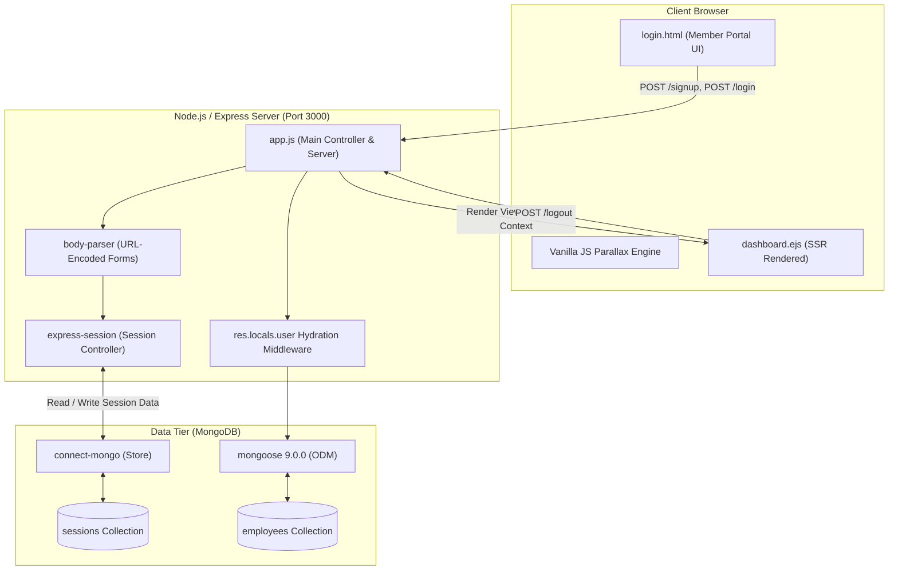

# Step 1: Project Scan & Code Map



## 1. Directory Tree & File Inventory

The repository is structured as a compact, self-contained full-stack server application:

```text
54-login-auth-portal/
├── app.js                    # Server entry point: Express app, Mongoose schemas, routes, session store
├── dashboard.ejs             # Server-side rendered EJS view for authenticated members (welcome page)
├── login.html                # Static client-facing interactive authentication interface (Dual panel + 3D Tilt)
├── package.json              # Project manifest, npm dependencies, scripts, and runtime configuration
├── package-lock.json         # Pinned dependency lockfile ensuring deterministic node_modules installation
├── user.json                 # Seed/Mock user dataset containing bcrypt hash fixtures (for reference/testing)
├── views/                    # Express EJS view directory (housing dashboard.ejs for view resolution)
│   └── dashboard.ejs         # Resolved view template accessed by res.render('dashboard')
└── docs/                     # Comprehensive Vue.js-style technical documentation and VitePress site
    ├── .vitepress/           # VitePress build, styling, navigation, and Mermaid configuration
    ├── features/             # Granular feature documentation files (F1 - F6)
    ├── system-design/        # Deep-dive enterprise system design chapters (14.1 - 14.17)
    └── *.md                  # Top-level guides, comparisons, security audits, and checklists
```

---

## 2. Technology Stack & Exact Versions

The project runs on **Node.js v22.23.2** and **Express 5.1.0**, representing a modern JavaScript runtime environment.

### Production Dependencies (`package.json`)

| Package Name | Exact Version in Code | Purpose & Function in This Project |
| :--- | :--- | :--- |
| **`express`** | `^5.1.0` | Core HTTP server framework providing route handling, middleware composition, and request-response lifecycle. |
| **`mongoose`** | `^9.0.0` | Object Data Modeling (ODM) library providing schema definition, data validation, and query abstraction for MongoDB. |
| **`express-session`**| `^1.18.2` | Session management middleware handling session cookie creation, signing (`connect.sid`), and state association. |
| **`connect-mongo`** | `^5.1.0` | MongoDB-backed session store for `express-session`, storing active user sessions in the `sessions` collection. |
| **`body-parser`** | `^2.2.0` | Request body parsing middleware configured to parse `application/x-www-form-urlencoded` standard HTML form submissions. |
| **`ejs`** | `^3.1.10` | Embedded JavaScript templating engine used for server-side dynamic HTML generation on `/dashboard`. |

### Developer Dependencies (`devDependencies`)

| Package Name | Exact Version | Purpose & Function |
| :--- | :--- | :--- |
| **`vitepress`** | `^1.6.4` | Vite-powered static documentation generator creating this Vue.js-style interview documentation. |
| **`mermaid`** | `^11.17.2` | Diagramming engine compiling declarative Markdown syntax into real SVG architecture flowcharts. |
| **`vitepress-plugin-mermaid`** | `^2.0.17` | VitePress integration plugin ensuring Mermaid diagrams render seamlessly across dark and light themes. |

---

## 3. Environment Variables & Secrets Analysis

Direct analysis of [`app.js`](file:///Users/avishjain/avishjain9-repos/54-login-auth-portal/app.js) reveals that runtime configurations and secrets are currently **hardcoded** rather than ingested via `process.env`. In production, these must be extracted into an environment configuration manager (`dotenv` or cloud secrets manager).

| Configuration Parameter | Hardcoded Value in Code | Recommended `.env` Variable | Description & Security Impact | Source Location |
| :--- | :--- | :--- | :--- | :--- |
| **Server Port** | `3000` | `PORT` | Local TCP port for the Express listener. Defaults to `3000` if not set. | [`app.js:9`](file:///Users/avishjain/avishjain9-repos/54-login-auth-portal/app.js#L9) |
| **Database URI** | `'mongodb://localhost:27017/hospital_login'` | `MONGODB_URI` | MongoDB connection connection string pointing to local instance. | [`app.js:12`](file:///Users/avishjain/avishjain9-repos/54-login-auth-portal/app.js#L12) |
| **Session Secret** | `'your_secret_key'` | `SESSION_SECRET` | Cryptographic secret used by `express-session` to sign the `connect.sid` cookie. | [`app.js:31`](file:///Users/avishjain/avishjain9-repos/54-login-auth-portal/app.js#L31) |
| **Session Cookie TTL**| `86400000` (24 hours) | `SESSION_MAX_AGE` | Milliseconds before the session expires (`1000 * 60 * 60 * 24`). | [`app.js:35`](file:///Users/avishjain/avishjain9-repos/54-login-auth-portal/app.js#L35) |

---

## 4. Third-Party Services & External Integrations

| External Entity | Integration Type | Detected in Code? | Details & Verification |
| :--- | :--- | :--- | :--- |
| **MongoDB Database Server** | Local Database Daemon | **Active** | Connected via `mongoose.connect()` at `mongodb://localhost:27017/hospital_login`. |
| **Google Web Fonts** | External CDN (CSS & WOFF2) | **Active** | Preconnect links to `fonts.googleapis.com` for *Cormorant Garamond* and *Outfit* in [`login.html:8-10`](file:///Users/avishjain/avishjain9-repos/54-login-auth-portal/login.html#L8-L10) and [`dashboard.ejs:7`](file:///Users/avishjain/avishjain9-repos/54-login-auth-portal/dashboard.ejs#L7). |
| **FontAwesome Icons** | External CDN (CSS) | **Active** | `cdnjs.cloudflare.com` FontAwesome 6.4.2 stylesheet for social icons in [`login.html:12`](file:///Users/avishjain/avishjain9-repos/54-login-auth-portal/login.html#L12). |
| **Social OAuth Providers** | Third-party OAuth | *UI Shell Only* | Links for Facebook, Google, and LinkedIn in `login.html` are placeholder anchors (`href="#"`). |
| **AI / LLM Providers** | Cloud API (OpenAI/Gemini) | *Not Implemented* | No external AI SDK or endpoint is present in the codebase. |

---

## 5. System Entry Points

1. **Backend Server Application**:
   - File: [`app.js`](file:///Users/avishjain/avishjain9-repos/54-login-auth-portal/app.js)
   - Command: `npm start` (or `node app.js`)
   - Entry Routine: Initializes Express 5, connects to MongoDB via Mongoose, attaches `body-parser` and `express-session` middleware, registers route handlers (`/login`, `/signup`, `/dashboard`, `/logout`), and calls `app.listen(3000)`.
2. **Client-Side Public Gateway**:
   - File: [`login.html`](file:///Users/avishjain/avishjain9-repos/54-login-auth-portal/login.html)
   - Route: `GET /login`
   - Entry Routine: Browser loads dual-form container, renders dynamic background canvas with CSS ambient blur orbs, and activates mousemove parallax tilt event listeners.
3. **Protected Member View**:
   - File: [`dashboard.ejs`](file:///Users/avishjain/avishjain9-repos/54-login-auth-portal/dashboard.ejs) (and `views/dashboard.ejs`)
   - Route: `GET /dashboard`
   - Entry Routine: Server evaluates `req.session.userId`, queries the database for user details, and renders the view with personalized member greetings.
