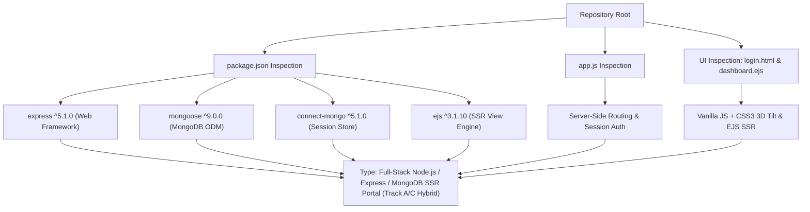

# Step 0 Pre-Check: Project Type Detection

## 1. Classification & Evidence

Based on direct examination of `package.json`, `app.js`, `login.html`, and `dashboard.ejs`, this project is classified as:

> **Full-Stack Node.js, Express, and MongoDB Server-Side Rendered (SSR) Web Application with Client-Side Interactive DOM Animation (Track A / Non-React Full-Stack)**.

### Concrete Evidence from Codebase

| Evidence Item | Source File & Location | Detected Value / Behavior | Architectural Implication |
| :--- | :--- | :--- | :--- |
| **Backend Framework** | [`package.json:16`](file:///Users/avishjain/avishjain9-repos/54-login-auth-portal/package.json#L16), [`app.js:1`](file:///Users/avishjain/avishjain9-repos/54-login-auth-portal/app.js#L1) | `express: ^5.1.0` | Node.js HTTP server handling routing, middleware, and request dispatching. |
| **Database & ODM** | [`package.json:18`](file:///Users/avishjain/avishjain9-repos/54-login-auth-portal/package.json#L18), [`app.js:5`](file:///Users/avishjain/avishjain9-repos/54-login-auth-portal/app.js#L5) | `mongoose: ^9.0.0` | MongoDB document data modeling, connection pooling, and CRUD operations. |
| **Session Persistence** | [`package.json:14,17`](file:///Users/avishjain/avishjain9-repos/54-login-auth-portal/package.json#L14), [`app.js:4,6`](file:///Users/avishjain/avishjain9-repos/54-login-auth-portal/app.js#L4) | `connect-mongo: ^5.1.0`, `express-session: ^1.18.2` | Stateful HTTP session management backed by MongoDB session collections (`sessions`). |
| **Frontend Rendering** | [`package.json:15`](file:///Users/avishjain/avishjain9-repos/54-login-auth-portal/package.json#L15), [`app.js:38-39`](file:///Users/avishjain/avishjain9-repos/54-login-auth-portal/app.js#L38-L39), [`login.html:1-475`](file:///Users/avishjain/avishjain9-repos/54-login-auth-portal/login.html) | EJS templating (`dashboard.ejs`) + Static HTML5/CSS3/Vanilla JS (`login.html`) | Hybrid Server-Side Rendering (SSR for authenticated dashboard) and static asset serving for public access. No React/Vue/Angular bundle used. |
| **Database Collection** | [`app.js:22`](file:///Users/avishjain/avishjain9-repos/54-login-auth-portal/app.js#L22) | `employees` collection in `hospital_login` database | Clinical/Hospital employee access portal context ("Sachidanand Health"). |
| **AI Integration** | Codebase inspection | None detected | No LLM APIs, embeddings, or ML models are called in `app.js`. Addressed honestly in documentation. |

---

## 2. Adaptation of Documentation Track

Following the prompt's adaptation rules:

1. **Full-Stack & Backend Sections**: Fully covered with deep dives into Node.js 22, Express 5.x router pipeline, Mongoose 9 ODM, connect-mongo session serialization, and MongoDB schema design.
2. **Frontend Adaptation**: Adapted to the real frontend architecture—Vanilla JavaScript, CSS3 custom properties, CSS glassmorphism, 3D mouse parallax transform matrices (`rotateX`, `rotateY`), and EJS dynamic server interpolation—without inventing React code.
3. **AI Integration**: Explicitly documented as *Not Implemented in Current Codebase*, followed by a production-grade blueprint for how clinical triage or authentication anomaly detection AI would be integrated in a healthcare enterprise context.
4. **Master Checklist & System Design**: All 275 items evaluated with rigorous 7-part breakdowns, scaling models, and Mermaid diagrams.
