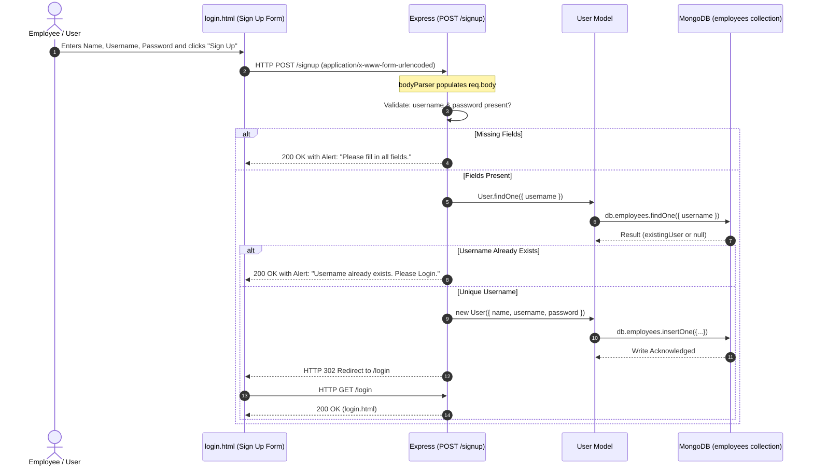
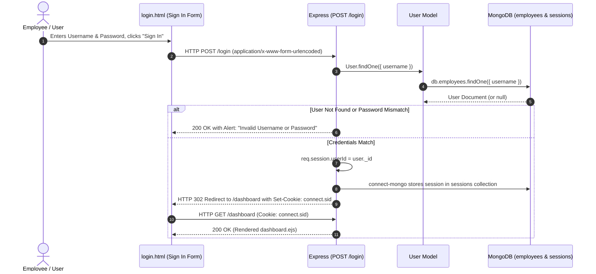
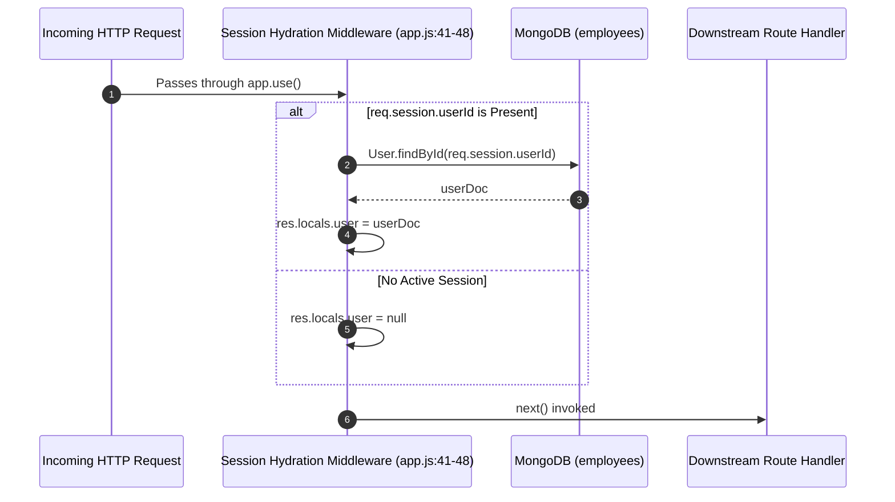
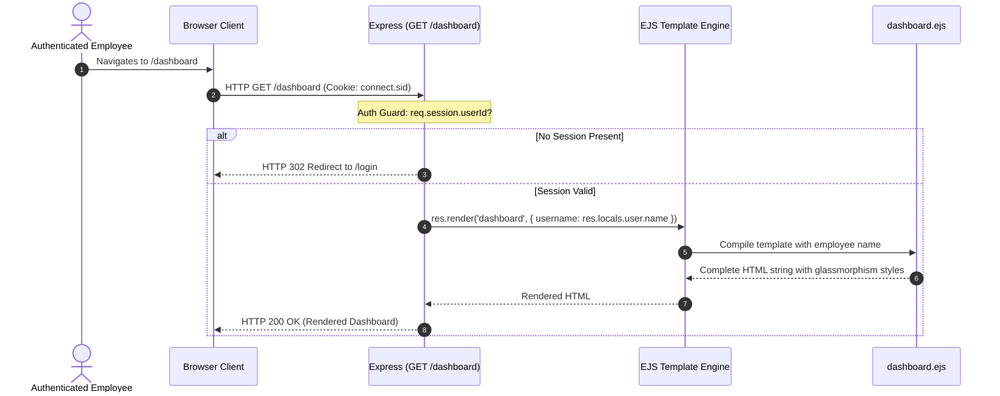
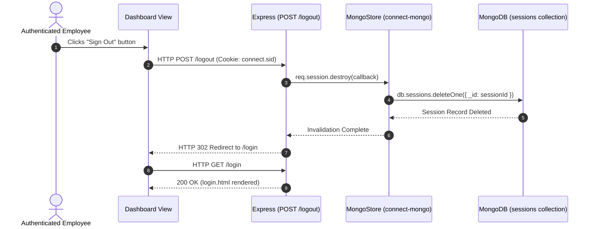
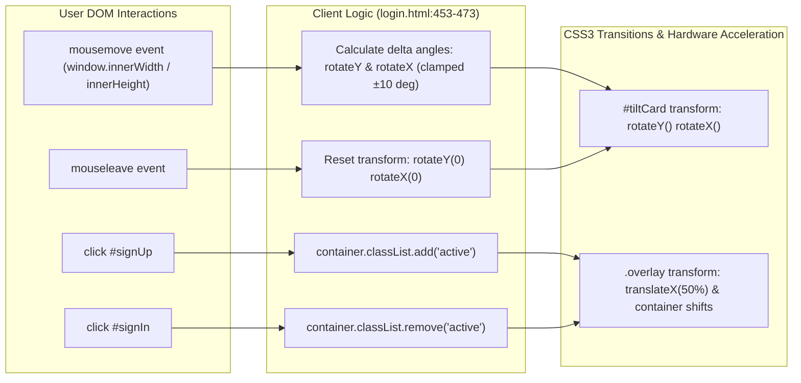
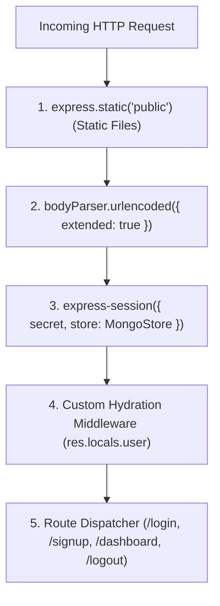
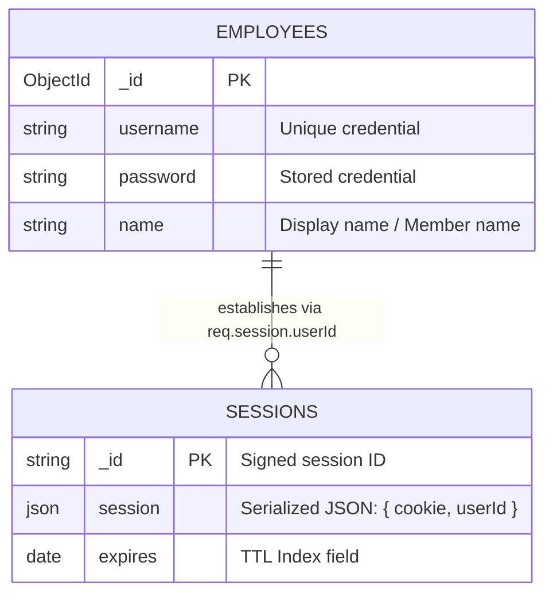

# Step 0: Full Project Analysis

```mermaid
flowchart TB
    subgraph Browser["User Browser Client"]
        U_Login["login.html (Public Auth Portal)"]
        U_Dash["dashboard.ejs (Protected Dashboard)"]
        TiltEngine["3D Tilt Mouse Event Tracker"]
    end

    subgraph ExpressServer["Node.js / Express 5.1.0 Backend"]
        BP["body-parser.urlencoded()"]
        SessMW["express-session + connect-mongo"]
        UserHydrate["User Hydration Middleware (res.locals.user)"]
        
        subgraph Routes["Express Route Handlers"]
            R_Root["GET / -> redirect('/login')"]
            R_GetLogin["GET /login -> sendFile('login.html')"]
            R_PostSignup["POST /signup -> User.save()"]
            R_PostLogin["POST /login -> Authenticate & set session.userId"]
            R_GetDash["GET /dashboard -> render('dashboard')"]
            R_PostLogout["POST /logout -> session.destroy()"]
        end
    end

    subgraph DataStorage["MongoDB Instance (mongodb://localhost:27017/hospital_login)"]
        Col_Emp[("Collection: employees")]
        Col_Sess[("Collection: sessions")]
    end

    U_Login -->|HTTP GET /login| R_GetLogin
    U_Login -->|HTTP POST /signup| BP --> SessMW --> UserHydrate --> R_PostSignup
    U_Login -->|HTTP POST /login| BP --> SessMW --> UserHydrate --> R_PostLogin
    U_Dash -->|HTTP GET /dashboard| BP --> SessMW --> UserHydrate --> R_GetDash
    U_Dash -->|HTTP POST /logout| BP --> SessMW --> UserHydrate --> R_PostLogout

    R_PostSignup -->|Query & Insert| Col_Emp
    R_PostLogin -->|Query & Verify| Col_Emp
    R_PostLogin -->|Persist Session ID| SessMW --> Col_Sess
    UserHydrate -->|findById(session.userId)| Col_Emp
    R_PostLogout -->|Delete Session Document| Col_Sess
    R_GetDash -->|Inject res.locals.user| U_Dash
```

---

## 0.1 What the Project Is

### Purpose & Problem Solved
The **Sachidanand Member Access Portal** is a specialized, secure web authentication and identity management gateway designed for hospital staff, medical professionals, and clinic affiliates ("Sachidanand Health"). 

In medical and hospital settings, healthcare providers require access to sensitive internal systems (patient records, clinical schedules, diagnostic dashboards). This portal solves the fundamental challenge of **access control and perimeter authentication**:
1. Preventing unauthorized public access to hospital dashboards.
2. Providing a seamless, friction-free login and account registration interface.
3. Managing stateful authenticated sessions backed by a high-availability document store (MongoDB).
4. Providing immediate session invalidation (logout) to ensure HIPAA/healthcare compliance when terminals are left unattended.

### Target Users & Personas
- **Hospital Employees & Clinicians**: Staff members accessing clinical dashboards and internal portals using unique employee credentials.
- **System Administrators**: IT personnel monitoring authenticated sessions, managing employee accounts, and ensuring credential hygiene.
- **New Medical Affiliates**: Joining practitioners who register their account credentials via the onboarding sign-up interface.

### Main User Journeys
1. **New Staff Onboarding Flow**:
   - Accesses `/login` $\rightarrow$ Clicks "Sign Up" button on the glass card $\rightarrow$ Panel slides smoothly from right to left $\rightarrow$ Fills in Name, Email/Username, and Password $\rightarrow$ Submits form $\rightarrow$ Account is persisted in MongoDB $\rightarrow$ Redirected to login with active account.
2. **Clinical Authentication Flow**:
   - Accesses `/login` $\rightarrow$ Enters Username and Password into the Sign In panel $\rightarrow$ Submits form $\rightarrow$ Server queries MongoDB $\rightarrow$ Matching credentials create an authenticated session document in MongoDB $\rightarrow$ `connect.sid` cookie issued $\rightarrow$ Redirected to `/dashboard` $\rightarrow$ Dashboard displays personalized greeting.
3. **Session Invalidation & Sign Out**:
   - From `/dashboard` $\rightarrow$ Staff member clicks "Sign Out" $\rightarrow$ Server executes `req.session.destroy()` $\rightarrow$ Session document deleted from MongoDB $\rightarrow$ User redirected back to `/login`.

### Pages and Screens

| Screen / View | Route Path | Access Level | Primary Capabilities | Implementation File |
| :--- | :--- | :--- | :--- | :--- |
| **Root Gateway** | `GET /` | Public | Automatically redirects incoming traffic to `/login`. | [`app.js:126-128`](file:///Users/avishjain/avishjain9-repos/54-login-auth-portal/app.js#L126-L128) |
| **Authentication Portal** | `GET /login` | Public (Redirects if logged in) | Interactive dual-panel glass card with 3D mouse parallax tilt, sign-in form, sign-up form, and animated overlay transitions. | [`login.html:1-475`](file:///Users/avishjain/avishjain9-repos/54-login-auth-portal/login.html), [`app.js:52-55`](file:///Users/avishjain/avishjain9-repos/54-login-auth-portal/app.js#L52-L55) |
| **Member Dashboard** | `GET /dashboard` | Protected (Requires valid session) | Server-rendered greeting displaying employee name, security confirmation message, and immediate sign-out button. | [`dashboard.ejs:1-102`](file:///Users/avishjain/avishjain9-repos/54-login-auth-portal/dashboard.ejs), [`app.js:111-116`](file:///Users/avishjain/avishjain9-repos/54-login-auth-portal/app.js#L111-L116) |

---

## 0.2 Detailed Feature Inventory & End-to-End Traces

### Feature F1: New User Registration & Account Provisioning



- **User Action**: User navigates to `/login`, toggles to "Create Account", enters Name, Email/Username, and Password, and clicks "Sign Up".
- **Frontend Path**: Form in [`login.html:387-411`](file:///Users/avishjain/avishjain9-repos/54-login-auth-portal/login.html#L387-L411) triggers standard HTTP POST submission to action `/signup`.
- **API Call**: `POST /signup`, Payload: `name={name}&username={username}&password={password}` (`application/x-www-form-urlencoded`).
- **Backend Flow**: [`app.js:58-86`](file:///Users/avishjain/avishjain9-repos/54-login-auth-portal/app.js#L58-L86):
  1. Destructures `name`, `username`, `password` from `req.body`.
  2. Guard clause: Checks if `!username || !password`. If missing, returns browser script alert and redirects to `/login`.
  3. Executes `User.findOne({ username })` to detect collisions. If exists, alerts user.
  4. Instantiates `new User({ name: name || "New Member", username, password })`.
  5. Awaits `newUser.save()`, persisting record into `employees` collection.
  6. Executes `res.redirect('/login')`.
- **Database Operations**: `findOne` query on `username`, followed by `insertOne` write operation on `hospital_login.employees`.
- **Failure Paths**:
  - Missing field: Client receives `<script>alert("Please fill in all fields."); window.location.href="/login";</script>`.
  - Duplicate username: Client receives `<script>alert("Username already exists. Please Login."); window.location.href="/login";</script>`.
  - Database exception: Caught in `try...catch`, logs error to console, returns `<script>alert("Database Error"); window.location.href="/login";</script>`.

---

### Feature F2: User Authentication & Session Establishment



- **User Action**: User enters Username and Password into the "Sign in" form in [`login.html:413-435`](file:///Users/avishjain/avishjain9-repos/54-login-auth-portal/login.html#L413-L435) and clicks "Sign In".
- **Backend Flow**: [`app.js:89-108`](file:///Users/avishjain/avishjain9-repos/54-login-auth-portal/app.js#L89-L108):
  1. Destructures `username` and `password` from `req.body`.
  2. Queries `User.findOne({ username })`.
  3. Verifies `user && user.password === password`.
  4. If valid, attaches user identifier: `req.session.userId = user._id`.
  5. `connect-mongo` serializes session data into the `sessions` collection in MongoDB.
  6. Sends HTTP 302 redirecting to `/dashboard` while issuing `connect.sid` cookie.
- **Failure Paths**:
  - Invalid credentials: Returns script alert: `"Invalid Username or Password"` and redirects to `/login`.
  - Server exception: Returns `"Server Error"` script alert and redirects to `/login`.

---

### Feature F3: Global Session Hydration Middleware



- **Execution Path**: [`app.js:41-48`](file:///Users/avishjain/avishjain9-repos/54-login-auth-portal/app.js#L41-L48).
- **Behavior**: Intercepts every incoming HTTP request. Inspects `req.session.userId`. If a session exists, it executes an asynchronous lookup `User.findById(req.session.userId)` and attaches the user document to `res.locals.user`, making it globally available to view templates and subsequent middleware.

---

### Feature F4: Protected Dashboard & Dynamic SSR Rendering



- **User Action**: Authenticated user accesses `/dashboard` or is redirected after login.
- **Backend Flow**: [`app.js:111-116`](file:///Users/avishjain/avishjain9-repos/54-login-auth-portal/app.js#L111-L116):
  1. Guard: If `!req.session.userId`, immediately redirects to `/login`.
  2. Calls `res.render('dashboard', { username: res.locals.user ? res.locals.user.name : 'User' })`.
  3. EJS injects employee name into `<h1>Welcome, <%= username %></h1>` in [`dashboard.ejs:93`](file:///Users/avishjain/avishjain9-repos/54-login-auth-portal/dashboard.ejs#L93).
- **Output**: Pure server-side rendered HTML sent over HTTP with full CSS glassmorphism styling.

---

### Feature F5: Session Invalidation & Logout



- **User Action**: User clicks the "Sign Out" button on the dashboard [`dashboard.ejs:96-98`](file:///Users/avishjain/avishjain9-repos/54-login-auth-portal/dashboard.ejs#L96-L98).
- **Backend Flow**: [`app.js:119-123`](file:///Users/avishjain/avishjain9-repos/54-login-auth-portal/app.js#L119-L123):
  1. Receives `POST /logout`.
  2. Invokes `req.session.destroy()`.
  3. `MongoStore` issues a `deleteOne` command removing the session document from MongoDB.
  4. Callback executes `res.redirect('/login')`.

---

### Feature F6: Interactive Client-Side 3D Parallax Tilt & Sliding Card



- **Implementation**: [`login.html:453-473`](file:///Users/avishjain/avishjain9-repos/54-login-auth-portal/login.html#L453-L473).
- **Behavior**:
  - Calculates cursor offset relative to window center: `(window.innerWidth / 2 - e.pageX) / 25`.
  - Dynamically clamps rotation angle between `-10deg` and `+10deg`.
  - Applies 3D transform matrix `rotateY(...) rotateX(...)` directly to the card container.
  - Automatically resets tilt upon `mouseleave`.
  - Toggles `.active` CSS class to slide the dual authentication forms with hardware-accelerated CSS cubic-bezier transitions.

---

## 0.3 Endpoint & Secret Inventory

### Complete Backend Endpoints Table

| HTTP Method | Route Path | Access Level | Middleware Pipeline | Controller Logic | Success Status | Failure Handling |
| :--- | :--- | :--- | :--- | :--- | :--- | :--- |
| `GET` | `/` | Public | None | `res.redirect('/login')` | `302 Found` | N/A |
| `GET` | `/login` | Public (Guest) | Session inspection | If `req.session.userId`, redirect `/dashboard`; else `sendFile(login.html)` | `200 OK` / `302 Found` | Sends `login.html` |
| `POST` | `/signup` | Public | `bodyParser`, `session`, `hydration` | Checks user existence, saves new `User` to `employees`, redirects to `/login` | `302 Found` | `200 OK` with `<script>` alert and redirect |
| `POST` | `/login` | Public | `bodyParser`, `session`, `hydration` | Compares plain-text credentials, sets `req.session.userId`, redirects `/dashboard` | `302 Found` | `200 OK` with `<script>` alert and redirect |
| `GET` | `/dashboard` | Protected | `bodyParser`, `session`, `hydration` | Auth check: if `!req.session.userId`, redirect `/login`; else `res.render('dashboard')` | `200 OK` / `302 Found` | `302` redirect to `/login` |
| `POST` | `/logout` | Authenticated | `bodyParser`, `session`, `hydration` | Invokes `req.session.destroy()`, deletes MongoDB session document, redirects to `/login` | `302 Found` | Internal error caught |

### External APIs & SDKs Table

| Provider | Purpose | Detected in Code | API Key / Auth Required | Implementation Note |
| :--- | :--- | :--- | :--- | :--- |
| **Google Fonts** | Typography CDN | Yes ([`login.html:8-10`](file:///Users/avishjain/avishjain9-repos/54-login-auth-portal/login.html#L8-L10)) | None (Public Asset CDN) | Imports Cormorant Garamond & Outfit. |
| **Cloudflare cdnjs** | FontAwesome Icons | Yes ([`login.html:12`](file:///Users/avishjain/avishjain9-repos/54-login-auth-portal/login.html#L12)) | None (Public Asset CDN) | Imports FontAwesome 6.4.2 stylesheet. |
| **AI Providers** | Clinical AI / Diagnostics | No | N/A | No AI provider integrated in this codebase. |

### Secrets & Configuration Variables Table

| Variable Name | Service | Purpose | Source Location | Where to Obtain / Recommended Setup |
| :--- | :--- | :--- | :--- | :--- |
| `PORT` | Node.js HTTP Server | Port listener binding | [`app.js:9`](file:///Users/avishjain/avishjain9-repos/54-login-auth-portal/app.js#L9) | Hardcoded `3000`. Recommend `process.env.PORT \|\| 3000`. |
| `MONGODB_URI` | MongoDB / Mongoose | Database connection string | [`app.js:12`](file:///Users/avishjain/avishjain9-repos/54-login-auth-portal/app.js#L12) | Hardcoded `'mongodb://localhost:27017/hospital_login'`. Move to `.env`. |
| `SESSION_SECRET` | express-session | Cookie signing HMAC secret | [`app.js:31`](file:///Users/avishjain/avishjain9-repos/54-login-auth-portal/app.js#L31) | Hardcoded `'your_secret_key'`. Generate with `crypto.randomBytes(64).toString('hex')`. |

---

## 0.4 Middleware & Shared Components

### Middleware Execution Pipeline (Order of Execution)



1. **`express.static(path.join(__dirname, 'public'))`** ([`app.js:26`](file:///Users/avishjain/avishjain9-repos/54-login-auth-portal/app.js#L26)): Serves static assets from `public/` directory if present.
2. **`bodyParser.urlencoded({ extended: true })`** ([`app.js:27`](file:///Users/avishjain/avishjain9-repos/54-login-auth-portal/app.js#L27)): Decodes incoming URL-encoded form submissions and attaches parsed key-value pairs to `req.body`.
3. **`express-session` + `connect-mongo`** ([`app.js:30-36`](file:///Users/avishjain/avishjain9-repos/54-login-auth-portal/app.js#L30-L36)): Parses incoming `connect.sid` cookie, retrieves session document from MongoDB `sessions` collection, and binds it to `req.session`.
4. **Custom User Hydration Middleware** ([`app.js:41-48`](file:///Users/avishjain/avishjain9-repos/54-login-auth-portal/app.js#L41-L48)): Asynchronously looks up user in MongoDB by `req.session.userId` and sets `res.locals.user`.

---

## 0.5 Database Models & Relationships



- **Mongoose Model**: `User` mapped explicitly to MongoDB collection `'employees'` in database `hospital_login` ([`app.js:18-24`](file:///Users/avishjain/avishjain9-repos/54-login-auth-portal/app.js#L18-L24)).
- **Session Collection**: Handled automatically by `MongoStore.create({ mongoUrl: dbUrl })`. Stores serialized session state with an automatic MongoDB TTL (Time-To-Live) index on the `expires` field.

---

## 0.6 Final Inventory Counts

To ensure absolute consistency across all sections of this documentation suite, the verified codebase inventory counts are:

| Metric Category | Verified Count in Codebase | Reference Verification |
| :--- | :--- | :--- |
| **Total HTML / EJS Pages** | **2** | `login.html` (public portal) and `dashboard.ejs` (SSR member view) |
| **Total Features Documented** | **6** | F1 (Registration), F2 (Login), F3 (Hydration), F4 (Dashboard), F5 (Logout), F6 (3D Tilt UI) |
| **Total Backend Endpoints** | **6** | `GET /`, `GET /login`, `POST /signup`, `POST /login`, `GET /dashboard`, `POST /logout` |
| **Database Models** | **1** | Mongoose `User` model (maps to `employees` collection) |
| **Database Collections** | **2** | `employees` (Mongoose) and `sessions` (`connect-mongo`) |
| **Global Express Middleware** | **4** | `static`, `bodyParser`, `express-session`, custom `res.locals.user` hydration |
| **External Dependencies** | **6** | `express`, `mongoose`, `express-session`, `connect-mongo`, `body-parser`, `ejs` |
| **Dev Dependencies** | **3** | `vitepress`, `mermaid`, `vitepress-plugin-mermaid` |
| **External API Integrations** | **0** | No external REST or AI APIs called |
| **System Environment Variables** | **0 active (3 needed)** | Currently hardcoded in `app.js` |
