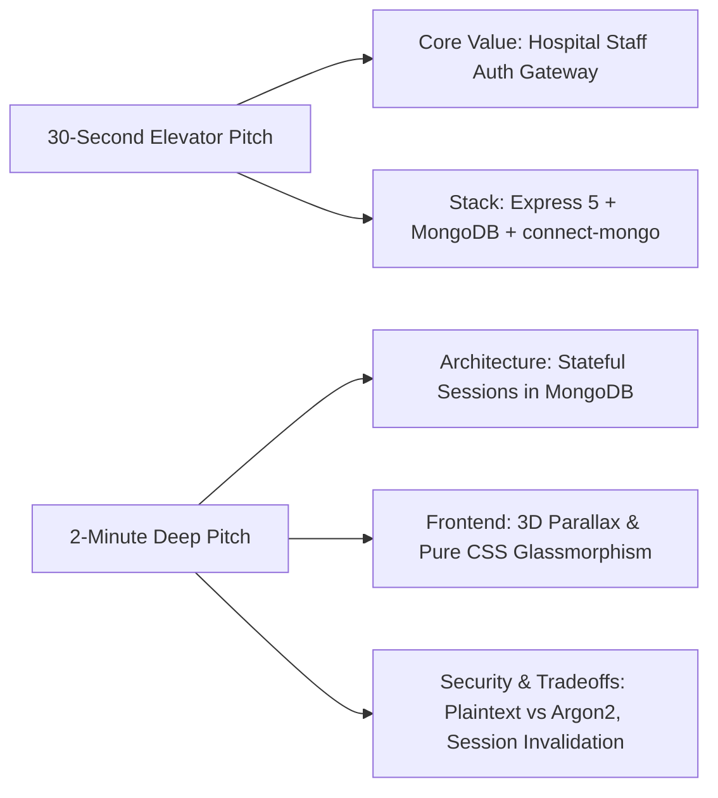

# Project Pitches: 30-Second & 2-Minute Interview Scripts

---

## 1. The 30-Second Elevator Pitch

> "I built the Sachidanand Member Access Portal, a secure, full-stack authentication gateway designed for hospital staff and healthcare affiliates. It runs on Node.js and Express 5 with MongoDB and Mongoose, using stateful server sessions backed by `connect-mongo` so active clinical logins survive server restarts. On the client side, I built an interactive glassmorphic interface with pure CSS and a custom 3D mouse parallax tilt engine in vanilla JavaScript, completely avoiding heavy UI framework overhead. It demonstrates end-to-end full-stack state management, secure session destruction, and server-side EJS rendering for protected hospital dashboards."

---

## 2. The 2-Minute Architectural Pitch

> "In a healthcare setting, clinician terminals need immediate, rock-solid perimeter access control without unnecessary frontend bundle bloat or complex SPA hydration issues. I engineered this portal as a lightweight, full-stack Node.js and Express web application backed by MongoDB.
>
> When an employee arrives at the portal, they are greeted by an interactive glassmorphic login card. Instead of using a bulky React or Three.js bundle, I implemented the 3D mouse parallax tilt in pure vanilla JavaScript by calculating cursor offsets relative to the viewport center and clamping rotation angles to ten degrees on the GPU. The interface allows seamless sliding between account registration and login via hardware-accelerated CSS transforms.
>
> On the backend, I chose stateful session authentication over stateless JWTs. Many engineers default to JWTs, but in a clinical hospital environment, you need instantaneous session revocation—if a nurse logs out or an employee badge is revoked, you must immediately invalidate that session without waiting for a token to expire. I integrated `express-session` with `connect-mongo`, serializing session identifiers into a dedicated MongoDB collection with automated TTL expiration indexes.
>
> When a user logs in, the backend authenticates their credentials against the `employees` collection and serializes their user ID into the MongoDB session store. A global hydration middleware intercepts authenticated requests, fetches the employee document, and populates `res.locals.user`. Protected routes like `/dashboard` verify session presence before rendering dynamic EJS templates on the server, ensuring zero unauthorized access.
>
> If I were taking this architecture into a high-security HIPAA production deployment today, my immediate priority would be upgrading password persistence from the current prototype plaintext storage to Argon2id with salting, adding Redis as the high-throughput session cache layer ahead of MongoDB, and integrating clinical multi-factor authentication."

---

## 3. Delivery Guidance for Interviews

| Factor | What to Emphasize | Common Trap to Avoid |
| :--- | :--- | :--- |
| **Pacing** | Speak calmly and deliberately. Take a 1-second pause after mentioning stateful sessions. | Do not rush through the dependencies or speak in a monotone list. |
| **Tone** | Confident, analytical, and aware of architectural tradeoffs (e.g., admitting plaintext password storage as a prototype limitation). | Never pretend the prototype is an enterprise-ready HIPAA system; frame it as an architectural foundation ready for hardening. |
| **Visual Cues** | Point to the session store in MongoDB and the 3D tilt engine when screen-sharing the demo. | Avoid getting bogged down in CSS syntax; keep focus on performance and GPU acceleration. |
