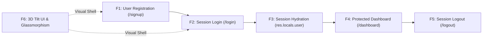
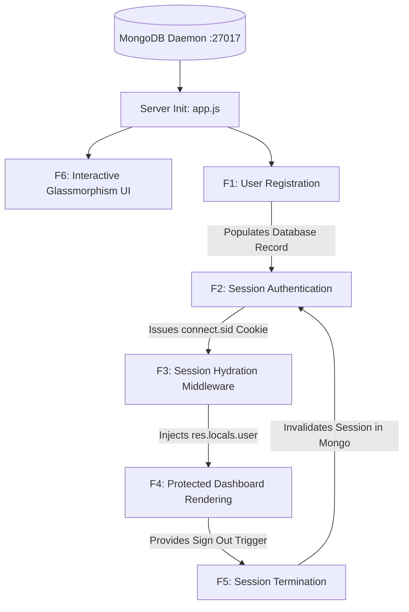

# Master Feature Catalog & Inventory

---

## 1. Feature Catalog Overview

The portal consists of six distinct, tightly integrated features bridging client-side interactive DOM engineering, asynchronous server-side middleware, stateful session persistence in MongoDB, and dynamic template rendering.

| ID | Feature Name | Primary Endpoint / Event | Core Component / File | Purpose & Architectural Role | Detailed Deep Dive Link |
| :--- | :--- | :--- | :--- | :--- | :--- |
| **F1** | **User Registration & Account Provisioning** | `POST /signup` | [`app.js:58-86`](file:///Users/avishjain/avishjain9-repos/54-login-auth-portal/app.js#L58-L86), [`login.html:387`](file:///Users/avishjain/avishjain9-repos/54-login-auth-portal/login.html#L387) | Validates input, prevents duplicate usernames, and saves employee document to MongoDB. | [Read F1 Deep Dive](/features/01-user-registration) |
| **F2** | **Session Authentication & State Creation** | `POST /login` | [`app.js:89-108`](file:///Users/avishjain/avishjain9-repos/54-login-auth-portal/app.js#L89-L108), [`login.html:413`](file:///Users/avishjain/avishjain9-repos/54-login-auth-portal/login.html#L413) | Authenticates credentials, binds `req.session.userId`, and persists session in MongoDB via `connect-mongo`. | [Read F2 Deep Dive](/features/02-session-authentication) |
| **F3** | **Global Session Hydration Middleware** | All Routes | [`app.js:41-48`](file:///Users/avishjain/avishjain9-repos/54-login-auth-portal/app.js#L41-L48) | Intercepts requests, queries MongoDB for active session user, and populates `res.locals.user`. | [Read F3 Deep Dive](/features/03-session-middleware-rbac) |
| **F4** | **Protected Dashboard & Dynamic SSR** | `GET /dashboard` | [`app.js:111-116`](file:///Users/avishjain/avishjain9-repos/54-login-auth-portal/app.js#L111-L116), [`dashboard.ejs:1`](file:///Users/avishjain/avishjain9-repos/54-login-auth-portal/dashboard.ejs#L1) | Guards internal portal, evaluates active session, and renders personalized HTML greeting. | [Read F4 Deep Dive](/features/04-protected-dashboard) |
| **F5** | **Session Termination & Logout** | `POST /logout` | [`app.js:119-123`](file:///Users/avishjain/avishjain9-repos/54-login-auth-portal/app.js#L119-L123), [`dashboard.ejs:96`](file:///Users/avishjain/avishjain9-repos/54-login-auth-portal/dashboard.ejs#L96) | Commands `connect-mongo` to permanently delete the session from MongoDB and redirects to login. | [Read F5 Deep Dive](/features/05-session-termination-logout) |
| **F6** | **3D Interactive Tilt Card & Glass UI** | DOM `mousemove` | [`login.html:453-473`](file:///Users/avishjain/avishjain9-repos/54-login-auth-portal/login.html#L453-L473) | GPU-accelerated 3D mouse parallax tracking, sliding dual-panel transitions, and CSS blur orbs. | [Read F6 Deep Dive](/features/06-interactive-ui-tilt-card) |

---

## 2. Feature Dependency Graph

---

## 3. Comparative Architecture & Security Review

| Feature | Primary Failure Mode | Handling in Code | Production Recommendation |
| :--- | :--- | :--- | :--- |
| **F1 Registration** | Duplicate username or missing input | Inline `` + redirect | Express-validator + Connect-flash error banners + unique MongoDB index |
| **F2 Login** | Incorrect password or non-existent user | Inline `` + redirect | Constant-time comparison (`crypto.timingSafeEqual`) + Argon2id hash verification |
| **F3 Hydration** | User deleted while session cookie active | Fallback to `null` and ternary string fallback | Short-lived Redis cache layer + session invalidation hooks |
| **F4 Dashboard** | Unauthorized direct URL access | HTTP 302 redirect to `/login` | Add HTTP Cache-Control: `no-store` headers to prevent back-button cache leaks |
| **F5 Logout** | Stale cookie replay attempt | Session document erased from MongoDB | Add `res.clearCookie('connect.sid')` and audit logging |
| **F6 UI Tilt** | Mobile browser gesture conflicts | Breakpoint check disables tracking `< 768px` | Debounce mousemove events with `requestAnimationFrame` for 144Hz monitors |
