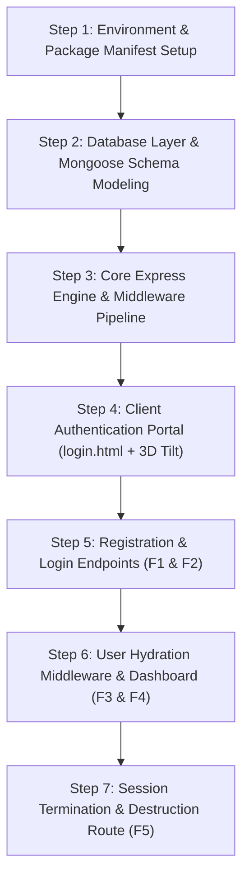

# Step 3: Rebuilding From Scratch (Build Order)



---

## 1. Overview & Architectural Sequence

Building a secure, stateful full-stack application requires a deliberate sequence: data persistence and session stores must be configured before route controllers are defined, and middleware must be registered before the routes that depend on them.

---

## 2. Step-by-Step Implementation Guide

### Step 1: Project Initialization & Package Manifest

Create the project directory and initialize `package.json` with the required runtime dependencies:

```bash
mkdir login-auth-portal && cd login-auth-portal
npm init -y
npm install express@^5.1.0 mongoose@^9.0.0 express-session@^1.18.2 connect-mongo@^5.1.0 body-parser@^2.2.0 ejs@^3.1.10
```

**Reasoning**: Express 5 provides native Promise-aware error handling, while `connect-mongo` v5 interfaces seamlessly with Mongoose 9's connection pooling.

---

### Step 2: Database Connection & Schema Modeling

In `app.js`, establish the connection to the MongoDB daemon and define the schema for hospital employees:

```javascript
// app.js (Lines 11-24)
const mongoose = require('mongoose');

const dbUrl = 'mongodb://localhost:27017/hospital_login';
mongoose.connect(dbUrl)
  .then(() => console.log('Connected to MongoDB: hospital_login'))
  .catch(err => console.error('MongoDB connection error:', err));

const userSchema = new mongoose.Schema({
  username: { type: String, required: true },
  password: { type: String, required: true },
  name: String
}, { collection: 'employees' });

const User = mongoose.model('User', userSchema);
```

#### Line-by-Line Breakdown:
- **Line 12**: `dbUrl`: Defines the connection URI targeting the local database `hospital_login`.
- **Line 13-15**: `mongoose.connect()`: Asynchronously initialises connection pool (default size 100).
- **Line 18-22**: `new mongoose.Schema(...)`: Configures strict typing with `username` and `password` as required strings, mapping explicitly to the collection name `'employees'` via schema options.
- **Line 24**: `mongoose.model(...)`: Compiles the schema into a queryable Mongoose Model.

---

### Step 3: Express Configuration, Session Store & Middleware Pipeline

Configure middleware in exact order: static files, request body parsing, session persistence, and view engine setup:

```javascript
// app.js (Lines 26-48)
const express = require('express');
const path = require('path');
const bodyParser = require('body-parser');
const session = require('express-session');
const MongoStore = require('connect-mongo');

const app = express();
const port = 3000;

app.use(express.static(path.join(__dirname, 'public')));
app.use(bodyParser.urlencoded({ extended: true }));

app.use(session({
  secret: 'your_secret_key',
  resave: false,
  saveUninitialized: false,
  store: MongoStore.create({ mongoUrl: dbUrl }),
  cookie: { maxAge: 1000 * 60 * 60 * 24 } // 24 Hours
}));

app.set('view engine', 'ejs');
app.set('views', path.join(__dirname, 'views'));

app.use(async (req, res, next) => {
  if (req.session.userId) {
    res.locals.user = await User.findById(req.session.userId);
  } else {
    res.locals.user = null;
  }
  next();
});
```

#### Line-by-Line Breakdown:
- **Line 26**: `express.static(...)`: Serves public assets before hitting heavier session middleware.
- **Line 27**: `bodyParser.urlencoded(...)`: Parses standard HTML form payloads (`application/x-www-form-urlencoded`).
- **Line 30-36**: `session(...)`: Configures `express-session` with MongoDB persistence. `resave: false` prevents unnecessary writes if session is unmodified; `saveUninitialized: false` prevents creating empty sessions for anonymous visitors.
- **Line 38-39**: Configures EJS template resolution targeting `views/`.
- **Line 41-48**: Global hydration middleware querying `User.findById` and populating `res.locals.user`.

---

### Step 4: Client Authentication Portal UI (`login.html`)

Create `login.html` containing the dual sliding form panels, CSS frosted glass styling, and the vanilla JS 3D mouse parallax engine:

```javascript
// login.html (Lines 461-468)
document.addEventListener('mousemove', (e) => {
    if (window.innerWidth < 768) return;
    const x = (window.innerWidth / 2 - e.pageX) / 25;
    const y = (window.innerHeight / 2 - e.pageY) / 25;
    const rotateX = Math.min(Math.max(y, -10), 10);
    const rotateY = Math.min(Math.max(x, -10), 10);
    container.style.transform = `rotateY(${rotateY}deg) rotateX(${rotateX}deg)`;
});
```

#### Line-by-Line Breakdown:
- **Line 462**: Guard clause checks viewport width; mobile screens bypass calculations to save battery and prevent touch conflicts.
- **Line 463-464**: Normalizes cursor offset from viewport center, divided by damping factor 25.
- **Line 465-466**: Clamps pitch and roll to $\pm 10^\circ$.
- **Line 467**: Applies GPU-accelerated 3D transform matrix to `#tiltCard`.

---

### Step 5: Route Implementation (`/signup` and `/login`)

Implement user provisioning and session creation in `app.js`:

```javascript
// app.js (Lines 58-108)
app.post('/signup', async (req, res) => {
  const { name, username, password } = req.body;
  if (!username || !password) {
    return res.send('<script>alert("Please fill in all fields."); window.location.href="/login";</script>');
  }
  try {
    const existingUser = await User.findOne({ username });
    if (existingUser) {
      return res.send('<script>alert("Username already exists. Please Login."); window.location.href="/login";</script>');
    }
    const newUser = new User({ name: name || "New Member", username, password });
    await newUser.save();
    res.redirect('/login');
  } catch (err) {
    console.error(err);
    res.send('<script>alert("Database Error"); window.location.href="/login";</script>');
  }
});

app.post('/login', async (req, res) => {
  const { username, password } = req.body;
  try {
    const user = await User.findOne({ username });
    if (!user || user.password !== password) {
      return res.send('<script>alert("Invalid Username or Password"); window.location.href="/login";</script>');
    }
    req.session.userId = user._id;
    res.redirect('/dashboard');
  } catch (err) {
    console.error(err);
    res.send('<script>alert("Server Error"); window.location.href="/login";</script>');
  }
});
```

---

### Step 6: Protected Dashboard & Dynamic View Rendering

Create `views/dashboard.ejs` and register the guarded route:

```javascript
// app.js (Lines 111-116)
app.get('/dashboard', (req, res) => {
  if (!req.session.userId) return res.redirect('/login');
  res.render('dashboard', { 
    username: res.locals.user ? res.locals.user.name : 'User' 
  });
});
```

```html
<!-- views/dashboard.ejs -->
<div class="dashboard-card">
    <h1>Welcome, <%= username %></h1>
    <p>You have successfully accessed the Sachidanand Secure Portal.</p>
    <form action="/logout" method="POST">
        <button type="submit" class="btn-logout">Sign Out</button>
    </form>
</div>
```

---

### Step 7: Session Destruction & Server Listener

Implement logout and bind the HTTP listener:

```javascript
// app.js (Lines 119-132)
app.post('/logout', (req, res) => {
  req.session.destroy(() => {
    res.redirect('/login');
  });
});

app.get('/', (req, res) => {
  res.redirect('/login');
});

app.listen(port, () => {
  console.log(`Server running at http://localhost:${port}`);
});
```
