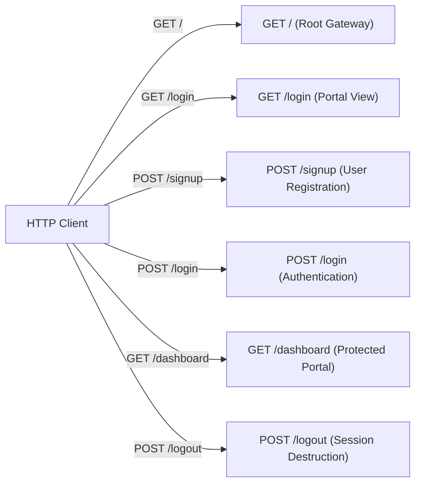

# Step 4: Complete HTTP API Reference



---

## 1. Global Request Specifications

- **Protocol**: HTTP/1.1 (Standard Express listener on port 3000)
- **Base URL**: `http://localhost:3000`
- **Data Transport**: Form-encoded URL (`application/x-www-form-urlencoded`) for mutations; HTML/EJS for views
- **Session Cookie**: `connect.sid` (Signed HMAC cookie generated by `express-session`)

---

## 2. API Endpoint Catalog

### Endpoint 1: Root Redirect

- **HTTP Method**: `GET`
- **Path**: `/`
- **Purpose**: Directs incoming root web traffic to the authentication portal.
- **Authentication**: None (Public)
- **Middleware Chain**: None
- **Request Headers**: Standard browser headers (`Accept: text/html`)
- **Query / Body**: None
- **Success Response**:
  - **Status Code**: `302 Found`
  - **Headers**: `Location: /login`
- **Source Code**: [`app.js:126-128`](file:///Users/avishjain/avishjain9-repos/54-login-auth-portal/app.js#L126-L128)

---

### Endpoint 2: Get Authentication Portal

- **HTTP Method**: `GET`
- **Path**: `/login`
- **Purpose**: Serves the public member access portal interface (`login.html`). If the user already possesses an active session, redirects them straight to the dashboard.
- **Authentication**: None (Guest Only; Authenticated users are redirected)
- **Middleware Chain**: `express.static` $\rightarrow$ `bodyParser.urlencoded` $\rightarrow$ `express-session` $\rightarrow$ `userHydrationMiddleware`
- **Request Headers**: `Cookie: connect.sid=...` (optional)
- **Success Response (Guest)**:
  - **Status Code**: `200 OK`
  - **Content-Type**: `text/html; charset=UTF-8`
  - **Body**: Complete `login.html` static file content
- **Success Response (Already Authenticated)**:
  - **Status Code**: `302 Found`
  - **Headers**: `Location: /dashboard`
- **Source Code**: [`app.js:52-55`](file:///Users/avishjain/avishjain9-repos/54-login-auth-portal/app.js#L52-L55)

---

### Endpoint 3: Register New User

- **HTTP Method**: `POST`
- **Path**: `/signup`
- **Purpose**: Creates a new hospital employee account in MongoDB.
- **Authentication**: None (Public)
- **Middleware Chain**: `express.static` $\rightarrow$ `bodyParser.urlencoded` $\rightarrow$ `express-session` $\rightarrow$ `userHydrationMiddleware`
- **Request Headers**: `Content-Type: application/x-www-form-urlencoded`
- **Request Body Parameters**:
  | Field | Type | Required | Description | Fallback Behavior |
  | :--- | :--- | :--- | :--- | :--- |
  | `name` | `string` | Optional | Clinician display name | Defaults to `"New Member"` if omitted |
  | `username` | `string` | **Required** | Email or unique username | Triggers missing field alert if empty |
  | `password` | `string` | **Required** | Secret authentication string | Triggers missing field alert if empty |
- **Sample Request Payload**:
  ```text
  name=Dr.+Sunil+Kumar&username=sunil%40hospital.com&password=SecurePassword123
  ```
- **Validation Rules**:
  1. `if (!username || !password)`: Returns 200 with inline alert.
  2. `User.findOne({ username })`: Confirms username is unassigned.
- **Success Response**:
  - **Status Code**: `302 Found`
  - **Headers**: `Location: /login`
- **Error Responses**:
  - **Missing Fields**:
    - Status: `200 OK`
    - Content-Type: `text/html`
    - Body: `<script>alert("Please fill in all fields."); window.location.href="/login";</script>`
  - **Username Collision**:
    - Status: `200 OK`
    - Content-Type: `text/html`
    - Body: `<script>alert("Username already exists. Please Login."); window.location.href="/login";</script>`
  - **Database Error**:
    - Status: `200 OK`
    - Content-Type: `text/html`
    - Body: `<script>alert("Database Error"); window.location.href="/login";</script>`
- **Source Code**: [`app.js:58-86`](file:///Users/avishjain/avishjain9-repos/54-login-auth-portal/app.js#L58-L86)

---

### Endpoint 4: Authenticate & Establish Session

- **HTTP Method**: `POST`
- **Path**: `/login`
- **Purpose**: Verifies employee credentials, creates a stateful session document in MongoDB, and issues a signed session cookie.
- **Authentication**: None (Public)
- **Middleware Chain**: `express.static` $\rightarrow$ `bodyParser.urlencoded` $\rightarrow$ `express-session` $\rightarrow$ `userHydrationMiddleware`
- **Request Headers**: `Content-Type: application/x-www-form-urlencoded`
- **Request Body Parameters**:
  | Field | Type | Required | Description |
  | :--- | :--- | :--- | :--- |
  | `username` | `string` | **Required** | Registered employee username |
  | `password` | `string` | **Required** | Account password |
- **Sample Request Payload**:
  ```text
  username=sunil%40hospital.com&password=SecurePassword123
  ```
- **Success Response**:
  - **Status Code**: `302 Found`
  - **Headers**:
    - `Location: /dashboard`
    - `Set-Cookie: connect.sid=s%3A...; Path=/; Expires=Mon, 26 Oct 2026 ...; Max-Age=86400`
- **Error Responses**:
  - **Invalid Credentials (User not found or password mismatch)**:
    - Status: `200 OK`
    - Content-Type: `text/html`
    - Body: `<script>alert("Invalid Username or Password"); window.location.href="/login";</script>`
  - **Server / DB Error**:
    - Status: `200 OK`
    - Content-Type: `text/html`
    - Body: `<script>alert("Server Error"); window.location.href="/login";</script>`
- **Source Code**: [`app.js:89-108`](file:///Users/avishjain/avishjain9-repos/54-login-auth-portal/app.js#L89-L108)

---

### Endpoint 5: Access Member Dashboard

- **HTTP Method**: `GET`
- **Path**: `/dashboard`
- **Purpose**: Renders the protected member dashboard view populated with the authenticated user's details.
- **Authentication**: **Required** (`req.session.userId` must exist)
- **Middleware Chain**: `express.static` $\rightarrow$ `bodyParser.urlencoded` $\rightarrow$ `express-session` $\rightarrow$ `userHydrationMiddleware`
- **Request Headers**: `Cookie: connect.sid=s%3A...`
- **Success Response**:
  - **Status Code**: `200 OK`
  - **Content-Type**: `text/html; charset=UTF-8`
  - **Sample HTML Response**:
    ```html
    <div class="dashboard-card">
        <h1>Welcome, Dr. Sunil Kumar</h1>
        <p>You have successfully accessed the Sachidanand Secure Portal.</p>
        <form action="/logout" method="POST">
            <button type="submit" class="btn-logout">Sign Out</button>
        </form>
    </div>
    ```
- **Error / Unauthorized Response**:
  - **Status Code**: `302 Found`
  - **Headers**: `Location: /login`
- **Source Code**: [`app.js:111-116`](file:///Users/avishjain/avishjain9-repos/54-login-auth-portal/app.js#L111-L116)

---

### Endpoint 6: Session Termination & Logout

- **HTTP Method**: `POST`
- **Path**: `/logout`
- **Purpose**: Revokes user authentication by deleting the session document from MongoDB and redirecting to the login screen.
- **Authentication**: Authenticated Session
- **Middleware Chain**: `express.static` $\rightarrow$ `bodyParser.urlencoded` $\rightarrow$ `express-session` $\rightarrow$ `userHydrationMiddleware`
- **Request Headers**: `Cookie: connect.sid=s%3A...`
- **Success Response**:
  - **Status Code**: `302 Found`
  - **Headers**: `Location: /login`
- **Source Code**: [`app.js:119-123`](file:///Users/avishjain/avishjain9-repos/54-login-auth-portal/app.js#L119-L123)

---

## 3. External API Integrations Table

| External API | Purpose in Code | Request Timeout | Retry Strategy | Failure Mode Handling |
| :--- | :--- | :--- | :--- | :--- |
| **MongoDB Driver Protocol** | Database CRUD | Default (30s) | Mongoose auto-reconnect | Caught in route-level `try...catch` blocks |
| **Google Fonts API** | Web Font Stylesheet | Browser Default | Managed by browser | Browser renders system fallback serif/sans-serif fonts |
| **Cloudflare cdnjs** | FontAwesome CSS | Browser Default | Managed by browser | Social icons render as empty squares if CDN unreachable |
| **AI / LLM Services** | N/A (Not Implemented) | N/A | N/A | N/A |
