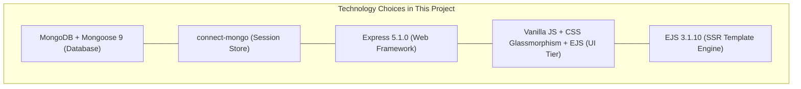

# Step 5: Technology Choice Comparisons

---

## 1. Database Layer: MongoDB (Mongoose) vs Alternatives

### 1. What I Used
MongoDB connected via Mongoose ODM v9.0.0 ([`app.js:5,12-24`](file:///Users/avishjain/avishjain9-repos/54-login-auth-portal/app.js#L5)).

### 2. What It Does in This Project
Stores employee identity records in the `employees` collection and serves as the durable backing store for user session documents in the `sessions` collection.

### 3. Exhaustive Comparison Table

| Database Engine | Data Model | ACID Support | Query Language | Schema Flexibility | Connection Overhead | Fit With Node.js / This Portal |
| :--- | :--- | :--- | :--- | :--- | :--- | :--- |
| **MongoDB (Chosen)** | **Document (BSON)** | **Document ACID (Multi-doc via replica sets)** | **Mongoose Query / Aggregation** | **Dynamic / Flexible** | **Medium (Built-in connection pool)** | **High (Native JSON/BSON, directly supports connect-mongo)** |
| **PostgreSQL** | Relational / Object | Full ACID (Multi-row transactions) | SQL | Strict / Static | High (Requires connection pooler like PgBouncer) | High (Standard SQL, but requires schema migrations) |
| **MySQL** | Relational | Full ACID (InnoDB) | SQL | Strict / Static | High | Medium (Standard, but rigid for fast schema iteration) |
| **CockroachDB** | Distributed Relational | Multi-region distributed ACID | SQL | Strict | High | Overkill (Massive distributed overhead for a single portal) |
| **Redis** | In-Memory Key-Value | Single-command atomicity | Redis commands | Key-value structures | Low (Extremely lightweight) | High for sessions, Low for durable employee records |
| **Amazon DynamoDB** | Managed NoSQL / Key-Value | ACID via TransactItems | DynamoDB API / PartiQL | Flexible | Low (HTTP-based) | Vendor-locked to AWS, complex local simulation |
| **Firebase Firestore**| Document NoSQL | Document ACID | Firestore SDK | Flexible | Low (Managed) | Heavy client SDK lock-in, proprietary cloud dependencies |
| **SQLite** | Embedded Relational | Full ACID (Single file) | SQL | Strict | Zero | File lock bottlenecks on concurrent writes |
| **Supabase** | Managed PostgreSQL | Full ACID | PostgREST / SQL | Strict | High | Cloud wrapper; unnecessary overhead for local custom Express server |

### 5. Why I Used This
MongoDB was chosen because its native JSON document paradigm maps directly to JavaScript objects without impedance mismatch. Crucially, using MongoDB allowed both employee identities and web session storage (`connect-mongo`) to share a single, unified database infrastructure without deploying a separate Redis cluster [CONFIRM WITH DEVELOPER].

### 6. Why I Did NOT Use Each Alternative
- **PostgreSQL**: Required setting up schema migration runners (`Knex`/`TypeORM`) and rigid column types before rapid prototype iteration could occur.
- **MySQL**: Offered no document flexibility and requires external table definitions for session stores.
- **CockroachDB**: Carries immense architectural complexity and hardware overhead designed for multi-region geo-replication that this single-region portal does not require.
- **Redis**: Stores data primarily in RAM; using it as the sole database risks data loss on node reboot unless expensive disk append policies (AOF) are configured.
- **DynamoDB**: Would tie the project to Amazon Web Services and make local offline execution cumbersome.
- **Firebase Firestore**: Imposes proprietary Google SDKs and pricing tiers that prevent self-hosted on-premise hospital deployment.
- **SQLite**: Lacks robust support for high-concurrency write operations due to table-level file locking.
- **Supabase**: Wraps PostgreSQL behind client REST libraries, conflicting with our goal of writing clean, native Express backend controllers.

### 7. Benefits Provided
- Zero schema migration friction during initial employee field additions.
- Unified storage: a single MongoDB daemon hosts both persistent employee data and transient user sessions.
- Out-of-the-box MongoDB TTL indexes manage session expiry automatically.

### 8. Drawbacks & Trade-offs Accepted
- Joins and referential integrity must be manually enforced at the application layer rather than guaranteed by database constraints.
- Default Mongoose installation does not automatically create unique indexes unless explicitly configured.

### 9. When I Would Switch
I would switch to PostgreSQL if the hospital system expands to require complex relational joins (e.g. linking patients to doctors, medical billing records, prescriptions, and insurance claims) where relational foreign keys and strict ACID transactions across multiple tables are legally mandated.

### 10. 30-Second Spoken Answer
> "I chose MongoDB with Mongoose because its document model aligns naturally with JavaScript, and it allowed me to use a single database instance for both employee records and persistent session storage through `connect-mongo`. While PostgreSQL is outstanding for relational healthcare records, MongoDB eliminated schema migration friction and allowed me to leverage native TTL indexes for automatic session expiration."

---

## 2. Authentication Strategy: Stateful Server Sessions vs JWT vs Alternatives

### 1. What I Used
Stateful server-side sessions using `express-session` backed by `connect-mongo` in MongoDB ([`app.js:4,6,30-36`](file:///Users/avishjain/avishjain9-repos/54-login-auth-portal/app.js#L4)).

### 2. What It Does in This Project
Generates a cryptographically signed cookie (`connect.sid`), stores session state in MongoDB, and maintains user authentication state between HTTP requests.

### 3. Exhaustive Comparison Table

| Auth Mechanism | State Location | Invalidation Speed | Network Payload Size | Multi-Server Scalability | Revocation Feasibility | XSS / CSRF Vulnerability Profile |
| :--- | :--- | :--- | :--- | :--- | :--- | :--- |
| **MongoDB Sessions (Chosen)** | **Server DB (MongoDB)** | **Instantaneous (Delete DB row)** | **Minimal (~50 bytes cookie)** | **High (Shared database pool)** | **Immediate (On logout or admin action)** | **Safe from XSS if httpOnly; Needs CSRF defense** |
| **Stateless JWT** | Client (Storage/Cookie) | Impossible without blacklist | Large (~500–1000 bytes header) | Infinite (No DB query needed) | Impossible until token expires | Dangerous in localStorage (XSS); Cookie requires CSRF token |
| **Redis Sessions** | Server RAM (Redis) | Instantaneous (<1ms) | Minimal (~50 bytes) | High (Shared Redis instance) | Immediate | Same as Mongo session |
| **In-Memory Express Sessions** | Server RAM (Node process) | Instantaneous | Minimal | Zero (Sessions lost on multi-core / restart) | Immediate | Unsuitable for production |
| **OAuth2 / OpenID Connect** | Third-Party Provider | Dependent on IdP | High | High | Managed by identity provider | Complex integration |

### 5. Why I Used This
In a healthcare environment where clinicians share workstations, immediate access revocation is critical. With stateful sessions, calling `req.session.destroy()` deletes the session document from MongoDB immediately. If an attacker recovers an old cookie, it is instantly invalid [CONFIRM WITH DEVELOPER].

### 6. Why I Did NOT Use Each Alternative
- **Stateless JWT**: Cannot be revoked on demand without maintaining a server-side token blacklist, which defeats the purpose of being stateless.
- **Redis Sessions**: While faster than MongoDB, adding Redis would have introduced an extra infrastructure component and deployment requirement for a single server application.
- **In-Memory Sessions (`MemoryStore`)**: Express's default memory store leaks memory and drops all logged-in users whenever the Node server restarts or scales to multiple processes.
- **OAuth2 (Google/Facebook)**: Requires external internet connectivity, which violates internal air-gapped hospital network compliance requirements.

### 7. Benefits Provided
- True instant revocation on logout.
- Persistent sessions that survive server crashes and redeployments.
- Automatic document cleanup via MongoDB's background TTL thread.

### 8. Drawbacks & Trade-offs Accepted
- Incurs a database query to MongoDB on incoming authenticated requests.
- MongoDB write latency for session creation is higher than in-memory Redis (~5ms vs <1ms).

### 9. When I Would Switch
I would introduce Redis as a caching layer in front of `connect-mongo` if concurrent daily active sessions exceed 50,000, offloading session read traffic from MongoDB disk to RAM.

### 10. 30-Second Spoken Answer
> "I chose stateful sessions backed by `connect-mongo` over stateless JWTs because in a medical portal, instant session revocation is a strict security requirement. With JWTs, you cannot easily revoke a token if a clinician forgets to log off or an employee is terminated. Stateful MongoDB sessions allow immediate revocation on `/logout` while surviving server restarts."

---

## 3. Web Framework: Express 5 vs Alternatives

### 1. What I Used
Express.js v5.1.0 ([`package.json:16`](file:///Users/avishjain/avishjain9-repos/54-login-auth-portal/package.json#L16), [`app.js:1`](file:///Users/avishjain/avishjain9-repos/54-login-auth-portal/app.js#L1)).

### 2. What It Does in This Project
Handles the entire backend HTTP server lifecycle, middleware pipeline, static asset delivery, and route dispatching.

### 3. Exhaustive Comparison Table

| Framework | Runtime / Language | Paradigm | Async / Promise Handling | Learning Curve | Community Ecosystem | Production Overhead |
| :--- | :--- | :--- | :--- | :--- | :--- | :--- |
| **Express 5 (Chosen)** | **Node.js (JS)** | **Minimalist / Unopinionated** | **Native Promise / Async-Await support** | **Very Low** | **Massive (De facto standard)** | **Extremely Low** |
| **NestJS** | Node.js (TypeScript) | Opinionated / Angular-like | Native | High | Large enterprise | Heavy (Decorators, DI modules, reflection) |
| **Fastify** | Node.js (JS/TS) | Schema-driven / High performance| Native | Low | Growing rapidly | Low (JSON schema serialization overhead) |
| **Koa** | Node.js (JS) | Bare-bones Middleware | Native | Medium | Moderate | Requires assembling every utility manually |
| **Django** | Python | Full-battery Web Framework | Async in Django 4+ | Medium | Massive | Heavy (Enforces ORM, admin, migrations) |
| **Spring Boot** | Java | Enterprise Modular | Reactive / Threads | Very High | Massive | Extremely Heavy (JVM memory footprint) |
| **Go (Gin / Fiber)** | Go | Compiled Binary | Goroutines | Medium | Moderate | Requires compiled deployments and static binaries |

### 5. Why I Used This
Express 5 provides native asynchronous error handling without the nested try-catch wrappers required in Express 4, while preserving the battle-tested simplicity and universal compatibility of the Express middleware ecosystem [CONFIRM WITH DEVELOPER].

### 6. Why I Did NOT Use Each Alternative
- **NestJS**: Adds excessive boilerplate, dependency injection containers, and TypeScript compilation overhead that slows down small-to-medium portal development.
- **Fastify**: While marginally faster in micro-benchmarks, Express 5 provides broader ecosystem support for session stores like `connect-mongo`.
- **Koa**: Lacks built-in routing and request body parsing, requiring multiple third-party libraries just to establish basic CRUD.
- **Django**: Enforces Python and an ORM that is heavily biased toward SQL databases rather than MongoDB.
- **Spring Boot**: Requires a heavy JVM runtime consuming 500MB+ of baseline RAM, making it inappropriate for lightweight containerized services.
- **Go Gin**: Would eliminate the unified JavaScript language stack between backend and frontend scripts.

### 7. Benefits Provided
- Express 5 natively catches rejected Promises in async route handlers and forwards them to error middleware.
- Near-zero memory overhead and sub-second boot time.

### 8. Drawbacks & Trade-offs Accepted
- No built-in architecture enforcement; clean routing and folder structure must be maintained by the developer.

### 9. When I Would Switch
I would switch to NestJS or Fastify if our team grew past 15 backend engineers working in a shared monorepo where strict TypeScript interfaces, dependency injection, and auto-generated Swagger OpenAPI specifications are mandatory.

### 10. 30-Second Spoken Answer
> "I used Express 5 because it is lightweight, unopinionated, and now features native async-await error handling. It allows me to build clean, middleware-driven request pipelines without the massive boilerplate of NestJS or the language context-switching of Django."

---

## 4. Frontend Strategy: Vanilla JS + CSS Glassmorphism + EJS vs React SPA

### 1. What I Used
Static HTML5 with Vanilla JavaScript 3D Parallax and Server-Side Rendered EJS templates ([`login.html`](file:///Users/avishjain/avishjain9-repos/54-login-auth-portal/login.html), [`dashboard.ejs`](file:///Users/avishjain/avishjain9-repos/54-login-auth-portal/dashboard.ejs)).

### 2. What It Does in This Project
Renders the client authentication interface with hardware-accelerated 3D mouse parallax tilt and dynamically outputs the personalized dashboard directly from the server.

### 3. Exhaustive Comparison Table

| Approach | Bundle Size | Initial Page Load (FCP) | Hydration Overhead | SEO / Crawler Indexing | Maintenance Complexity | Hardware Utilization |
| :--- | :--- | :--- | :--- | :--- | :--- | :--- |
| **Vanilla JS + EJS (Chosen)**| **0 KB JS Bundle** | **Instantaneous (<100ms)** | **Zero (Native DOM)** | **Excellent (Pure HTML)** | **Extremely Low** | **GPU-accelerated CSS transforms** |
| **React SPA (Vite/CRA)** | ~150–300 KB JS | Slower (Wait for bundle) | Heavy (Virtual DOM reconciliation) | Poor without SSR | High (State management, routers) | Virtual DOM diffing |
| **Next.js (React SSR)** | ~250–500 KB JS | Fast | Medium | Excellent | High (Complex server/client boundary) | Node server + React hydration |
| **Vue.js / Nuxt** | ~100–250 KB JS | Fast | Medium | Excellent | Moderate | Vue reactivity engine |
| **Three.js / WebGL** | ~600 KB JS | Heavy initial download | N/A | Irrelevant | High | Heavy GPU canvas rendering |

### 5. Why I Used This
For a dedicated authentication gateway, importing a 300KB React bundle and configuring client-side state libraries like Redux is architectural over-engineering. Writing the 3D parallax tilt in 20 lines of vanilla JavaScript delivered modern visuals with zero bundle weight and instant page rendering [CONFIRM WITH DEVELOPER].

### 6. Why I Did NOT Use Each Alternative
- **React SPA**: Introduces bundle download delays, blank screen flash during hydration, and requires separate client-side auth state synchronisation.
- **Next.js**: Adds substantial deployment complexity and serverless abstraction layers unnecessary for a straightforward authentication portal.
- **Vue.js**: Still requires client-side bundlers and build steps to compile single-file components.
- **Three.js**: Excessively heavy for a card tilt effect that can be achieved using native CSS3 `rotateX` and `rotateY` transforms.

### 7. Benefits Provided
- Instantaneous First Contentful Paint (FCP) on hospital low-spec terminals.
- Zero build tools or transpilers (Babel/Webpack) required for the frontend.
- Hardware-accelerated 60 FPS tilt animations using the browser's GPU compositing engine.

### 8. Drawbacks & Trade-offs Accepted
- Lacks declarative two-way data binding for highly complex, multi-step interactive forms.

### 9. When I Would Switch
I would adopt React or Next.js if the post-login dashboard evolved into an extensive Clinical Electronic Health Record (EHR) application with interactive patient vitals charts, real-time messaging, and multi-tab workflows.

### 10. 30-Second Spoken Answer
> "Instead of shipping a heavy React bundle for an authentication gateway, I chose Vanilla JavaScript with CSS glassmorphism and server-rendered EJS. It loads instantly on low-spec hospital terminals, has zero client-side dependencies, and achieves 60 FPS 3D parallax tilt using native GPU CSS transforms."
