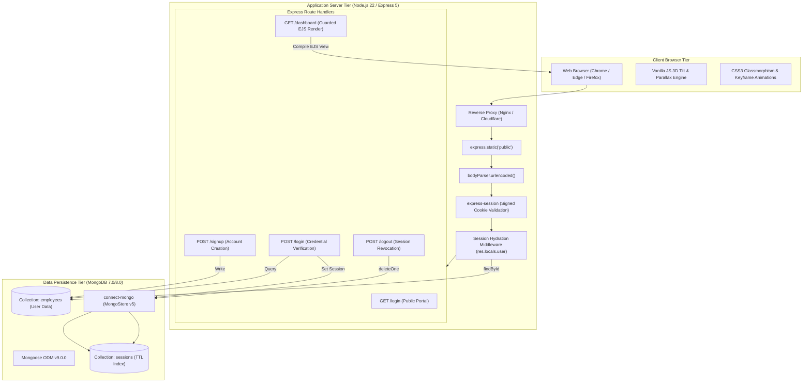
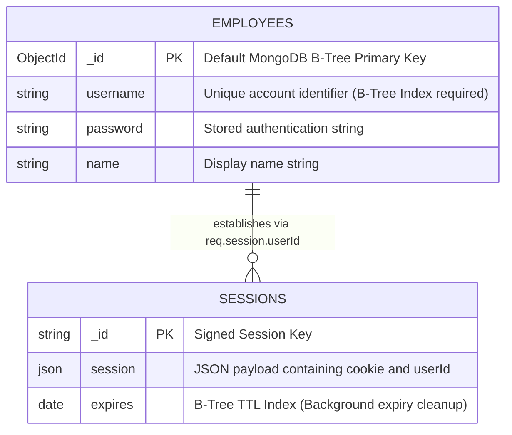
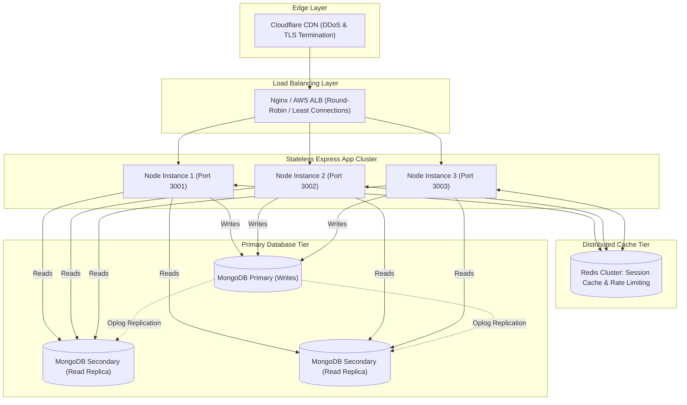

# Step 6: Architecture & System Design

---

## 1. High-Level Architectural Pattern

The application follows a **Monolithic Layered Architecture** adhering to the Classic Server-Side Model-View-Controller (MVC) pattern:

1. **Model Layer**: Represented by Mongoose Schema (`User`) mapped to MongoDB's `employees` collection and `connect-mongo` managing the `sessions` collection.
2. **View Layer**: Hybrid presentation composed of:
   - Client-side static HTML/CSS/Vanilla JS for the public authentication gateway (`login.html`).
   - Server-Side Rendered (SSR) dynamic templating for authenticated views (`views/dashboard.ejs`).
3. **Controller / Middleware Layer**: Handled directly in `app.js` using Express 5 route handlers, centralized session state hydration, and body parsers.

---

## 2. Request Lifecycles (The 3 Core Features)

### 1. User Registration Lifecycle (`POST /signup`)
1. **Network Ingestion**: Browser transmits URL-encoded form data over HTTP to Express.
2. **Middleware Parsing**: `body-parser` reads the TCP stream and attaches `name`, `username`, and `password` to `req.body`.
3. **Validation Guard**: Controller checks `!username || !password`. If missing, returns inline `<script>` alert and terminates request.
4. **Collision Check**: Asynchronously runs `User.findOne({ username })`. If document exists, returns alert.
5. **Persistence**: Constructs `new User(...)` with a fallback name of `"New Member"`. Saves document to MongoDB collection `employees`.
6. **Redirection**: Responds with HTTP 302 directing the client to `/login`.

### 2. User Authentication & Session Creation (`POST /login`)
1. **Payload Extraction**: Controller extracts `username` and `password` from `req.body`.
2. **Database Lookup**: Queries `User.findOne({ username })` in MongoDB.
3. **Verification**: Confirms user exists and compares password strings.
4. **Session Serialization**: Sets `req.session.userId = user._id`. `connect-mongo` receives the mutated session and writes an encrypted JSON document to MongoDB `sessions` collection with a 24-hour TTL expiration date.
5. **Cookie Issuance**: Express signs a `connect.sid` cookie with `HMAC-SHA256` using the session secret and sets it in the HTTP response headers.
6. **Redirection**: Responds with HTTP 302 directing the browser to `/dashboard`.

### 3. Guarded Dashboard Rendering (`GET /dashboard`)
1. **Cookie Ingestion**: Browser transmits `Cookie: connect.sid=...` header.
2. **Session Deserialization**: `express-session` reads the signed cookie, retrieves the session document from MongoDB, and populates `req.session`.
3. **Hydration Middleware**: Checks `req.session.userId`, executes `User.findById(...)`, and attaches the employee document to `res.locals.user`.
4. **Route Authorization Guard**: Controller checks `if (!req.session.userId)`. If unauthorized, redirects to `/login`.
5. **Template Compilation**: Calls `res.render('dashboard')`. EJS engine reads `views/dashboard.ejs`, interpolates `res.locals.user.name` into `<h1>Welcome, <%= username %></h1>`, and flushes complete HTML to the client browser.

---

## 3. Database Schema & Indexing Architecture

### Indexing Analysis

| Collection | Field Name | Index Type | Purpose & Query Optimization |
| :--- | :--- | :--- | :--- |
| `employees` | `_id` | **Default Unique B-Tree** | Primary key. Enables $O(\log N)$ point lookups during hydration (`findById`). |
| `employees` | `username` | **Recommended Unique B-Tree** | Accelerates login and registration queries (`User.findOne({ username })`). |
| `sessions` | `_id` | **Default Unique B-Tree** | Direct key-value lookup of active session state. |
| `sessions` | `expires` | **MongoDB TTL Index** | Handled automatically by `connect-mongo`. MongoDB's background thread checks this index every 60 seconds and deletes expired session documents automatically without application code intervention. |

---

## 4. Scaling Architecture & Bottleneck Analysis (100x Load)

At 100x traffic (scaling from 10 RPS to 1,000 RPS):

### The First Three Bottlenecks at Scale

1. **Bottleneck 1: Session Read IOPS on MongoDB**:
   - **The Issue**: Every authenticated page request triggers a read to MongoDB in `userHydrationMiddleware` (`User.findById`) and a session fetch in `connect-mongo`. At 1,000 RPS, this generates 2,000 disk queries per second, saturating database IOPS.
   - **The Fix**: Place a **Redis cache cluster** ahead of MongoDB. Cache session payloads and hydrated user objects in Redis with a 5-minute TTL.
2. **Bottleneck 2: Single-Threaded Node.js Event Loop**:
   - **The Issue**: The prototype runs on a single Node process (`app.listen`). A single CPU core can become saturated under heavy concurrent SSL handshakes or template compilations.
   - **The Fix**: Deploy using the **Node.js Cluster module** or a process manager like **PM2** to spawn worker processes matching the number of CPU cores, fronted by an Nginx reverse proxy.
3. **Bottleneck 3: Plaintext Password Verification & Timing Risks**:
   - **The Issue**: Once upgraded to bcrypt (as required for security), calculating bcrypt hashes (12 rounds) consumes ~80ms of CPU time per login attempt. 100 simultaneous login attempts would lock the Node worker thread.
   - **The Fix**: Offload password hashing to a background thread pool or use Node's asynchronous `crypto.scrypt` / `crypto.pbkdf2` APIs to avoid blocking the main event loop.
