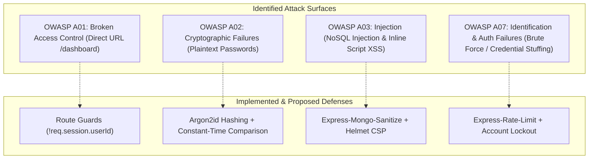

# Step 7: OWASP Top 10 Security Audit & Hardening



---

## 1. OWASP Top 10 Mapping & Detailed Vulnerability Assessment

### A01:2021 – Broken Access Control
- **Current Implementation**:
  - Guard clause in [`app.js:112`](file:///Users/avishjain/avishjain9-repos/54-login-auth-portal/app.js#L112): `if (!req.session.userId) return res.redirect('/login');`. Direct navigation to `/dashboard` by unauthenticated clients is successfully blocked and redirected.
- **Identified Gap / Attack Vector**:
  - No Role-Based Access Control (RBAC). All authenticated employees share the identical dashboard access level regardless of medical role (Nurse, Doctor, Administrator).
- **Remediation**:
  - Introduce a `role` field in `userSchema` (`enum: ['staff', 'physician', 'admin']`) and enforce role-checking middleware.

---

### A02:2021 – Cryptographic Failures
- **Current Implementation**:
  - `express-session` signs cookies with HMAC using the configured secret key.
- **Identified Gap / Attack Vector (CRITICAL)**:
  - Passwords are saved in **plain text** ([`app.js:20`](file:///Users/avishjain/avishjain9-repos/54-login-auth-portal/app.js#L20)). If the MongoDB database is compromised, all employee credentials are exposed in clear text.
  - The session secret `'your_secret_key'` ([`app.js:31`](file:///Users/avishjain/avishjain9-repos/54-login-auth-portal/app.js#L31)) is hardcoded in source control.
- **Remediation**:
  - Replace plaintext persistence with `bcrypt` (12 rounds) or `argon2id`.
  - Ingest `SESSION_SECRET` from environment variables, rotating keys periodically.

---

### A03:2021 – Injection (NoSQL & Cross-Site Scripting)
- **Current Implementation**:
  - EJS rendering in [`dashboard.ejs:93`](file:///Users/avishjain/avishjain9-repos/54-login-auth-portal/dashboard.ejs#L93) uses `<%= username %>` which applies HTML entity encoding, neutralizing stored XSS in the dashboard.
- **Identified Gap / Attack Vector**:
  - In `app.js:92` and `app.js:66`, `User.findOne({ username })` receives `username` directly from `req.body`. If an attacker submits a JSON or object payload like `{"username": {"$ne": null}}`, NoSQL injection could bypass credential checks if JSON body parsing were enabled.
  - Error responses emit `<script>alert(...)</script>` directly into the HTML response stream, violating strict Content Security Policies.
- **Remediation**:
  - Install `express-mongo-sanitize` to strip all `$` and `.` operators from request parameters.
  - Replace inline `<script>` alerts with redirect flash banners.

---

### A04:2021 – Insecure Design
- **Identified Gap**:
  - No rate limiting or lockout mechanism on `/login` or `/signup`. An attacker can run automated brute-force attacks or dictionary attacks against clinician accounts.
- **Remediation**:
  - Implement `express-rate-limit` limiting requests to 5 attempts per 15 minutes per IP address.

---

### A05:2021 – Security Misconfiguration
- **Current Implementation**:
  - Session cookie maxAge set to 24 hours ([`app.js:35`](file:///Users/avishjain/avishjain9-repos/54-login-auth-portal/app.js#L35)).
- **Identified Gap**:
  - Cookie flags `httpOnly`, `secure`, and `sameSite` are not explicitly defined. The cookie defaults to accessible via client-side JavaScript (`document.cookie`) if not protected.
  - Missing `helmet` security headers (X-Frame-Options, Strict-Transport-Security, Content-Security-Policy).
- **Remediation**:
  - Update session cookie options:
    ```javascript
    cookie: {
      httpOnly: true,
      secure: process.env.NODE_ENV === 'production',
      sameSite: 'lax',
      maxAge: 1000 * 60 * 60 * 24
    }
    ```
  - Mount `helmet()` as the first middleware in `app.js`.

---

### A07:2021 – Identification and Authentication Failures
- **Current Implementation**:
  - Stateful session revocation via `req.session.destroy()` deletes the MongoDB session document immediately.
- **Identified Gap**:
  - Password strength is not enforced. Single-character passwords or common credentials are accepted without policy validation.
- **Remediation**:
  - Integrate a password validation rule requiring minimum 10 characters, mixed case, numbers, and symbols.

---

## 2. Security Audit Summary Table

| Category | Status in Code | Risk Severity | Immediate Hardening Fix |
| :--- | :--- | :--- | :--- |
| **Password Storage** | Plaintext | **CRITICAL** | Hash with `argon2id` / `bcrypt` before Mongoose save |
| **Session Invalidation** | Implemented (MongoDB delete) | **LOW (Safe)** | Add `res.clearCookie('connect.sid')` |
| **Cookie Flags** | Default (Missing httpOnly/secure) | **HIGH** | Set `httpOnly: true, secure: true, sameSite: 'lax'` |
| **NoSQL Injection** | Mongoose Schema typing | **MEDIUM** | Add `express-mongo-sanitize` |
| **Brute Force Protection** | Not Implemented | **HIGH** | Add `express-rate-limit` (5 requests / 15m) |
| **Security Headers** | Not Implemented | **MEDIUM** | Add `helmet()` middleware |
| **Secrets Management** | Hardcoded strings in `app.js` | **HIGH** | Migrate to `dotenv` / cloud secret manager |
