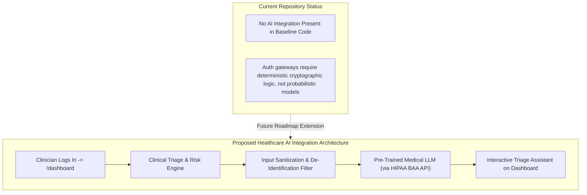
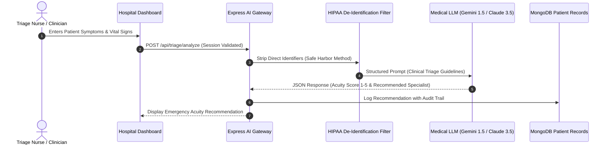

# Step 8: AI Integration Analysis & Healthcare Blueprint



---

## 1. Current Codebase Audit: AI Integration Status

> **Audit Status**: **No AI Integration in Current Codebase**.
> 
> Examination of `package.json`, `app.js`, and client-side scripts confirms that no external Large Language Model APIs (such as OpenAI, Anthropic Claude, or Google Gemini), local models (via Ollama or ONNX runtime), vector databases, or custom machine learning models are imported or invoked.

### Architectural Rationale for Excluding AI in the Core Portal
Authentication gateways require **strict deterministic behavior**:
1. A password either matches or it does not ($0$ or $1$).
2. A session is either valid in MongoDB or revoked ($0$ or $1$).
3. Injecting non-deterministic, probabilistic AI models into the core authentication evaluation pipeline introduces hallucination risks, latency spikes, and unpredictable access denial.

---

## 2. Production Blueprint: Where AI Fits in This Healthcare Portal

If this hospital portal is extended into an operational clinical platform, two high-value AI capabilities would integrate seamlessly with the existing architecture:



### Application 1: Clinical Triage & Patient Priority Recommendation
- **Problem Solved**: Hospital emergency departments experience clinician burnout and triage bottlenecks.
- **Implementation**: Once an employee authenticates into `/dashboard`, they access an AI-powered triage assistant that evaluates incoming patient symptom descriptions and outputs emergency severity index (ESI) acuity levels (1 to 5).
- **Prompt Architecture**:
  ```text
  You are an emergency medical triage assistant. Analyze the patient intake vitals and symptoms.
  Output strictly valid JSON conforming to the ESI protocol:
  {
    "acuity_level": 1 | 2 | 3 | 4 | 5,
    "rationale": "One-line clinical reason",
    "recommended_department": "Cardiology" | "Trauma" | "General"
  }
  ```

### Application 2: AI Authentication Risk Scoring (Adaptive MFA)
- **Problem Solved**: Detecting credential stuffing and compromised clinician passwords.
- **Implementation**: When an employee submits `/login`, a lightweight anomaly detection pipeline analyzes typing cadence, IP reputation, geolocation distance from hospital premises, and login hour.
- **Action**: If anomaly risk exceeds 0.85, the server demands secondary hardware MFA (FIDO2/WebAuthn) before establishing the session.

---

## 3. Pre-Trained API vs Custom Model Training

In interviews, engineers are frequently asked: *"Why use a pre-trained API instead of training your own machine learning model?"*

| Comparison Dimension | Pre-Trained API (e.g. Gemini / Claude / OpenAI) | Custom Trained In-House Model |
| :--- | :--- | :--- |
| **Upfront Capital Cost** | **Zero infrastructure investment** | **$250,000 – $1,000,000+** (GPU clusters: NVIDIA H100s) |
| **Time to Deployment** | **1–2 days** (REST API integration) | **6–12 months** (Data curation, training, validation) |
| **Dataset Requirement** | Zero proprietary training data needed | Millions of labeled medical charts and clinical notes |
| **HIPAA Compliance** | Covered by cloud enterprise Business Associate Agreements (BAA) | Requires physical secure on-premise compute infrastructure |
| **Maintenance Burden** | Managed by cloud provider | Continuous fine-tuning, drift detection, and GPU cluster ops |
| **Inference Latency** | Network latency (~500ms – 1.5s) | Hardware-dependent (~50ms on local GPU) |

### Why a Pre-Trained API is the Superior Architectural Choice
Training a custom foundational model requires tens of thousands of hours of GPU compute and massive clinical corpora that no individual team or small hospital possesses. Leveraging an enterprise pre-trained model with strict zero-data-retention BAAs provides state-of-the-art medical reasoning out of the box with zero capital expense.
