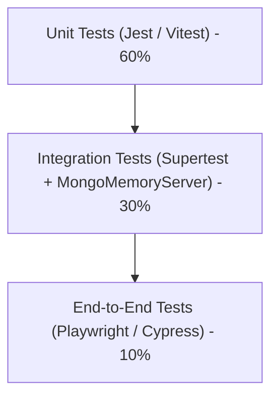

# Step 9: Engineering Quality, Operations & DevOps

```mermaid
flowchart LR
    Dev[Developer Workstation] --> Git[GitHub Repository]
    Git --> CI[GitHub Actions CI Pipeline]
    CI --> Test[Unit & Integration Tests (Jest + Supertest)]
    CI --> Lint[ESLint & Prettier Checks]
    CI --> DockerBuild[Docker Image Build & Security Scan]
    DockerBuild --> Deploy[Production Server Deployment (PM2 / Kubernetes)]
```

---

## 1. Testing Strategy: Current State vs Production Standard

### Current State in Codebase
In `package.json:7`, `"test": "echo \"Error: no test specified\" && exit 1"`. Automated tests are currently **not implemented**. Testing was performed manually via browser interactions and ad-hoc curl requests.

### Production Test Suite Blueprint



1. **Unit Testing Layer (Jest / Vitest)**:
   - Test user model validation rules (required fields, schema constraints).
   - Test coordinate normalization logic in the 3D tilt engine.
2. **Integration Testing Layer (Supertest + `mongodb-memory-server`)**:
   - Spin up an in-memory MongoDB instance to execute complete HTTP flows (`POST /signup`, `POST /login`, `GET /dashboard`, `POST /logout`) without polluting local or staging databases.
   - Assert cookie issuance, session serialization in MongoDB, and 302 redirect headers.
3. **End-to-End Testing Layer (Playwright)**:
   - Launch headless Chromium, interact with the dual-panel slider, verify 3D transform execution on mousemove, and assert DOM greetings in `dashboard.ejs`.

---

## 2. Containerization: Docker & Local Orchestration

To eliminate *"it works on my machine"* inconsistencies and ensure reproducible hospital server deployments, the project can be containerized using multi-stage Docker builds.

### `Dockerfile`
```dockerfile
# Multi-stage production Dockerfile
FROM node:22-alpine AS base
WORKDIR /app
COPY package*.json ./

FROM base AS dependencies
RUN npm ci --only=production

FROM base AS runner
ENV NODE_ENV=production
ENV PORT=3000
COPY --from=dependencies /app/node_modules ./node_modules
COPY . .
EXPOSE 3000
USER node
CMD ["node", "app.js"]
```

### `docker-compose.yml`
```yaml
version: '3.8'

services:
  web:
    build: .
    ports:
      - "3000:3000"
    environment:
      - PORT=3000
      - MONGODB_URI=mongodb://mongo:27017/hospital_login
      - SESSION_SECRET=c8e7b92f9a1b4c3d8e5f2a1b9c7d4e3f
    depends_on:
      - mongo
    restart: unless-stopped

  mongo:
    image: mongo:7.0
    ports:
      - "27017:27017"
    volumes:
      - mongo_data:/data/db
    restart: unless-stopped

volumes:
  mongo_data:
```

---

## 3. Observability, Logging & Error Telemetry

### Current State
Logging is performed via built-in `console.log` and `console.error` ([`app.js:14,15,83,105`](file:///Users/avishjain/avishjain9-repos/54-login-auth-portal/app.js#L14)).
- **Limitation**: `console.log` is synchronous in Node when writing to terminal outputs, blocking the event loop under heavy load. Logs lack timestamps, log levels, and request correlation IDs.

### Production Logging Standard (Pino / Winston)
Replace `console.log` with structured JSON logging:
```javascript
const pino = require('pino');
const logger = pino({ level: process.env.LOG_LEVEL || 'info' });

logger.info({ route: '/login', user: username }, 'User authenticated successfully');
```

---

## 4. Technical Debt Inventory & Prioritized Remediation

| Debt Item | Location in Code | Impact & Risk | Recommended Fix |
| :--- | :--- | :--- | :--- |
| **Plaintext Passwords** | [`app.js:20,95`](file:///Users/avishjain/avishjain9-repos/54-login-auth-portal/app.js#L20) | Catastrophic credential breach risk | Hash with `bcrypt` / `argon2` |
| **Hardcoded Secrets & DB URI** | [`app.js:12,31`](file:///Users/avishjain/avishjain9-repos/54-login-auth-portal/app.js#L12) | Security exposure in version control | Extract to `.env` using `dotenv` |
| **Missing Unique DB Index** | [`app.js:19`](file:///Users/avishjain/avishjain9-repos/54-login-auth-portal/app.js#L19) | $O(N)$ collection scan on registration | Add `unique: true` to schema and run `createIndex` |
| **Inline Script Alerts** | [`app.js:62,68,84...`](file:///Users/avishjain/avishjain9-repos/54-login-auth-portal/app.js#L62) | Violates strict CSP; poor UX | Replace with HTTP flash messages or JSON REST APIs |
| **Missing Automated Tests** | [`package.json:7`](file:///Users/avishjain/avishjain9-repos/54-login-auth-portal/package.json#L7) | Regression risk during updates | Add Jest + Supertest integration suite |
