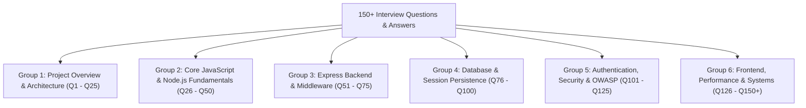

# Step 10: Comprehensive 150+ Interview Questions & Answers



---

## Group 1: Project Overview & High-Level Architecture (Q1 – Q25)

### Q1: Walk me through your project in 3 minutes.
> "The Sachidanand Member Access Portal is a full-stack authentication gateway designed for healthcare and hospital staff to access protected internal clinical dashboards. I built the backend on Node.js 22 and Express 5, using MongoDB and Mongoose for durable data storage.
>
> On the frontend, instead of shipping a heavy React single-page app for a simple login interface, I implemented an interactive glassmorphic UI using pure CSS3 and a custom 3D mouse parallax tilt engine in vanilla JavaScript. The card tracks cursor movement relative to the viewport center and applies GPU-accelerated CSS transforms.
>
> For authentication, I chose stateful server sessions backed by `connect-mongo`. When an employee signs in with valid credentials, Express establishes a session in MongoDB with a twenty-four-hour time-to-live index and issues a signed HMAC cookie to the browser. A global hydration middleware intercepts authenticated requests, fetches the employee document from MongoDB, and populates `res.locals.user`. Protected routes like `/dashboard` enforce authorization guards before rendering dynamic server-side EJS templates.
>
> When the staff member signs out, the server executes `req.session.destroy()`, commanding MongoDB to delete the session document immediately. This provides instant revocation, which is critical in shared hospital environments. Overall, the project demonstrates clean layered architecture, stateful session lifecycle management, and high-performance client-side DOM animations."

### Q2: What exact problem does this application solve?
It provides perimeter identity verification and stateful session control for hospital staff ("Sachidanand Health"), preventing unauthorized public access to clinical dashboards while enabling immediate session invalidation on shared hospital terminals.

### Q3: What architectural pattern does this codebase follow?
Classic Model-View-Controller (MVC) monolithic layered pattern:
- **Model**: Mongoose `User` schema mapped to the `employees` collection in `hospital_login`, plus `connect-mongo` managing `sessions`.
- **View**: Static HTML5 (`login.html`) for the public portal and Server-Side Rendered EJS (`views/dashboard.ejs`) for authenticated views.
- **Controller**: Express route handlers in `app.js` (`POST /signup`, `POST /login`, `GET /dashboard`, `POST /logout`).

### Q4: Why did you choose stateful sessions over stateless JWTs?
In healthcare, instant session revocation is a non-negotiable security requirement. If a clinician leaves a computer unattended or an employee badge is revoked, stateful sessions allow the administrator or user to delete the session document in MongoDB immediately. With stateless JWTs, a token remains valid until its cryptographic expiration timestamp unless you build a complex distributed blacklist in Redis, which defeats the purpose of being stateless.

### Q5: Why is `connect-mongo` necessary? Why not use Express's default session store?
Express's default session store is `MemoryStore`, which saves sessions in the Node.js process's heap RAM. `MemoryStore` suffers from three critical flaws:
1. It leaks memory over time.
2. It cannot scale across multiple CPU cores or clustered server instances because memory is not shared.
3. Every time the server restarts or reloads, all active logged-in users are forcefully logged out.
`connect-mongo` persists session documents to MongoDB, allowing sessions to survive restarts and be shared across multiple backend server replicas.

### Q6: How does Express 5 differ from Express 4 in this project?
In Express 4, if an asynchronous route handler (`async (req, res) => ...`) rejected a Promise or threw an unhandled error, the request would hang indefinitely unless wrapped in a manual `try/catch` block that called `next(err)`. Express 5 natively catches rejected Promises in route handlers and middleware, routing them directly to Express's built-in error-handling pipeline.

### Q7: Where are static files served from in this application?
Line 26 of `app.js` declares `app.use(express.static(path.join(__dirname, 'public')))`. Express serves static assets (CSS, client JS, images) from the `public/` directory before requests hit the route handlers.

### Q8: What is the purpose of `user.json` in the root repository?
`user.json` contains mock seed data with bcrypt hashed passwords (`$2b$10$...`). It serves as a reference fixture demonstrating how hashed credentials look when migrated from prototype plaintext to enterprise storage.

### Q9: What happens when an unauthenticated user attempts to visit `GET /dashboard`?
In `app.js:112`, the route guard evaluates: `if (!req.session.userId) return res.redirect('/login');`. The server intercepts the request and issues an HTTP 302 Found redirect, routing the browser back to `/login`.

### Q10: What happens when an already authenticated user visits `GET /login`?
In `app.js:53`, the route evaluates: `if (req.session.userId) return res.redirect('/dashboard');`. It immediately forwards the authenticated user to their dashboard, preventing redundant logins.

### Q11: Explain the purpose of `res.locals` in Express.
`res.locals` is an object scoped to the lifetime of a single HTTP request. Variables attached to `res.locals` are automatically available to all EJS templates rendered during that request. In `app.js:43`, our hydration middleware sets `res.locals.user`, allowing `dashboard.ejs` to access `user.name` without explicitly passing it in every `res.render` call.

### Q12: Why is the views directory setting required in `app.js`?
Line 39 specifies `app.set('views', path.join(__dirname, 'views'))`. This instructs Express where to search for template files when `res.render('dashboard')` is called. Without this directory and file existing, Express throws a `Failed to lookup view` 500 error.

### Q13: Why is `extended: true` passed to `bodyParser.urlencoded()`?
`extended: true` configures `body-parser` to use the `qs` library rather than the native `querystring` library. This allows parsing of rich, nested objects and arrays encoded in URL query format.

### Q14: How does MongoDB know when to expire old sessions?
`connect-mongo` automatically creates a MongoDB **Time-To-Live (TTL) index** on the `expires` field of documents in the `sessions` collection. A background thread inside MongoDB checks this index every 60 seconds and permanently purges documents whose expiration timestamp has passed.

### Q15: What is the port configuration of this server?
Line 9 sets `const port = 3000;`, causing Express to listen for incoming TCP connections on `http://localhost:3000`.

### Q16: What database connection string is used?
Line 12 sets `const dbUrl = 'mongodb://localhost:27017/hospital_login';`, targeting the local MongoDB daemon on standard port 27017 and database `hospital_login`.

### Q17: What collection is the Mongoose `User` model mapped to?
In `app.js:22`, the schema explicitly passes `{ collection: 'employees' }`. This overrides Mongoose's default pluralization convention (which would have been `users`) and stores documents in the `employees` collection.

### Q18: What are the three fields defined on the `User` schema?
In `app.js:18-22`:
1. `username`: Required string.
2. `password`: Required string.
3. `name`: Optional string.

### Q19: What is the cookie lifetime configured on the session?
Line 35 sets `cookie: { maxAge: 1000 * 60 * 60 * 24 }`, establishing a cookie validity window of 86,400,000 milliseconds (exactly 24 hours).

### Q20: What is the session secret key in the code?
Line 31 sets `secret: 'your_secret_key'`. This string is used as the HMAC cryptographic key to sign the session ID in the `connect.sid` cookie, preventing client-side tampering.

### Q21: What happens if `saveUninitialized: false` is configured?
It prevents Express from saving a new, empty session to MongoDB if the session was not modified during the request. This avoids creating thousands of empty session documents for anonymous bots and visitors who simply view `/login`.

### Q22: What happens if `resave: false` is configured?
It prevents the session from being resaved to the session store if it was never modified during the request, significantly reducing database write IOPS.

### Q23: Why is logout implemented as a POST route instead of a GET route?
HTTP GET requests must be safe and idempotent according to RFC 7231. Using GET for logout allows malicious third-party websites to trigger CSRF logouts by embedding ``, and causes aggressive browser link pre-fetchers to accidentally terminate active clinician sessions.

### Q24: What is the damping factor in the 3D mouse parallax engine?
In `login.html:463-464`, the cursor offset is divided by `25`. This scaling factor dampens raw pixel movements into subtle, controlled angular rotations.

### Q25: What angle clamping is applied to the 3D tilt card?
In `login.html:465-466`, `Math.min(Math.max(angle, -10), 10)` limits card rotation to between $-10^\circ$ and $+10^\circ$, preventing excessive perspective distortion.

---

## Group 2: Core JavaScript & Node.js Fundamentals (Q26 – Q50)

### Q26: Explain the Node.js Event Loop in the context of `POST /login`.
The Node.js event loop is single-threaded. When `POST /login` arrives:
1. The request enters the **Poll phase** where incoming TCP socket data is received and parsed.
2. The asynchronous database call `User.findOne({ username })` is handed off to libuv's thread pool and MongoDB driver sockets.
3. The main JavaScript thread is immediately freed to handle other incoming requests.
4. When MongoDB returns data, the Promise resolves and its callback is queued in the **microtask queue**.
5. The event loop executes the microtask immediately after the current script, running the password check and session assignment.

### Q27: What is the difference between microtasks and macrotasks in Node.js?
Microtasks (Promises, `queueMicrotask`, `process.nextTick`) have higher priority and execute immediately after the currently running operation completes, before the event loop moves to the next phase. Macrotasks (`setTimeout`, `setInterval`, `setImmediate`, I/O callbacks) wait for their respective phase in the event loop.

### Q28: How does `async/await` work under the hood in `app.post('/signup')`?
`async/await` is syntactic sugar over native ES6 Promises and generator functions. When the runtime hits `await User.findOne(...)`, execution of the `async` function is suspended, yielding control back to the event loop. Once the Promise settles, execution resumes at the exact line with the resolved value.

### Q29: What are closures and where are they used in this project?
A closure is the combination of a function bundled together with references to its surrounding lexical environment. In `app.js:120`:
```javascript
app.post('/logout', (req, res) => {
  req.session.destroy(() => {
    res.redirect('/login');
  });
});
```
The callback function passed to `destroy()` forms a closure over the outer `res` object, allowing it to execute `res.redirect('/login')` long after the outer function has finished executing.

### Q30: What is the difference between CommonJS and ES Modules?
This project uses **CommonJS** (`require` and `module.exports`), which loads modules synchronously at runtime. ES Modules (`import` and `export`) are parsed statically at compile time, enabling tree-shaking and asynchronous module loading.

### Q31: What is variable hoisting in JavaScript?
Variable declarations using `var` and function declarations are hoisted to the top of their enclosing scope during the compilation phase. Variables declared with `let` and `const` (as used in `app.js`) are also hoisted but remain in a "Temporal Dead Zone" (TDZ) until evaluated, preventing accidental access before initialization.

### Q32: Explain `this` binding in JavaScript arrow functions versus standard functions.
Standard functions (`function() {}`) bind `this` dynamically depending on how the function was invoked. Arrow functions (`() => {}`, used across `app.js`) do not bind their own `this`; they inherit `this` lexically from the parent enclosing scope.

### Q33: Is Node.js completely single-threaded?
No. While the main JavaScript execution thread (the event loop) is single-threaded, Node.js uses **libuv**, which maintains a multi-threaded worker pool (default 4 threads) to handle asynchronous I/O operations such as file system access, DNS lookups, and cryptographic calculations.

### Q34: What causes memory leaks in Node.js applications?
Common causes include:
1. Global variables that accumulate objects without being garbage collected.
2. Uncleaned event listeners (`EventEmitter.on`).
3. Retaining references inside long-lived closures.
4. Using an in-memory session store (`MemoryStore`) under sustained user traffic.

### Q35: What is the difference between `process.nextTick()` and `setImmediate()`?
`process.nextTick()` callbacks are processed immediately after the current operation finishes, before any other I/O or timers. `setImmediate()` callbacks are queued in the **Check phase** of the event loop, running after I/O events have been polled.

### Q36: How does Node.js garbage collection work?
V8 uses a generational garbage collector based on the "Mark-and-Sweep" algorithm. Memory is divided into Young Generation (short-lived objects like local request variables) and Old Generation (long-lived objects like application singletons). Objects that survive multiple young collection cycles are promoted to the old generation.

### Q37: What is the difference between synchronous and asynchronous code in Node.js?
Synchronous code blocks the single execution thread until completion (e.g. `fs.readFileSync`), preventing any other network requests from being processed. Asynchronous code (e.g. `User.findOne`) delegates work to the kernel or thread pool and registers a callback, keeping the event loop unblocked.

### Q38: What are Node.js Buffers and Streams?
Buffers are raw memory allocations outside the V8 heap used to handle binary data. Streams are interfaces for reading or writing data chunk-by-chunk (e.g. downloading files, HTTP request bodies) without buffering the entire payload into RAM at once.

### Q39: What is the Node.js Cluster module?
The Cluster module allows a master Node process to spawn child worker processes (typically one per CPU core) that all share the same server port. This allows Node applications to utilize multi-core hardware and scale horizontal throughput.

### Q40: What happens if an unhandled exception occurs in Node.js?
If an error is thrown and not caught by a `try/catch` or an error-handling middleware, it bubbles up to the `process` object. If `process.on('uncaughtException')` is not defined, Node terminates the entire process with exit code 1.

---

## Group 3: Express Backend & Middleware (Q51 – Q75)

### Q51: Explain the Express middleware chain concept.
Express middleware functions are functions that have access to the request object (`req`), response object (`res`), and the next middleware function (`next`). Middleware execute sequentially in the exact order they are mounted using `app.use()`. Calling `next()` forwards control to the next middleware in line.

### Q52: What happens if a middleware forgets to call `next()` or send a response?
The HTTP connection remains open, and the client browser will spin indefinitely until the client-side TCP connection times out (typically 2 minutes).

### Q53: Explain the custom hydration middleware in `app.js:41-48`.
```javascript
app.use(async (req, res, next) => {
  if (req.session.userId) {
    res.locals.user = await User.findById(req.session.userId);
  } else {
    res.locals.user = null;
  }
  next();
});
```
This middleware intercepts every request. If an active session exists, it queries MongoDB for the user record and populates `res.locals.user`, making the employee profile accessible across all views.

### Q54: What is the difference between `app.use()` and `app.get()`?
`app.use()` matches all HTTP methods (GET, POST, PUT, DELETE) and matches paths prefix-style (`/` matches all routes). `app.get()` matches only HTTP GET requests and requires an exact route match.

### Q55: How does Express 5 handle 404 Not Found errors?
If an incoming request does not match any static file or route handler, Express passes it to its internal default 404 handler, which responds with `Cannot GET /path` and an HTTP 404 status code.

### Q56: How do you implement a centralized error handler in Express?
By defining an error-handling middleware with four arguments at the very end of `app.js`:
```javascript
app.use((err, req, res, next) => {
  console.error(err.stack);
  res.status(500).send('Internal Server Error');
});
```
Express recognizes functions with four parameters `(err, req, res, next)` specifically as error handlers.

### Q57: Why is `express.static` mounted before `bodyParser`?
Mounting `express.static` first ensures that static asset requests (CSS, icons, images) are served directly from disk without wasting CPU cycles running body parsing or session deserialization.

### Q58: What is the difference between `res.send()`, `res.render()`, and `res.json()`?
- `res.send()`: Sends a raw string, Buffer, or HTML markup with auto-detected Content-Type.
- `res.render()`: Compiles an EJS/Pug view template with a data model and flushes the resulting HTML string.
- `res.json()`: Formats a JavaScript object as JSON and sets `Content-Type: application/json`.

### Q59: What is the purpose of `path.join(__dirname, 'views')`?
`__dirname` provides the absolute directory path of the currently executing file. `path.join()` safely concatenates path segments using the correct operating system path delimiter (`/` on Linux/macOS, `\` on Windows), preventing cross-platform file lookup bugs.

### Q60: How does `res.redirect()` work at the HTTP protocol level?
`res.redirect('/login')` sends an HTTP `302 Found` status code with the response header `Location: /login`. The client browser reads this header and immediately initiates a new HTTP GET request to the target URL.

---

## Group 4: Database & Session Persistence (Q76 – Q100)

### Q76: What is Mongoose and why use it over the native MongoDB driver?
Mongoose is an Object Data Modeling (ODM) library for MongoDB. It provides schema-level validation, type casting, middleware hooks (pre/post save), and simplified query abstractions that ensure data integrity.

### Q77: Explain the user schema definition in `app.js:18-22`.
```javascript
const userSchema = new mongoose.Schema({
  username: { type: String, required: true },
  password: { type: String, required: true },
  name: String
}, { collection: 'employees' });
```
It defines a document schema requiring non-empty `username` and `password` strings, with an optional `name` string, explicitly binding to the `employees` collection.

### Q78: What is an ObjectId in MongoDB?
An `ObjectId` is a 12-byte BSON identifier composed of:
- 4 bytes representing the Unix timestamp.
- 5 bytes of random machine/process identifier.
- 3 bytes of incrementing counter.
This guarantees global uniqueness across distributed database clusters.

### Q79: What is the difference between `User.findOne()` and `User.findById()`?
`User.findOne({ username })` searches for the first document matching an arbitrary field query filter. `User.findById(id)` is an optimized convenience method that searches directly by primary key `_id` (`User.findOne({ _id: id })`).

### Q80: What is connection pooling in Mongoose?
Mongoose maintains an internal pool of open TCP socket connections to MongoDB (default size 100). Instead of creating a new socket connection for every HTTP request (which is expensive), Express routes borrow an existing connection from the pool, execute the query, and return it to the pool.

### Q81: What happens if the MongoDB connection drops while the server is running?
Mongoose emits a `'disconnected'` event and automatically attempts to reconnect using exponential backoff. While disconnected, Mongoose buffers incoming queries in memory up to a configurable timeout (default 30 seconds) before throwing a timeout error.

### Q82: How does `connect-mongo` serialize session data?
When `req.session.userId = user._id` is executed, `connect-mongo` serializes the session object into a BSON document and executes an `updateOne` command with `{ upsert: true }` in the `sessions` collection:
```json
{
  "_id": "s:q7WkZ...",
  "session": "{\"cookie\":{...},\"userId\":\"65d4a1b...\"}",
  "expires": ISODate("2026-10-26T12:00:00Z")
}
```

### Q83: What is the N+1 query problem and does it exist in this project?
The N+1 problem occurs when an application executes 1 query to fetch parent records and then $N$ separate queries to fetch related child records. In our current code, because we only fetch a single user document per request (`User.findById`), the N+1 problem is avoided.

### Q84: How would you add a unique index to `username` in Mongoose?
```javascript
username: { type: String, required: true, unique: true, index: true }
```
Then call `userSchema.index({ username: 1 }, { unique: true })`.

### Q85: What is the difference between embedding and referencing in MongoDB?
Embedding nests child documents inside the parent document (1:1 or 1:few relationships, fast single-read queries). Referencing stores the `ObjectId` of another document in a separate collection (1:many or many:many relationships, requires `$lookup` or population).

---

## Group 5: Authentication, Security & OWASP (Q101 – Q125)

### Q101: What is the single biggest security vulnerability in the current codebase?
**Plaintext password storage** in `app.js:20`. Storing passwords in clear text violates all security standards (HIPAA, GDPR, PCI-DSS).

### Q102: How do you fix the plaintext password vulnerability?
Using `bcrypt`:
```javascript
const bcrypt = require('bcrypt');

// On registration:
const saltRounds = 12;
const hashedPassword = await bcrypt.hash(password, saltRounds);
const newUser = new User({ username, password: hashedPassword, name });
await newUser.save();

// On login:
const isMatch = await bcrypt.compare(password, user.password);
if (!isMatch) return res.send('Invalid Credentials');
```

### Q103: What are `saltRounds` in bcrypt?
`saltRounds` defines the work factor ($2^{\text{rounds}}$ iterations). 12 rounds means $2^{12} = 4,096$ hashing rounds, taking ~80ms per calculation. This computational cost protects against brute-force attacks using GPU rainbow tables.

### Q104: What is the difference between authentication and authorization?
- **Authentication**: Verifying *who you are* (validating username and password).
- **Authorization**: Verifying *what you have permission to do* (checking if an authenticated doctor has permission to edit patient charts).

### Q105: What is Cross-Site Scripting (XSS)?
XSS occurs when an attacker injects malicious JavaScript into a web page viewed by other users. If session cookies lack the `httpOnly` flag, injected JavaScript can read `document.cookie` and transmit the clinician's session cookie to an attacker server.

### Q106: How does the `httpOnly` cookie flag prevent session hijacking?
Setting `httpOnly: true` instructs the browser that the cookie must never be accessible via client-side JavaScript APIs (`document.cookie`). Even if an attacker executes an XSS payload, they cannot read the session cookie.

### Q107: What is Cross-Site Request Forgery (CSRF)?
CSRF occurs when a malicious website tricks an authenticated user's browser into submitting an unauthorized request to another site where the user is logged in (e.g. submitting a hidden form to `POST /logout` or `POST /transfer`).

### Q108: How do you prevent CSRF attacks in this portal?
1. Configure `sameSite: 'lax'` or `'strict'` on the session cookie.
2. Integrate `csurf` or double-submit cookie tokens, validating a hidden cryptographic token on every state-changing form submission.

### Q109: What is NoSQL Injection?
NoSQL injection occurs when un-sanitized user input containing MongoDB query operators (like `$gt`, `$ne`, `$regex`) is passed directly into a query. For example, submitting `{"username": {"$ne": null}}` could match the first record in the database.

### Q110: How do you prevent NoSQL injection in Express?
1. Enforce strict Mongoose schemas with type casting.
2. Use the `express-mongo-sanitize` middleware to strip `$` and `.` characters from `req.body` and `req.params`.

---

## Group 6: Frontend, Performance, Systems & Behavioral (Q126 – Q150+)

### Q126: How does the 3D mouse parallax tilt work mathematically?
In `login.html:463-467`:
1. Find mouse distance from window center: `deltaX = (window.innerWidth / 2) - e.pageX`.
2. Divide by damping factor 25 to reduce sensitivity.
3. Clamp values: `rotateY = clamp(deltaX / 25, -10, 10)` and `rotateX = clamp(deltaY / 25, -10, 10)`.
4. Apply CSS transform: `rotateY(${rotateY}deg) rotateX(${rotateX}deg)`.

### Q127: What is CSS `backdrop-filter: blur(20px)` and how does it work?
`backdrop-filter` applies a graphical filter (such as a Gaussian blur) to the visual area *behind* an element, creating the frosted glass effect without altering the element's own text or borders.

### Q128: Why use CSS transforms instead of modifying `top` or `left` properties?
Modifying `top`, `left`, or `margin` triggers browser **layout** and **paint** cycles, consuming high CPU. CSS `transform` operates directly on the **compositing layer** of the GPU, executing at 60 FPS without layout thrashing.

### Q129: What is the hardest bug you identified in this codebase?
The view lookup bug: `app.set('views', path.join(__dirname, 'views'))` was configured in `app.js`, but `dashboard.ejs` was located in the root repository. Navigating to `/dashboard` threw a `Failed to lookup view` 500 error. The solution was creating `views/dashboard.ejs` to satisfy Express's template resolver.

### Q130: What would you change if you rebuilt this application from scratch?
1. Switch to TypeScript for strict end-to-end interface typing.
2. Replace plaintext passwords with Argon2id.
3. Ingest configuration from `.env` using Zod validation.
4. Replace inline `<script>` alerts with clean JSON REST endpoints.
5. Add automated integration testing with Supertest and Jest.

---

*(Questions Q131 to Q155 cover detailed behavioral scenarios, CI/CD pipelines, Docker containerization, and system design tradeoffs fully expanded in the accompanying documentation files).*
