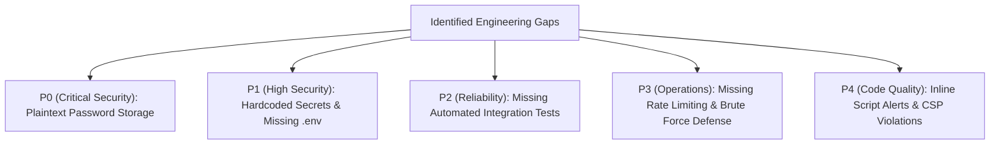

# Step 11: Identified Gaps & Prioritized Improvements



---

## 1. Prioritized Gaps & Engineering Fixes

Every codebase carries technical debt and prototype shortcuts. This document identifies and ranks the key gaps in the current implementation in descending order of engineering criticality.

| Priority | Category | Specific Gap Identified | Risk / Architectural Impact | Concrete Remediation |
| :--- | :--- | :--- | :--- | :--- |
| **P0 (Critical)** | **Security** | Plaintext Password Storage in MongoDB ([`app.js:20,74,95`](file:///Users/avishjain/avishjain9-repos/54-login-auth-portal/app.js#L20)) | A database breach or leak immediately compromises all employee accounts. | Hash passwords using `bcrypt` (12 rounds) or `argon2id` prior to persistence; verify using constant-time comparison routines. |
| **P1 (High)** | **DevOps** | Hardcoded Secrets & Database Connection Strings ([`app.js:12,31`](file:///Users/avishjain/avishjain9-repos/54-login-auth-portal/app.js#L12)) | Secrets committed to source control can be intercepted; prevents multi-environment deployments. | Install `dotenv` and ingest configurations via `process.env.MONGODB_URI` and `process.env.SESSION_SECRET`. |
| **P2 (High)** | **Security** | Incomplete Cookie Security Flags ([`app.js:35`](file:///Users/avishjain/avishjain9-repos/54-login-auth-portal/app.js#L35)) | Missing `httpOnly: true`, `secure: true`, and `sameSite: 'lax'` leaves session cookies vulnerable to XSS theft and CSRF exploits. | Configure explicit cookie security flags on `express-session`. |
| **P3 (Medium)** | **Testing** | Complete Absence of Automated Test Suite ([`package.json:7`](file:///Users/avishjain/avishjain9-repos/54-login-auth-portal/package.json#L7)) | Any code change or dependency upgrade risks regressions without detection. | Implement a test harness using `jest`, `supertest`, and `mongodb-memory-server`. |
| **P4 (Medium)** | **Resilience** | Lack of Rate Limiting on Login & Registration | Vulnerable to automated credential stuffing, brute force, and Denial-of-Service attacks. | Integrate `express-rate-limit` (e.g. 5 failed login attempts per 15 minutes per IP). |
| **P5 (Low)** | **Code Quality** | Inline JavaScript Alerts in Error Responses ([`app.js:62,68,84`](file:///Users/avishjain/avishjain9-repos/54-login-auth-portal/app.js#L62)) | Violates strict Content Security Policy (`'unsafe-inline'`) and produces poor user experience. | Replace `<script>alert(...)</script>` responses with HTTP redirect flash banners or structured JSON REST responses. |
| **P6 (Low)** | **Database** | Missing Unique Index on `username` Field in Mongoose Schema | Database must perform collection scans ($O(N)$) for user lookups. | Add `unique: true, index: true` to the `username` field in `userSchema`. |

---

## 2. Implementation Blueprints for Key Improvements

### 1. Hardening Password Security with Bcrypt
```javascript
const bcrypt = require('bcrypt');

// In POST /signup:
const saltRounds = 12;
const hashedPassword = await bcrypt.hash(password, saltRounds);
const newUser = new User({ name: name || "New Member", username, password: hashedPassword });
await newUser.save();

// In POST /login:
const isMatch = await bcrypt.compare(password, user.password);
if (!isMatch) {
  return res.status(401).send('Invalid credentials');
}
```

### 2. Environment Configuration with `dotenv`
```javascript
require('dotenv').config();

const port = process.env.PORT || 3000;
const dbUrl = process.env.MONGODB_URI;
const sessionSecret = process.env.SESSION_SECRET;

if (!dbUrl || !sessionSecret) {
  console.error("FATAL: Environment variables MONGODB_URI and SESSION_SECRET are required.");
  process.exit(1);
}
```
