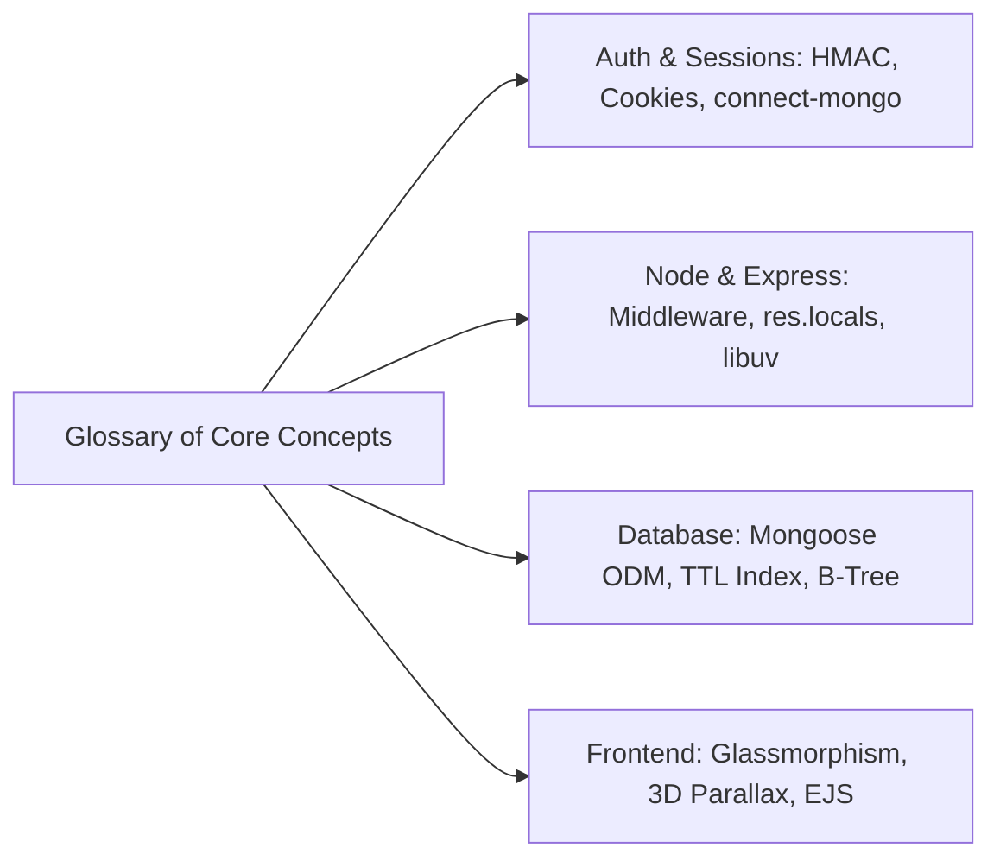

# Step 12: Technical Terms Glossary

---

## 1. Authentication & Security Terms

- **`connect.sid`**: The standard cookie name used by `express-session` to transmit the signed session ID between client browser and Node server.
- **HMAC (Hash-based Message Authentication Code)**: A cryptographic authentication technique combining a cryptographic hash function with a secret key (`session.secret`) to verify the integrity and authenticity of a cookie.
- **Stateful Authentication**: An authentication pattern where the server maintains session records in a database (such as MongoDB), requiring incoming requests to match an active record.
- **Stateless Authentication**: An authentication pattern (e.g. JWT) where identity claims are digitally signed and stored entirely on the client, requiring no database lookup on the server.
- **Salt Rounds (Bcrypt)**: The logarithmic work factor ($2^{\text{rounds}}$ iterations) that controls the amount of time required to calculate a bcrypt hash, protecting against hardware brute-force attacks.
- **Session Hijacking**: An attack where an adversary steals a valid user's session identifier (e.g. via XSS or network eavesdropping) to impersonate them.
- **HttpOnly Cookie**: A browser security flag that prevents client-side scripts (`document.cookie`) from accessing the cookie, mitigating XSS token theft.
- **Secure Cookie**: A flag instructing the browser to only transmit the cookie over encrypted HTTPS/TLS connections.
- **SameSite Cookie**: A security attribute (`Strict`, `Lax`, or `None`) that controls whether cookies are sent with cross-site requests, mitigating Cross-Site Request Forgery (CSRF).

---

## 2. Node.js & Express Architecture Terms

- **Middleware**: A function with access to `req`, `res`, and `next` that executes in the Express request-response pipeline to inspect, mutate, or reject HTTP traffic.
- **`res.locals`**: An object scoped to the lifetime of a single request used to pass data directly to rendered EJS templates without polluting global namespaces.
- **Event Loop**: Node's single-threaded orchestration mechanism that coordinates non-blocking asynchronous I/O callbacks via libuv.
- **libuv**: The multi-platform C library providing Node.js with asynchronous I/O abstractions and an internal worker thread pool.
- **`bodyParser`**: Middleware that intercepts incoming HTTP request streams and parses encoded body payloads into `req.body`.
- **SSR (Server-Side Rendering)**: A web rendering pattern where HTML markup is dynamically compiled on the server and delivered as a complete document to the browser.
- **EJS (Embedded JavaScript)**: A templating engine that allows developers to embed standard JavaScript syntax (`<%= username %>`) directly inside HTML templates.

---

## 3. Database & Persistence Terms

- **Mongoose ODM**: An Object Data Modeling library providing schema-based validation and query abstractions over the native MongoDB driver.
- **MongoDB Collection**: A grouped set of BSON documents inside a MongoDB database, analogous to a table in relational SQL databases.
- **BSON (Binary JSON)**: The binary-encoded serialization format used by MongoDB to store documents and execute remote procedure calls.
- **TTL Index (Time-To-Live)**: A special single-field index in MongoDB that automatically removes documents after a specified duration or timestamp.
- **Connection Pool**: A cache of open, reusable database socket connections maintained by Mongoose to eliminate the overhead of creating new TCP handshakes per request.
- **`MongoStore`**: The session persistence adapter provided by `connect-mongo` that connects `express-session` directly to a MongoDB collection.

---

## 4. Frontend & User Interface Terms

- **Glassmorphism**: A UI design trend characterized by background translucency, multi-layered floating elements, and `backdrop-filter: blur()`.
- **CSS `backdrop-filter`**: A CSS property that applies graphical effects (like Gaussian blur) to the area immediately behind an element.
- **3D Parallax Tilt**: An interactive effect where elements rotate in 3D space along the X and Y axes in response to cursor position, creating visual depth.
- **GPU Compositing**: Offloading CSS rendering (like `transform: rotateX()`) directly to the graphics hardware rather than consuming main CPU threads.
