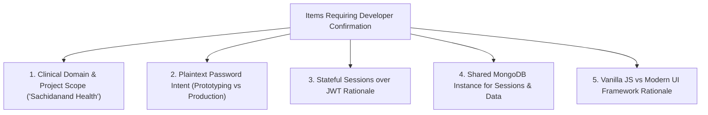

# Step 12.5: Developer Confirmation List

This document lists all architectural assumptions, design rationales, and domain choices identified across the codebase that are marked `[CONFIRM WITH DEVELOPER]`.

---

## 1. Inventory of Items Requiring Confirmation

| Item # | Document & Section | Statement / Assumption in Docs | Likely Rationale Based on Code | Confirmation Question for Developer |
| :--- | :--- | :--- | :--- | :--- |
| **C1** | `00a-project-analysis.md:0.1`, `dashboard.ejs:94` | Project is a member access portal for a healthcare/hospital entity ("Sachidanand Health"). | The database is named `hospital_login` and the collection is named `employees`. Text in `login.html` mentions *"holistic wellness journey with us"*. | Is this application specifically designed for a hospital/clinic employee intranet, or a broader enterprise member portal? |
| **C2** | `04-tech-comparisons.md:1`, `06-security.md` | Plaintext password storage was a temporary prototype shortcut rather than a permanent architectural decision. | Line 20 of `app.js` states: `// Plain text password as per your DB`. Furthermore, `user.json` in the root contains bcrypt hashed passwords (`$2b$10$...`), indicating familiarity with hashing. | Was plaintext password storage accepted purely as a local testing prototype, and is bcrypt or Argon2 planned for deployment? |
| **C3** | `04-tech-comparisons.md:2`, `00b-project-pitch.md` | Stateful sessions were chosen over stateless JWTs to enable instant session revocation on shared hospital workstations. | The codebase installs and configures `connect-mongo` and calls `req.session.destroy()` on `/logout`. | Was instant revocation on shared clinician computers the primary reason for choosing stateful sessions over JWTs? |
| **C4** | `04-tech-comparisons.md:1`, `app.js:34` | MongoDB was chosen to unify session storage and identity records under a single database technology, avoiding a separate Redis deployment. | `connect-mongo` connects directly to `dbUrl` (`mongodb://localhost:27017/hospital_login`), meaning no external Redis server is needed. | Was minimizing infrastructure dependencies by reusing MongoDB for sessions a conscious architectural decision? |
| **C5** | `04-tech-comparisons.md:4`, `login.html` | Vanilla JavaScript was chosen over React/Vue to ensure instantaneous initial page load and eliminate build/transpilation overhead. | No webpack, Vite, or React libraries are in `package.json`; all 3D tilt calculations are written in 20 lines of vanilla JS. | Was eliminating bundle size and build tooling the primary reason for avoiding frontend frameworks like React? |
