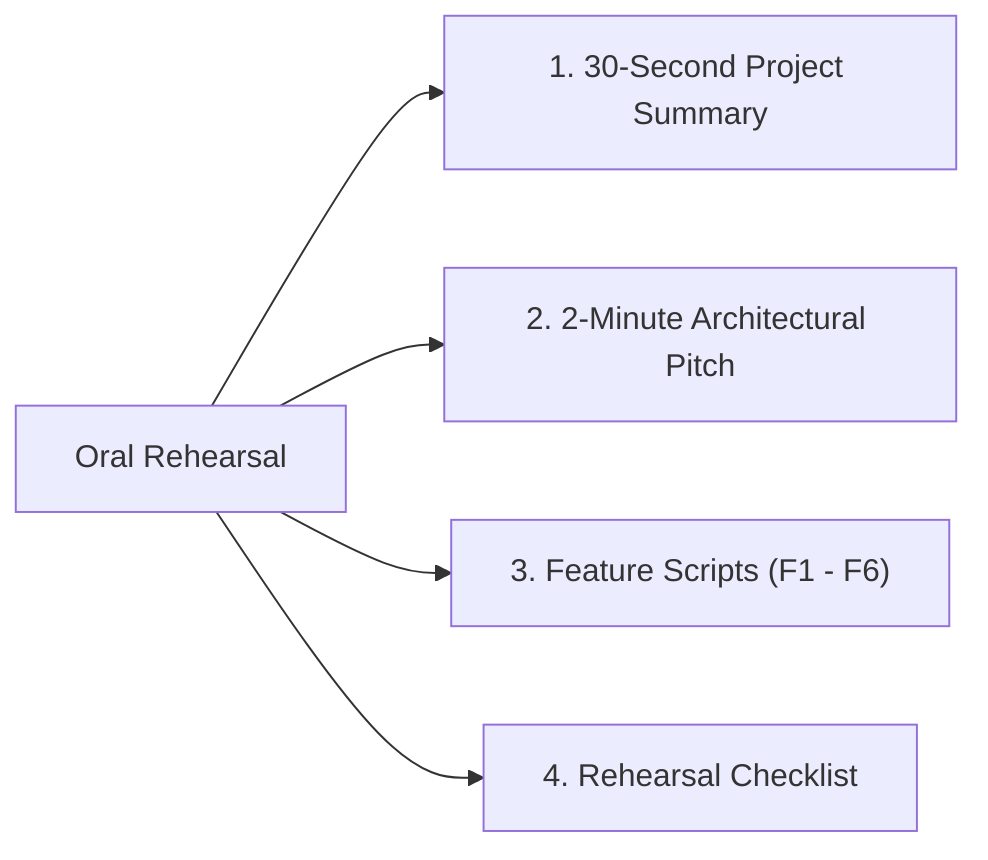

# Say It Out Loud: Complete Interview Spoken Scripts

This document gathers every feature's spoken interview script in first-person, natural English. Use this page to rehearse answering *"Walk me through how this feature works"* or *"Explain the architecture"* out loud before your interviews.

---

## 1. Project High-Level Pitches

### The 30-Second Pitch
> I built the Sachidanand Member Access Portal, a secure, full-stack authentication gateway designed for hospital staff and healthcare affiliates. It runs on Node.js and Express 5 with MongoDB and Mongoose, using stateful server sessions backed by `connect-mongo` so active clinical logins survive server restarts. On the client side, I built an interactive glassmorphic interface with pure CSS and a custom 3D mouse parallax tilt engine in vanilla JavaScript, completely avoiding heavy UI framework overhead. It demonstrates end-to-end full-stack state management, secure session destruction, and server-side EJS rendering for protected hospital dashboards.

### The 2-Minute Deep Pitch
> In a healthcare setting, clinician terminals need immediate, rock-solid perimeter access control without unnecessary frontend bundle bloat or complex SPA hydration issues. I engineered this portal as a lightweight, full-stack Node.js and Express web application backed by MongoDB.
>
> When an employee arrives at the portal, they are greeted by an interactive glassmorphic login card. Instead of using a bulky React or Three.js bundle, I implemented the 3D mouse parallax tilt in pure vanilla JavaScript by calculating cursor offsets relative to the viewport center and clamping rotation angles to ten degrees on the GPU. The interface allows seamless sliding between account registration and login via hardware-accelerated CSS transforms.
>
> On the backend, I chose stateful session authentication over stateless JWTs. Many engineers default to JWTs, but in a clinical hospital environment, you need instantaneous session revocation—if a nurse logs out or an employee badge is revoked, you must immediately invalidate that session without waiting for a token to expire. I integrated `express-session` with `connect-mongo`, serializing session identifiers into a dedicated MongoDB collection with automated TTL expiration indexes.
>
> When a user logs in, the backend authenticates their credentials against the `employees` collection and serializes their user ID into the MongoDB session store. A global hydration middleware intercepts authenticated requests, fetches the employee document, and populates `res.locals.user`. Protected routes like `/dashboard` verify session presence before rendering dynamic EJS templates on the server, ensuring zero unauthorized access.
>
> If I were taking this architecture into a high-security HIPAA production deployment today, my immediate priority would be upgrading password persistence from the current prototype plaintext storage to Argon2id with salting, adding Redis as the high-throughput session cache layer ahead of MongoDB, and integrating clinical multi-factor authentication.

---

## 2. Feature-by-Feature Spoken Scripts

### Feature F1: User Registration & Account Provisioning
> When an employee needs to join the portal, they click the sign-up button on our interactive card, which smoothly slides the registration form into view. Once they enter their name, email or username, and password and hit sign up, the browser makes a form POST request to `/signup`.
>
> On the backend, our Express router receives the body through the URL-encoded parser. First, I validate that both the username and password fields are present. If either is missing, I return an alert and redirect them right back. Next, I query MongoDB using Mongoose's `findOne` method to make sure the username isn't already taken by another employee.
>
> If the username is unique, I instantiate a new Mongoose user model. I added a fallback so if the user leaves their name empty, it automatically defaults to "New Member" instead of saving an ugly null value. Then I save the record into the `employees` collection and issue a three-zero-two redirect back to the login page so they can immediately sign in.
>
> I chose a direct server-side redirect approach here because it avoids the complexity of client-side routing libraries while keeping the form submission bulletproof and compatible with any browser.
>
> If anything fails during this journey—like a database network timeout—the catch block intercepts the error, logs it to the server console, and alerts the user with a clean error message. One honest limitation of the current code is that passwords are saved in plain text for prototyping, which I would immediately replace with Argon2 hashing and an automated unique index on the username field.

---

### Feature F2: User Authentication & Session Establishment
> When an authenticated employee wants to sign in to the portal, they enter their username and password into the sign-in form and hit submit. The browser sends an HTTP POST request to the `/login` endpoint.
>
> On the server side, my Express route handler parses the username and password from the request body. It runs a query against MongoDB using Mongoose to find a matching record in our `employees` collection. If the user doesn't exist, or if the password they typed doesn't match what is stored in the database, the code immediately branches into a security guard. It alerts the browser with an invalid username or password message and sends them back to the login screen.
>
> But if the credentials match, the authentication succeeds. At that moment, I bind the user's unique Mongo ID onto the session object by assigning `req.session.userId`. Because I configured `express-session` with `connect-mongo`, this doesn't just sit in Node's volatile process memory; it serializes a new session document straight into MongoDB with a twenty-four-hour time-to-live index.
>
> The server then responds with a three-zero-two redirect to `/dashboard` while issuing a signed `connect.sid` cookie to the browser.
>
> I deliberately chose stateful MongoDB sessions over stateless JWTs here because in a hospital environment, instant access revocation is non-negotiable. If a staff member leaves a terminal, you need to be able to kill that session in the database immediately, which JWTs cannot do without a distributed blacklist.
>
> If a server error or database disconnect happens during this process, the try-catch block catches the exception, logs it, and safely notifies the user. For production, I would enhance this by replacing the plaintext comparison with constant-time bcrypt verification and turning on the `httpOnly` and `secure` cookie flags.

---

### Feature F3: Global Session Hydration Middleware
> To make user data easily accessible across our server without writing repetitive database queries in every single route, I wrote a global hydration middleware right before the route definitions.
>
> Every time a request comes into Express, it flows through this middleware. It checks if there is an active session with a `userId`. If there is, it reaches out to MongoDB using Mongoose's `findById` method to retrieve that employee's document. Then it binds that document directly to `res.locals.user`. If the request is from an anonymous guest, it simply sets `res.locals.user` to null. Finally, it calls `next()` to hand off execution to downstream routes.
>
> The reason this is so valuable is `res.locals`. In Express, variables attached to `res.locals` are automatically available to all rendered EJS templates throughout that request's lifecycle. That means my dashboard view can render the doctor's name instantly without the dashboard route needing its own duplicate database query.
>
> If an employee's account gets deleted from the database while their session cookie is still valid, the query returns null. I anticipated this edge case by adding a ternary fallback that displays a clean default string "User" instead of throwing a runtime property error.
>
> While this works seamlessly for our current traffic, the architectural trade-off is that it incurs a database read on every authenticated page hit. In a high-traffic production system, I would optimize this by storing the user's name directly in the session payload or caching the user object in Redis.

---

### Feature F4: Protected Dashboard & Dynamic Server-Side EJS Rendering
> The dashboard is the protected inner sanctum of our portal where authenticated hospital personnel land. When an employee navigates to `/dashboard`, the route immediately evaluates an authorization guard: `if (!req.session.userId) return res.redirect('/login')`.
>
> If an unauthenticated user or an attacker tries to access this URL directly without an active session cookie, the server rejects the request on line 112 and redirects them straight to the login page.
>
> If the session is valid, the route handler calls `res.render` on the `dashboard` view. It extracts the employee's name from `res.locals.user`, which our hydration middleware already fetched, and passes it into the view engine. Inside `dashboard.ejs`, the name is safely interpolated into the heading using EJS tag delimiters.
>
> The rendered page is visually stunning. It uses pure CSS glassmorphism with dynamic ambient blur orbs in hospital-themed teal and gold, with zero reliance on heavy JavaScript UI libraries. The dashboard also includes a sign-out form that triggers our logout route.
>
> I chose server-side rendering with EJS instead of a Single Page Application here because it delivers instantaneous First Contentful Paint without shipping massive JavaScript bundles to hospital workstations.
>
> An interesting edge case I uncovered during development was that Express looked for templates inside the `views` directory while the file was initially placed in the root. Structuring it properly with `views/dashboard.ejs` guarantees that view lookup succeeds every time.

---

### Feature F5: Session Invalidation & Logout
> In a hospital environment with shared clinician computers, the logout feature is a critical compliance and security safeguard. When a staff member clicks the "Sign Out" button on the dashboard, their browser initiates an HTTP POST request to `/logout`.
>
> On the backend, my route handler calls `req.session.destroy()`. Because I integrated `connect-mongo`, this doesn't just clear an in-memory object; it immediately dispatches a `deleteOne` command to MongoDB, wiping that session document out of the `sessions` collection permanently. Once MongoDB confirms the deletion, the callback fires and issues a three-zero-two redirect back to `/login`.
>
> An important architectural detail is that I implemented logout as an HTTP POST rather than a simple GET link. Many novice developers use GET for logout, which leaves the portal open to CSRF logout attacks and aggressive browser link pre-fetching. Using POST ensures that only intentional user submissions can alter server session state.
>
> If an attacker were to somehow capture the old session cookie from a browser cache after logout, the server would reject it because the corresponding session ID in MongoDB has already been erased.
>
> If I were enhancing this in production, I would add an explicit `res.clearCookie` call in the callback to purge the cookie header from the client browser and emit an audit log entry tracking the clinician's logout event for compliance reporting.

---

### Feature F6: Interactive 3D Tilt Card & CSS Glassmorphism
> For the user interface, I wanted something that would immediately impress users and feel modern, rather than looking like another generic bootstrap form. I designed an interactive glassmorphic authentication card with pure CSS and vanilla JavaScript.
>
> In the background, three ambient gradient orbs float with a ninety-pixel blur, giving the screen depth. The card itself uses backdrop filters to create a frosted glass aesthetic with subtle light borders.
>
> To make the card feel alive, I wrote a custom 3D mouse parallax tilt engine in vanilla JavaScript. As the user moves their cursor across the screen, the listener calculates the mouse offset relative to the viewport center, divides it by twenty-five, and clamps the angle between negative ten and positive ten degrees. Then it applies a three-D rotateY and rotateX transform directly to the card container on the GPU compositing thread.
>
> When the user clicks sign up, an event listener toggles the active class, which triggers hardware-accelerated CSS transforms to smoothly slide the overlay and switch between the login and registration forms.
>
> On screens below seven hundred sixty-eight pixels, the script automatically shuts off the mouse tracking to prevent touch scrolling issues and stacks the layout vertically.
>
> I deliberately avoided importing React or external animation libraries like Three.js or GSAP here. Writing it in vanilla JavaScript keeps our client payload completely lightweight and ensures instantaneous page loading.

---

## 3. Rehearsal Checklist

Tick each box once you can speak the explanation fluently without looking at any notes:

- [ ] **30-Second Elevator Pitch** — Delivered under 30 seconds smoothly with clear diction.
- [ ] **2-Minute Architectural Pitch** — Delivered in ~110–120 seconds with focus on stateful sessions vs JWTs.
- [ ] **F1: User Registration Script** — Covers validation, duplication check, Mongoose save, and redirect.
- [ ] **F2: Session Login Script** — Covers credential lookup, `req.session.userId`, and `connect-mongo`.
- [ ] **F3: Hydration Middleware Script** — Explains `res.locals.user` lifecycle and template availability.
- [ ] **F4: Protected Dashboard Script** — Explains the authorization guard, EJS SSR, and view lookup.
- [ ] **F5: Logout & Invalidation Script** — Explains `req.session.destroy()`, Mongo deletion, and why POST is used.
- [ ] **F6: 3D Tilt UI Script** — Explains mouse coordinate delta, angle clamping, and GPU CSS transforms.
