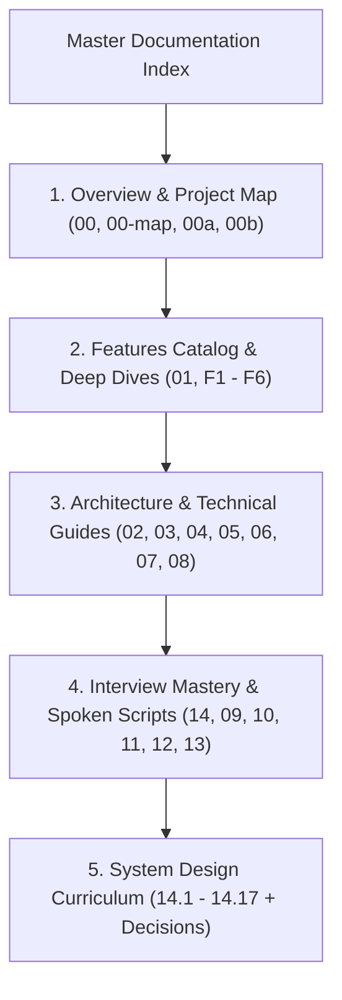

# Sachidanand Auth Portal: Master Documentation Index



---

## 1. Documentation Reading Order

This documentation suite is organized in the style of the official Vue.js documentation: clean, direct, step-by-step, and backed by verifiable code references. Read the documents in the following order:

### Part 1: Foundations & Project Overview
1. **[00-project-type.md](/00-project-type)**: Project classification pre-check and codebase evidence.
2. **[00-project-map.md](/00-project-map)**: Complete folder tree, tech stack versions, dependencies, and entry points.
3. **[00a-project-analysis.md](/00a-project-analysis)**: Complete system inventory, end-to-end traces, and component map.
4. **[00b-project-pitch.md](/00b-project-pitch)**: 30-second elevator pitch and 2-minute architectural interview pitch.

### Part 2: Feature Catalog & Deep Dives
5. **[01-features.md](/01-features)**: Master catalog of all 6 features.
   - **[F1: User Registration](/features/01-user-registration)**: Account creation, input validation, and collision prevention.
   - **[F2: Session Authentication](/features/02-session-authentication)**: Credential verification and MongoDB session persistence.
   - **[F3: Session Hydration Middleware](/features/03-session-middleware-rbac)**: Automatic `res.locals.user` resolution.
   - **[F4: Protected Dashboard](/features/04-protected-dashboard)**: Route guards and dynamic EJS server-side rendering.
   - **[F5: Session Revocation & Logout](/features/05-session-termination-logout)**: Hard deletion of sessions from MongoDB.
   - **[F6: Interactive 3D Tilt Card](/features/06-interactive-ui-tilt-card)**: Vanilla JS mouse parallax engine and CSS glassmorphism.

### Part 3: Architecture & Engineering Guides
6. **[02-build-order.md](/02-build-order)**: Step-by-step scratch build order with line-by-line code breakdowns.
7. **[03-api-reference.md](/03-api-reference)**: Complete HTTP API reference and request-response contracts.
8. **[04-tech-comparisons.md](/04-tech-comparisons)**: Exhaustive technology comparison tables and spoken justifications.
9. **[05-architecture.md](/05-architecture)**: High-level architecture, database schemas, and 100x scaling model.
10. **[06-security.md](/06-security)**: OWASP Top 10 security audit, vulnerability analysis, and hardening.
11. **[07-ai-integration.md](/07-ai-integration)**: AI integration analysis and hospital clinical triage blueprint.
12. **[08-quality-and-ops.md](/08-quality-and-ops)**: DevOps, Dockerfile, docker-compose, logging, and technical debt.

### Part 4: Interview Mastery & Practice
13. **[14-say-it-out-loud.md](/14-say-it-out-loud)**: Spoken first-person interview scripts and the oral rehearsal checklist.
14. **[09-interview-qa.md](/09-interview-qa)**: 150+ comprehensive technical and behavioral interview questions & answers.
15. **[10-gaps-and-improvements.md](/10-gaps-and-improvements)**: Prioritized technical debt inventory and remediation blueprints.
16. **[11-glossary.md](/11-glossary)**: Comprehensive dictionary of all technical terms used in the codebase.
17. **[12-confirm-list.md](/12-confirm-list)**: Ledger of all assumptions marked `[CONFIRM WITH DEVELOPER]`.
18. **[13-master-checklist.md](/13-master-checklist)**: Complete 275-item master audit checklist across all 18 categories.

### Part 5: Enterprise System Design
19. **[system-design/index.md](/system-design/index)**: System design curriculum overview.
    - [14.1 Requirements & Capacity Estimation](/system-design/14.1-requirements-estimation)
    - [14.2 Architecture Styles](/system-design/14.2-architecture-styles)
    - [14.3 Networking & Communication Protocols](/system-design/14.3-networking-communication)
    - [14.4 Load Balancing & Scaling](/system-design/14.4-load-balancing-scaling)
    - [14.5 Databases & Storage Hierarchy](/system-design/14.5-databases-storage)
    - [14.6 Multi-Tier Caching](/system-design/14.6-caching)
    - [14.7 Messaging & Async Queues](/system-design/14.7-messaging-queues)
    - [14.8 Concurrency & Consistency](/system-design/14.8-consistency-concurrency)
    - [14.9 Reliability & Resilience](/system-design/14.9-reliability-resilience)
    - [14.10 API Design & Rate Limiting](/system-design/14.10-api-design-rate-limiting)
    - [14.11 Security Architecture & Zero Trust](/system-design/14.11-security-architecture)
    - [14.12 Search Systems & AI Pipelines](/system-design/14.12-search-ai-architecture)
    - [14.13 Real-Time Systems](/system-design/14.13-real-time-systems)
    - [14.14 Observability & Telemetry](/system-design/14.14-observability-operations)
    - [14.15 Performance Engineering](/system-design/14.15-performance-engineering)
    - [14.16 Cost & Cloud FinOps](/system-design/14.16-cost-tradeoffs)
    - [14.17 Classic System Design Problems](/system-design/14.17-classic-system-design-problems)
    - [Architectural Decisions Log](/system-design/decisions)

---

## 2. Running Locally

### 1. Run the Project Web Application
Make sure MongoDB is running on `localhost:27017`, then start the Express server:
```bash
npm start
```
The application will be live at **`http://localhost:3000`**.

### 2. Run the Documentation Site (VitePress)
To launch the interactive documentation website locally with hot module reloading and local search:
```bash
npm run docs:dev
```
The documentation portal will open at **`http://localhost:5173`**.

### 3. Build Documentation for Production
To compile the documentation into a static, zero-dependency HTML bundle:
```bash
npm run docs:build
```
The compiled output will be generated inside `docs/.vitepress/dist`, ready for deployment to GitHub Pages, Vercel, or Netlify.
