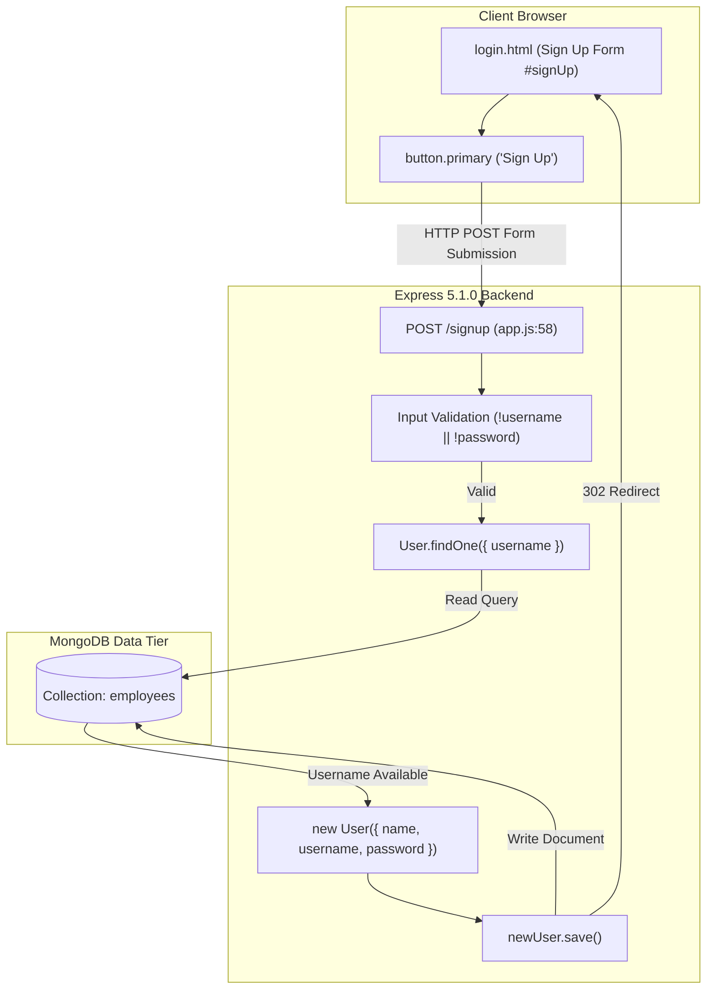
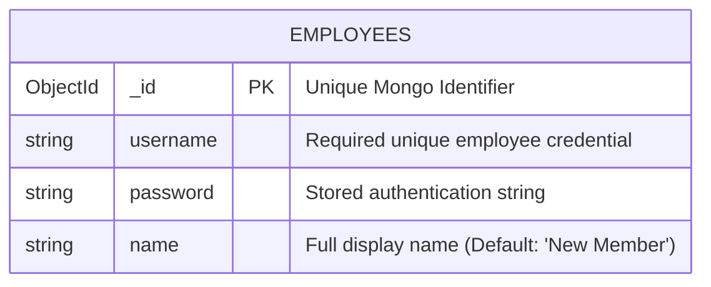
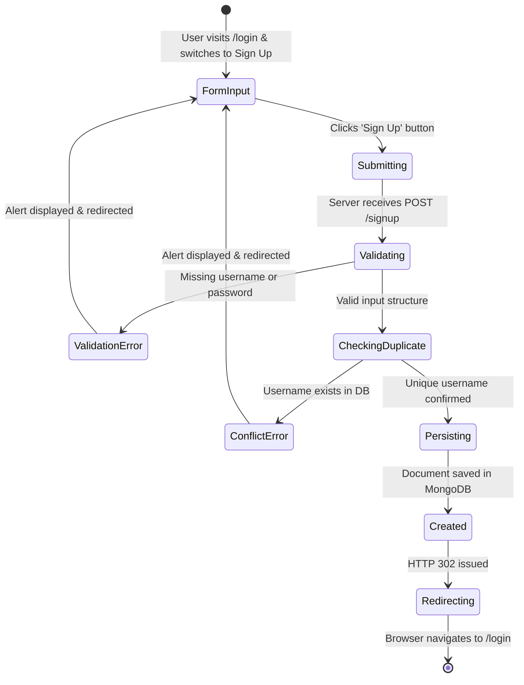

# Feature F1: User Registration & Account Provisioning



---

## 1. Overview & User-Facing Behavior

Feature **F1** allows new hospital staff members to create an identity in the portal. The user clicks "Sign Up" on the interactive portal, sliding the registration form into view. Upon providing their Full Name, Email/Username, and Password and submitting the form:
1. The server validates that all mandatory fields are present.
2. The server queries MongoDB to prevent duplicate username collisions.
3. The new employee record is created with default fallback naming ("New Member" if name is left blank).
4. The user is redirected back to the login screen with their account primed for authentication.

---

## 2. Code Trace & Function Level Reference

| Hop | File & Location | Function / Construct | Parameters | Return Value | Purpose |
| :--- | :--- | :--- | :--- | :--- | :--- |
| **Frontend Form** | [`login.html:387-411`](file:///Users/avishjain/avishjain9-repos/54-login-auth-portal/login.html#L387-L411) | `<form action="/signup" method="POST">` | User inputs: `name`, `username`, `password` | HTTP Form Post | Collects employee credentials and submits payload via browser form POST. |
| **Body Parser** | [`app.js:27`](file:///Users/avishjain/avishjain9-repos/54-login-auth-portal/app.js#L27) | `bodyParser.urlencoded({ extended: true })` | Stream `req` | `req.body` object | Deserializes incoming URL-encoded form data into accessible key-value pairs. |
| **Route Handler** | [`app.js:58`](file:///Users/avishjain/avishjain9-repos/54-login-auth-portal/app.js#L58) | `app.post('/signup', async (req, res) => ...)` | `req`, `res` | Void (Sends HTTP response) | Primary controller orchestrating validation, duplication checking, and persistence. |
| **Duplicate Query**| [`app.js:66`](file:///Users/avishjain/avishjain9-repos/54-login-auth-portal/app.js#L66) | `User.findOne({ username })` | Query filter: `{ username }` | Promise`<User \| null>` | Searches MongoDB collection `employees` for conflicting username. |
| **Model Creation** | [`app.js:71-75`](file:///Users/avishjain/avishjain9-repos/54-login-auth-portal/app.js#L71-L75) | `new User({ name, username, password })` | Schema document object | Mongoose Document instance | Instantiates new document matching Mongoose schema definition. |
| **DB Save** | [`app.js:77`](file:///Users/avishjain/avishjain9-repos/54-login-auth-portal/app.js#L77) | `newUser.save()` | None | Promise`<Document>` | Executes MongoDB `insertOne` write operation to store employee record. |
| **Redirect** | [`app.js:80`](file:///Users/avishjain/avishjain9-repos/54-login-auth-portal/app.js#L80) | `res.redirect('/login')` | `'/login'` | Void | Emits HTTP 302 Found response directing browser to login screen. |

---

## 3. Diagrams

### Full Request Sequence Diagram

```mermaid
sequenceDiagram
    autonumber
    actor User as Employee
    participant UI as login.html (Sign Up)
    participant Server as Express Router (POST /signup)
    participant Mongoose as User Model
    participant DB as MongoDB (employees)

    User->>UI: Fills Name, Username, Password & Submits
    UI->>Server: POST /signup (Body: name, username, password)
    Server->>Server: Check if username && password exist
    alt Missing Inputs
        Server-->>UI: 200 OK (<script>alert("Please fill in all fields."); redirect('/login')</script>)
    else Valid Inputs
        Server->>Mongoose: User.findOne({ username })
        Mongoose->>DB: findOne({ username })
        DB-->>Mongoose: Existing document or null
        alt Username Conflict
            Server-->>UI: 200 OK (<script>alert("Username already exists."); redirect('/login')</script>)
        else Unique Username
            Server->>Mongoose: new User({ name: name || "New Member", username, password })
            Server->>Mongoose: newUser.save()
            Mongoose->>DB: insertOne({ name, username, password })
            DB-->>Mongoose: Acknowledged { insertedId: ObjectId(...) }
            Server-->>UI: HTTP 302 Redirect to /login
            UI->>Server: GET /login
            Server-->>UI: 200 OK (login.html)
        end
    end
```

### Data Schema Diagram



### Lifecycle State Machine



### Failure Path Diagram

```mermaid
flowchart TD
    Start[User Submits POST /signup] --> C1{username && password?}
    C1 -->|No| F1["Return script alert: 'Please fill in all fields.' & redirect"]
    C1 -->|Yes| C2{User.findOne({ username })}
    C2 -->|DB Error| F2["Catch block: return script alert 'Database Error' & redirect"]
    C2 -->|Found| F3["Return script alert: 'Username already exists. Please Login.' & redirect"]
    C2 -->|Not Found| C3{newUser.save()}
    C3 -->|Write Error| F2
    C3 -->|Success| S1["HTTP 302 Redirect to /login"]
```

---

## 4. Edge Cases, Security & Engineering Quality

1. **Edge Case: Missing Optional Name**:
   - In [`app.js:72`](file:///Users/avishjain/avishjain9-repos/54-login-auth-portal/app.js#L72), the fallback operator `name: name || "New Member"` ensures that if the employee leaves the Name field blank, a readable default string is preserved in the database rather than `null` or `undefined`.
2. **Security Consideration: Plaintext Password Storage**:
   - As noted in [`app.js:20`](file:///Users/avishjain/avishjain9-repos/54-login-auth-portal/app.js#L20) (`// Plain text password as per your DB`), passwords are currently stored directly without cryptographic hashing. In production, passwords must be hashed using `bcrypt` (12 rounds) or `argon2id` prior to database persistence.
3. **Security Consideration: Client-Side Inline Script Alerts**:
   - Errors are returned as inline JavaScript alerts (`<script>alert(...); window.location.href="/login";</script>`). In an enterprise application, this violates strict Content Security Policy (CSP) headers (`'unsafe-inline'`). Flash messages or JSON REST error payloads should replace inline scripts.
4. **Performance & Indexes**:
   - `User.findOne({ username })` executes on every registration attempt. Currently, no explicit unique index is declared on `username` in Mongoose schema options (`{ username: { type: String, required: true, unique: true } }`), causing MongoDB to perform a collection scan ($O(N)$) instead of an index lookup ($O(\log N)$).

---

## 5. Say It Out Loud

> When an employee needs to join the portal, they click the sign-up button on our interactive card, which smoothly slides the registration form into view. Once they enter their name, email or username, and password and hit sign up, the browser makes a form POST request to `/signup`.
>
> On the backend, our Express router receives the body through the URL-encoded parser. First, I validate that both the username and password fields are present. If either is missing, I return an alert and redirect them right back. Next, I query MongoDB using Mongoose's `findOne` method to make sure the username isn't already taken by another employee.
>
> If the username is unique, I instantiate a new Mongoose user model. I added a fallback so if the user leaves their name empty, it automatically defaults to "New Member" instead of saving an ugly null value. Then I save the record into the `employees` collection and issue a three-zero-two redirect back to the login page so they can immediately sign in.
>
> I chose a direct server-side redirect approach here because it avoids the complexity of client-side routing libraries while keeping the form submission bulletproof and compatible with any browser.
>
> If anything fails during this journey—like a database network timeout—the catch block intercepts the error, logs it to the server console, and alerts the user with a clean error message. One honest limitation of the current code is that passwords are saved in plain text for prototyping, which I would immediately replace with Argon2 hashing and an automated unique index on the username field.
