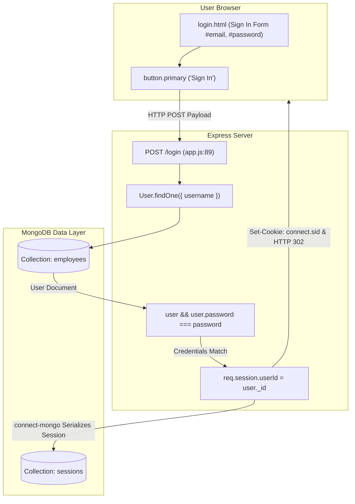
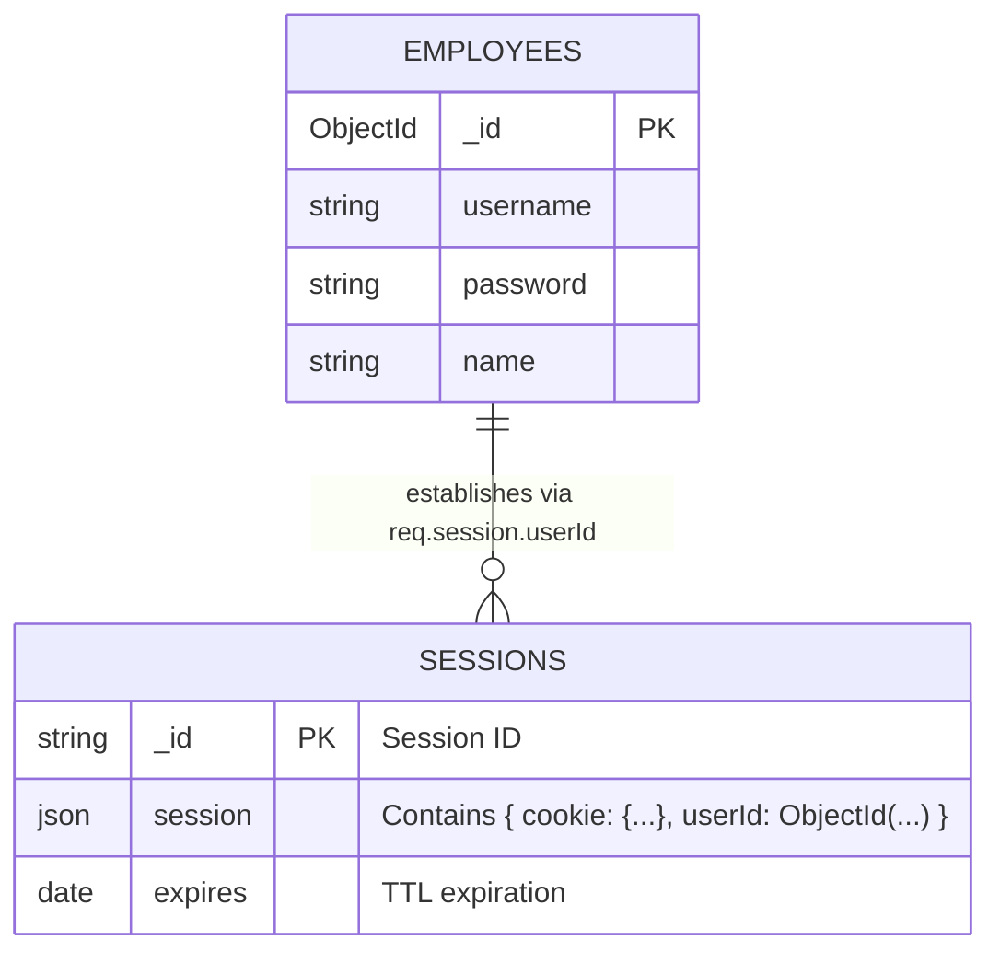
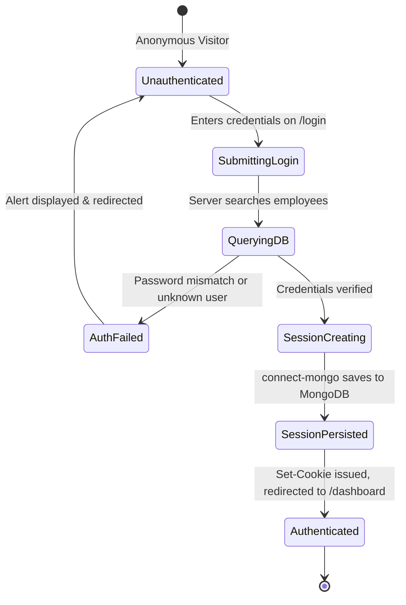

# Feature F2: User Authentication & Session Establishment



---

## 1. Overview & User-Facing Behavior

Feature **F2** establishes an authenticated, persistent user session. An employee enters their Username and Password into the "Sign in" panel of `login.html` and clicks "Sign In":
1. The server checks the submitted username against MongoDB's `employees` collection.
2. If the user exists and the password matches, the server establishes a stateful session by binding the user's `ObjectId` to `req.session.userId`.
3. `connect-mongo` immediately persists this session document to MongoDB in the `sessions` collection.
4. The server responds with an HTTP 302 redirect to `/dashboard`, setting the signed session cookie `connect.sid` with a 24-hour expiration window.

---

## 2. Code Trace & Function Level Reference

| Hop | File & Location | Function / Construct | Parameters | Return Value | Purpose |
| :--- | :--- | :--- | :--- | :--- | :--- |
| **Frontend Form** | [`login.html:413-435`](file:///Users/avishjain/avishjain9-repos/54-login-auth-portal/login.html#L413-L435) | `<form action="/login" method="POST">` | `username`, `password` | HTTP Form Post | Encodes user credentials and submits payload to the `/login` endpoint. |
| **Login Route** | [`app.js:89`](file:///Users/avishjain/avishjain9-repos/54-login-auth-portal/app.js#L89) | `app.post('/login', async (req, res) => ...)` | `req`, `res` | Void | Express POST handler coordinating user lookup, verification, and session creation. |
| **User Lookup** | [`app.js:92`](file:///Users/avishjain/avishjain9-repos/54-login-auth-portal/app.js#L92) | `User.findOne({ username })` | `{ username }` | Promise`<User \| null>` | Queries MongoDB collection `employees` to find employee record. |
| **Credential Check** | [`app.js:95`](file:///Users/avishjain/avishjain9-repos/54-login-auth-portal/app.js#L95) | `if (!user \|\| user.password !== password)` | Boolean comparison | Boolean | Determines if user exists and if input password matches database record. |
| **Session Binding**| [`app.js:101`](file:///Users/avishjain/avishjain9-repos/54-login-auth-portal/app.js#L101) | `req.session.userId = user._id;` | `ObjectId` | Void | Mutates session object; triggers `connect-mongo` to serialize session to DB. |
| **Redirect** | [`app.js:102`](file:///Users/avishjain/avishjain9-repos/54-login-auth-portal/app.js#L102) | `res.redirect('/dashboard')` | `'/dashboard'` | Void | Emits HTTP 302 Found response, instructing browser to request protected dashboard. |

---

## 3. Diagrams

### Full Request Sequence Diagram

```mermaid
sequenceDiagram
    autonumber
    actor User as Employee
    participant UI as login.html (Sign In)
    participant Server as Express (POST /login)
    participant Mongoose as User Model
    participant DB as MongoDB (employees)
    participant Store as connect-mongo (sessions)

    User->>UI: Enters Username & Password and submits
    UI->>Server: POST /login (application/x-www-form-urlencoded)
    Server->>Mongoose: User.findOne({ username })
    Mongoose->>DB: findOne({ username: "user" })
    DB-->>Mongoose: User Document or null
    
    alt User Not Found or Password Mismatch
        Server-->>UI: 200 OK (<script>alert("Invalid Username or Password"); redirect('/login')</script>)
    else Valid Credentials
        Server->>Server: req.session.userId = user._id
        Server->>Store: save session data { cookie, userId }
        Store->>DB: db.sessions.updateOne({ _id: sessId }, ..., { upsert: true })
        DB-->>Store: Acknowledged
        Server-->>UI: HTTP 302 Redirect to /dashboard [Set-Cookie: connect.sid]
        UI->>Server: GET /dashboard [Cookie: connect.sid]
        Server-->>UI: 200 OK (dashboard.ejs rendered)
    end
```

### Data Schema Diagram



### Lifecycle State Machine



### Failure Path Diagram

```mermaid
flowchart TD
    Req[POST /login Request] --> Lookup[User.findOne({ username })]
    Lookup -->|Query Error| ErrCatch["Catch block: return script alert 'Server Error' & redirect"]
    Lookup -->|Success| Check{!user || user.password !== password}
    Check -->|True| BadCreds["Return script alert 'Invalid Username or Password' & redirect"]
    Check -->|False| SaveSess[req.session.userId = user._id]
    SaveSess -->|MongoStore Failure| ErrCatch
    SaveSess -->|Success| Redirect[HTTP 302 Redirect to /dashboard]
```

---

## 4. Edge Cases, Security & Engineering Quality

1. **Stateful vs Stateless Auth**:
   - Rather than using stateless JSON Web Tokens (JWTs), the system uses stateful server sessions stored in MongoDB via `connect-mongo`. This allows immediate server-side session termination, preventing stale token reuse.
2. **Session Persistence**:
   - Because sessions are stored in MongoDB rather than in-memory Node process memory (`MemoryStore`), backend restarts and multi-core clustering do not drop active hospital clinician logins.
3. **Cookie Configuration**:
   - Configured in [`app.js:35`](file:///Users/avishjain/avishjain9-repos/54-login-auth-portal/app.js#L35) with `cookie: { maxAge: 1000 * 60 * 60 * 24 }` (24 hours). In production, security flags must be appended: `httpOnly: true` (prevents XSS theft), `secure: true` (ensures cookies are only transmitted over TLS/HTTPS), and `sameSite: 'strict'` or `'lax'` (mitigates CSRF exploits).
4. **Timing Attack Vulnerability**:
   - [`app.js:95`](file:///Users/avishjain/avishjain9-repos/54-login-auth-portal/app.js#L95) uses standard string equality (`user.password !== password`). In security audits, this is vulnerable to character-by-character timing analysis. Production implementations must use constant-time comparisons (`crypto.timingSafeEqual`) or bcrypt compare routines.

---

## 5. Say It Out Loud

> When an authenticated employee wants to sign in to the portal, they enter their username and password into the sign-in form and hit submit. The browser sends an HTTP POST request to the `/login` endpoint.
>
> On the server side, my Express route handler parses the username and password from the request body. It runs a query against MongoDB using Mongoose to find a matching record in our `employees` collection. If the user doesn't exist, or if the password they typed doesn't match what is stored in the database, the code immediately branches into a security guard. It alerts the browser with an invalid username or password message and sends them back to the login screen.
>
> But if the credentials match, the authentication succeeds. At that moment, I bind the user's unique Mongo ID onto the session object by assigning `req.session.userId`. Because I configured `express-session` with `connect-mongo`, this doesn't just sit in Node's volatile process memory; it serializes a new session document straight into MongoDB with a twenty-four-hour time-to-live index.
>
> The server then responds with a three-zero-two redirect to `/dashboard` while issuing a signed `connect.sid` cookie to the browser.
>
> I deliberately chose stateful MongoDB sessions over stateless JWTs here because in a hospital environment, instant access revocation is non-negotiable. If a staff member leaves a terminal, you need to be able to kill that session in the database immediately, which JWTs cannot do without a distributed blacklist.
>
> If a server error or database disconnect happens during this process, the try-catch block catches the exception, logs it, and safely notifies the user. For production, I would enhance this by replacing the plaintext comparison with constant-time bcrypt verification and turning on the `httpOnly` and `secure` cookie flags.
