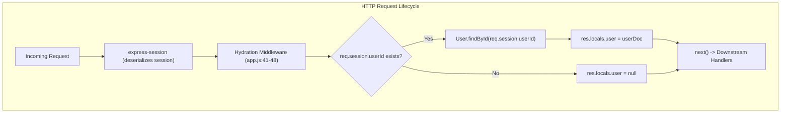
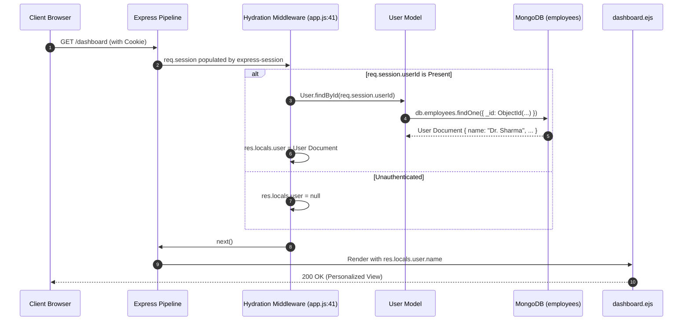
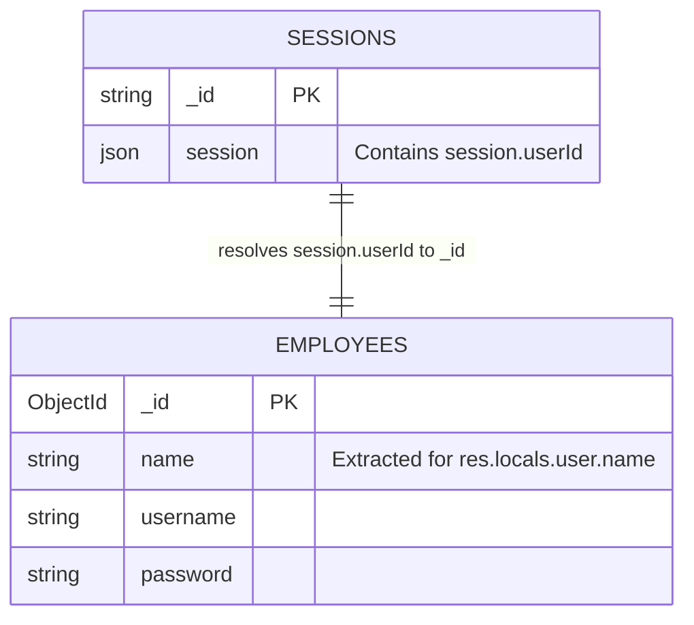
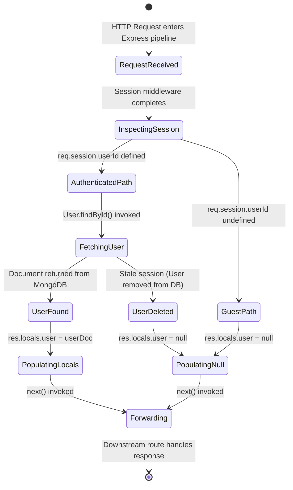

# Feature F3: Global Session Hydration Middleware



---

## 1. Overview & User-Facing Behavior

Feature **F3** is an architectural middleware that runs before route handling on every HTTP request. It ensures that any authenticated request has the current user's profile automatically attached to Express's `res.locals` namespace:
1. When an employee browser issues any HTTP request with a session cookie, the session middleware first populates `req.session`.
2. This hydration middleware checks if `req.session.userId` is present.
3. If present, it asynchronously queries MongoDB using `User.findById(req.session.userId)` and attaches the result to `res.locals.user`.
4. If no session exists, it sets `res.locals.user = null`.
5. It calls `next()` to pass control down the middleware chain, allowing views (like `dashboard.ejs`) to access `res.locals.user.name` without manual database queries in every route handler.

---

## 2. Code Trace & Function Level Reference

| Hop | File & Location | Function / Construct | Parameters | Return Value | Purpose |
| :--- | :--- | :--- | :--- | :--- | :--- |
| **Middleware Definition** | [`app.js:41-48`](file:///Users/avishjain/avishjain9-repos/54-login-auth-portal/app.js#L41-L48) | `app.use(async (req, res, next) => ...)` | `req`, `res`, `next` | Void | Express application-level middleware intercepting all HTTP requests. |
| **Session Evaluation** | [`app.js:42`](file:///Users/avishjain/avishjain9-repos/54-login-auth-portal/app.js#L42) | `if (req.session.userId)` | Boolean check | Boolean | Inspects session payload for presence of authenticated user ID. |
| **Database Query** | [`app.js:43`](file:///Users/avishjain/avishjain9-repos/54-login-auth-portal/app.js#L43) | `User.findById(req.session.userId)` | `ObjectId` | Promise`<User \| null>` | Queries MongoDB collection `employees` by primary key `_id`. |
| **Locals Population** | [`app.js:43,45`](file:///Users/avishjain/avishjain9-repos/54-login-auth-portal/app.js#L43-L45) | `res.locals.user = await User.findById(...)` | Object or `null` | Void | Binds user document to request-scoped `res.locals` template variables. |
| **Next Step Hand-off** | [`app.js:47`](file:///Users/avishjain/avishjain9-repos/54-login-auth-portal/app.js#L47) | `next()` | None | Void | Hands execution to next middleware or matched route handler. |

---

## 3. Diagrams

### Full Request Sequence Diagram



### Data Schema Diagram



### Lifecycle State Machine



### Failure Path Diagram

```mermaid
flowchart TD
    Req[Incoming HTTP Request] --> Check[req.session.userId exists?]
    Check -->|No| NullLocal[res.locals.user = null] --> Next[next()]
    Check -->|Yes| Query[await User.findById(userId)]
    Query -->|DB Connection Drops / Error| UnhandledErr["Unhandled Promise Rejection (Express 5 handles via default 500)"]
    Query -->|User Document Null| NullLocal
    Query -->|User Document Found| Populate[res.locals.user = userDoc] --> Next
```

---

## 4. Edge Cases, Security & Engineering Quality

1. **Stale Session Handling**:
   - If an employee record is deleted from the database while their session is still active, `User.findById(req.session.userId)` returns `null`. [`dashboard.ejs:93`](file:///Users/avishjain/avishjain9-repos/54-login-auth-portal/dashboard.ejs#L93) and [`app.js:114`](file:///Users/avishjain/avishjain9-repos/54-login-auth-portal/app.js#L114) handle this gracefully using a ternary operator: `username: res.locals.user ? res.locals.user.name : 'User'`.
2. **Performance Impact of Per-Request DB Query**:
   - Querying MongoDB on *every single request* creates database overhead ($1$ read per page hit). In high-scale deployments, user profile objects should be cached in Redis with a short TTL (e.g. 5 minutes) or user names should be serialized directly inside the session document (`req.session.userName`), avoiding repeated database trips.
3. **Async Error Handling in Express 5**:
   - Because Express 5 natively supports Promises returned from middleware, any rejection from `await User.findById(...)` is caught by Express's internal 500 error handler rather than crashing the Node process (as would happen in unpatched Express 4).

---

## 5. Say It Out Loud

> To make user data easily accessible across our server without writing repetitive database queries in every single route, I wrote a global hydration middleware right before the route definitions.
>
> Every time a request comes into Express, it flows through this middleware. It checks if there is an active session with a `userId`. If there is, it reaches out to MongoDB using Mongoose's `findById` method to retrieve that employee's document. Then it binds that document directly to `res.locals.user`. If the request is from an anonymous guest, it simply sets `res.locals.user` to null. Finally, it calls `next()` to hand off execution to downstream routes.
>
> The reason this is so valuable is `res.locals`. In Express, variables attached to `res.locals` are automatically available to all rendered EJS templates throughout that request's lifecycle. That means my dashboard view can render the doctor's name instantly without the dashboard route needing its own duplicate database query.
>
> If an employee's account gets deleted from the database while their session cookie is still valid, the query returns null. I anticipated this edge case by adding a ternary fallback that displays a clean default string "User" instead of throwing a runtime property error.
>
> While this works seamlessly for our current traffic, the architectural trade-off is that it incurs a database read on every authenticated page hit. In a high-traffic production system, I would optimize this by storing the user's name directly in the session payload or caching the user object in Redis.
