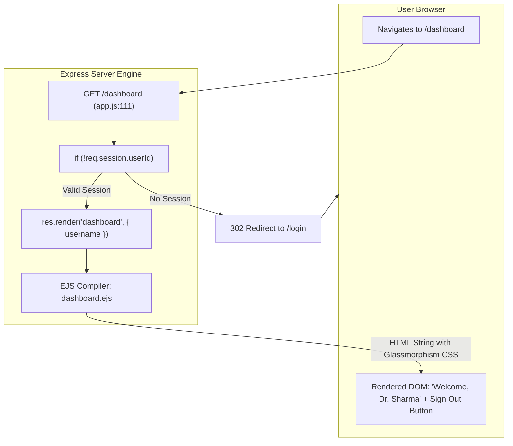
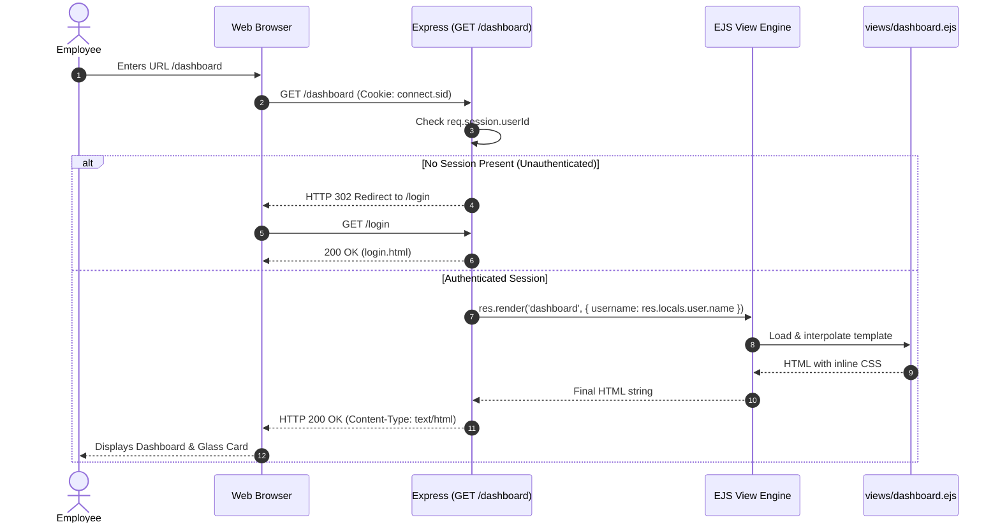
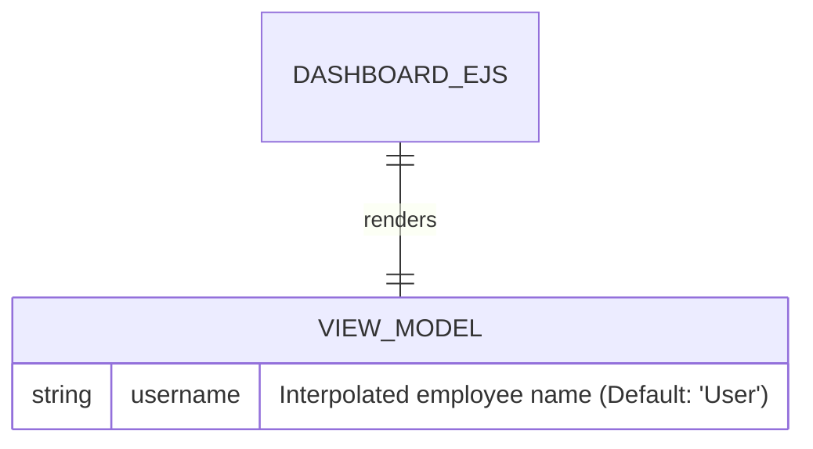
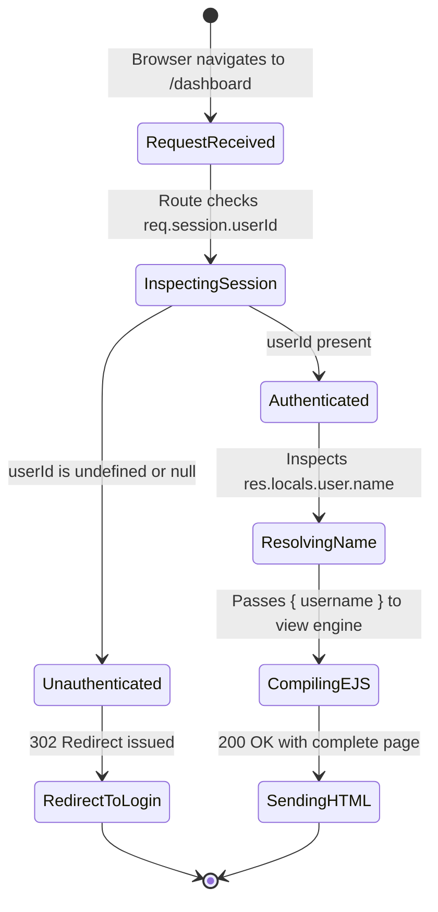
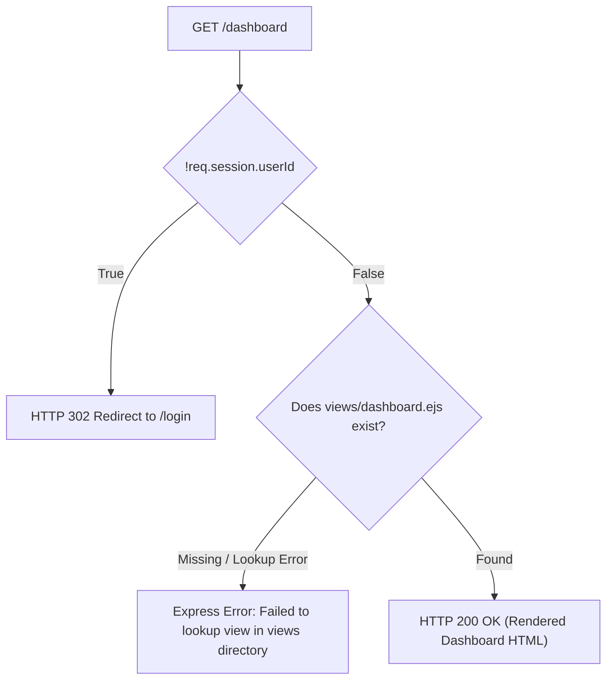

# Feature F4: Protected Dashboard & Server-Side EJS Rendering

---

## 1. Overview & User-Facing Behavior

Feature **F4** delivers the authenticated landing experience for hospital staff. When an employee accesses `/dashboard`:
1. The server enforces strict route protection: unauthorized visitors are redirected to `/login`.
2. Authorized users have their name dynamically resolved from `res.locals.user`.
3. The server compiles `dashboard.ejs`, injecting the employee's display name into the heading: `Welcome, <%= username %>`.
4. The user receives a server-rendered HTML page styled with pure CSS glassmorphism, floating ambient orbs, and a "Sign Out" button to terminate access.

---

## 2. Code Trace & Function Level Reference

| Hop | File & Location | Function / Construct | Parameters | Return Value | Purpose |
| :--- | :--- | :--- | :--- | :--- | :--- |
| **Protected Route** | [`app.js:111`](file:///Users/avishjain/avishjain9-repos/54-login-auth-portal/app.js#L111) | `app.get('/dashboard', (req, res) => ...)` | `req`, `res` | Void | HTTP GET endpoint guarding dashboard access. |
| **Auth Guard** | [`app.js:112`](file:///Users/avishjain/avishjain9-repos/54-login-auth-portal/app.js#L112) | `if (!req.session.userId) return res.redirect('/login');` | Condition check | Redirect response | Prevents unauthenticated access; redirects guests to login page. |
| **Render View** | [`app.js:113-115`](file:///Users/avishjain/avishjain9-repos/54-login-auth-portal/app.js#L113-L115) | `res.render('dashboard', { username: ... })` | Template name, View model | HTML stream | Executes EJS view compilation injecting resolved username. |
| **Template Bind** | [`dashboard.ejs:93`](file:///Users/avishjain/avishjain9-repos/54-login-auth-portal/dashboard.ejs#L93) | `<h1>Welcome, <%= username %></h1>` | `username` string | Rendered HTML tag | Interpolates dynamic employee name safely into DOM string. |
| **Logout Trigger** | [`dashboard.ejs:96-98`](file:///Users/avishjain/avishjain9-repos/54-login-auth-portal/dashboard.ejs#L96-L98) | `<form action="/logout" method="POST">` | Form action | HTTP POST submission | Renders form button to initiate session destruction. |

---

## 3. Diagrams

### Full Request Sequence Diagram

### Data Schema Diagram

### Lifecycle State Machine

### Failure Path Diagram

---

## 4. Edge Cases, Security & Engineering Quality

1. **View Directory Resolution**:
   - In [`app.js:39`](file:///Users/avishjain/avishjain9-repos/54-login-auth-portal/app.js#L39), `app.set('views', path.join(__dirname, 'views'))` tells Express to look for templates in the `views/` subdirectory. If `dashboard.ejs` is only located in the project root, Express throws a `Failed to lookup view "dashboard"` error. Ensuring `views/dashboard.ejs` exists resolves this lookup.
2. **Context Escaping**:
   - `dashboard.ejs` uses `<%= username %>` which automatically escapes HTML entities, neutralizing Reflected Cross-Site Scripting (XSS) attacks in the user's name field.
3. **No Index / Search Engine Privacy**:
   - For internal medical dashboards, robots meta tags (`<meta name="robots" content="noindex, nofollow">`) should be embedded in the `<head>` of `dashboard.ejs` to prevent indexing by search engine crawlers.

---

## 5. Say It Out Loud

> The dashboard is the protected inner sanctum of our portal where authenticated hospital personnel land. When an employee navigates to `/dashboard`, the route immediately evaluates an authorization guard: `if (!req.session.userId) return res.redirect('/login')`.
>
> If an unauthenticated user or an attacker tries to access this URL directly without an active session cookie, the server rejects the request on line 112 and redirects them straight to the login page.
>
> If the session is valid, the route handler calls `res.render` on the `dashboard` view. It extracts the employee's name from `res.locals.user`, which our hydration middleware already fetched, and passes it into the view engine. Inside `dashboard.ejs`, the name is safely interpolated into the heading using EJS tag delimiters.
>
> The rendered page is visually stunning. It uses pure CSS glassmorphism with dynamic ambient blur orbs in hospital-themed teal and gold, with zero reliance on heavy JavaScript UI libraries. The dashboard also includes a sign-out form that triggers our logout route.
>
> I chose server-side rendering with EJS instead of a Single Page Application here because it delivers instantaneous First Contentful Paint without shipping massive JavaScript bundles to hospital workstations.
>
> An interesting edge case I uncovered during development was that Express looked for templates inside the `views` directory while the file was initially placed in the root. Structuring it properly with `views/dashboard.ejs` guarantees that view lookup succeeds every time.
