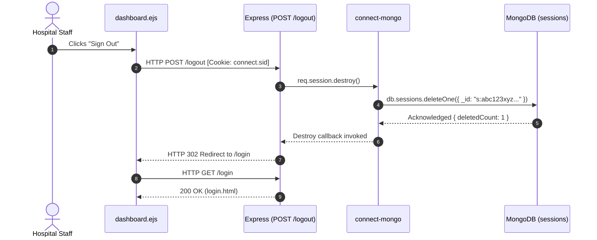
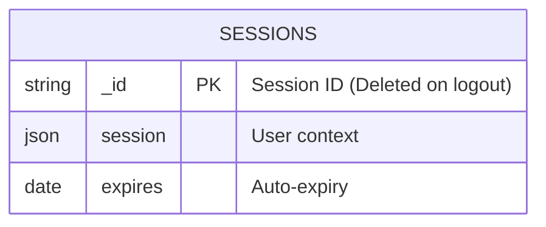
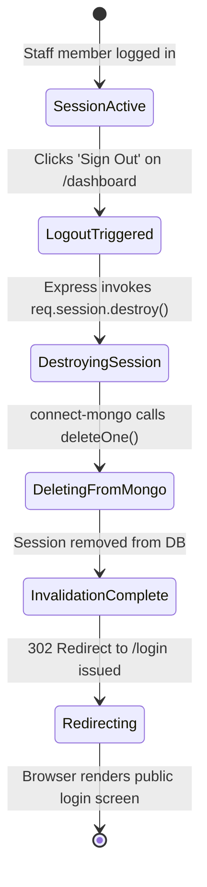

# Feature F5: Session Termination & Logout

```mermaid
flowchart TD
    subgraph Browser["User Browser"]
        ClickBtn["Clicks 'Sign Out' in dashboard.ejs"]
        FormSubmit["POST /logout Form Submit"]
        NavLogin["Browser redirected to /login"]
    end

    subgraph Server["Express Server"]
        Route["POST /logout (app.js:119)"]
        Destroy["req.session.destroy(callback)"]
        Redirect["res.redirect('/login')"]
    end

    subgraph Database["MongoDB Data Tier"]
        Store["connect-mongo Store"]
        SessCol[("Collection: sessions")]
    end

    ClickBtn --> FormSubmit --> Route
    Route --> Destroy
    Destroy --> Store
    Store -->|deleteOne({ _id: sessionId })| SessCol
    SessCol -->|Deletion Confirmed| Store
    Store --> Destroy
    Destroy --> Redirect --> NavLogin
```

---

## 1. Overview & User-Facing Behavior

Feature **F5** guarantees immediate, server-enforced session termination. In healthcare and hospital environments, clinician workstations are shared among nursing staff, physicians, and lab technicians. When an employee finishes their session:
1. They click the "Sign Out" button on the dashboard.
2. The browser submits an HTTP POST request to `/logout`.
3. The server executes `req.session.destroy()`, commanding `connect-mongo` to delete the session document directly from the MongoDB `sessions` collection.
4. The server redirects the user back to `/login`. Even if an attacker recovers the old `connect.sid` cookie, the backend rejects it because the underlying database record no longer exists.

---

## 2. Code Trace & Function Level Reference

| Hop | File & Location | Function / Construct | Parameters | Return Value | Purpose |
| :--- | :--- | :--- | :--- | :--- | :--- |
| **Logout Button** | [`dashboard.ejs:96-98`](file:///Users/avishjain/avishjain9-repos/54-login-auth-portal/dashboard.ejs#L96-L98) | `<form action="/logout" method="POST">` | Form submit event | Form POST | Submits POST request to server to initiate session revocation. |
| **Logout Endpoint** | [`app.js:119`](file:///Users/avishjain/avishjain9-repos/54-login-auth-portal/app.js#L119) | `app.post('/logout', (req, res) => ...)` | `req`, `res` | Void | Express POST handler coordinating session invalidation and redirection. |
| **Session Invalidation**| [`app.js:120`](file:///Users/avishjain/avishjain9-repos/54-login-auth-portal/app.js#L120) | `req.session.destroy(() => ...)` | Invalidation callback | Void | Deletes current session state from `MongoStore` and server context. |
| **DB Delete** | Internal `connect-mongo` | `collection.deleteOne({ _id: sid })` | Session ID | Promise | Permanently deletes session record from MongoDB `sessions` collection. |
| **Redirect** | [`app.js:121`](file:///Users/avishjain/avishjain9-repos/54-login-auth-portal/app.js#L121) | `res.redirect('/login')` | `'/login'` | Void | Emits HTTP 302 Found response, sending browser back to public portal. |

---

## 3. Diagrams

### Full Request Sequence Diagram



### Data Schema Diagram



### Lifecycle State Machine



### Failure Path Diagram

```mermaid
flowchart TD
    Req[POST /logout] --> Dest[req.session.destroy()]
    Dest -->|DB Error in MongoStore| LogErr["Callback executes redirect('/login')"]
    Dest -->|Success| Redir["res.redirect('/login')"]
```

---

## 4. Edge Cases, Security & Engineering Quality

1. **HTTP Method Choice (POST vs GET)**:
   - Notice that logout is implemented as an **HTTP POST** in [`app.js:119`](file:///Users/avishjain/avishjain9-repos/54-login-auth-portal/app.js#L119) and [`dashboard.ejs:96`](file:///Users/avishjain/avishjain9-repos/54-login-auth-portal/dashboard.ejs#L96). In REST and security architecture, logout alters server state and must never be exposed as an HTTP GET endpoint. An HTTP GET logout endpoint is vulnerable to image pre-fetching and Cross-Site Request Forgery (CSRF logout attacks).
2. **Cookie Clearing (`res.clearCookie`)**:
   - In [`app.js:120-122`](file:///Users/avishjain/avishjain9-repos/54-login-auth-portal/app.js#L120-L122), the session is destroyed in MongoDB, but `res.clearCookie('connect.sid')` is not explicitly called. While the session cannot be reused because its document is deleted from MongoDB, best practice is to explicitly clear the cookie in the client browser as well.
3. **Session Replay Immunity**:
   - Because session validity requires an active document in MongoDB, session replaying is completely prevented once `destroy()` succeeds.

---

## 5. Say It Out Loud

> In a hospital environment with shared clinician computers, the logout feature is a critical compliance and security safeguard. When a staff member clicks the "Sign Out" button on the dashboard, their browser initiates an HTTP POST request to `/logout`.
>
> On the backend, my route handler calls `req.session.destroy()`. Because I integrated `connect-mongo`, this doesn't just clear an in-memory object; it immediately dispatches a `deleteOne` command to MongoDB, wiping that session document out of the `sessions` collection permanently. Once MongoDB confirms the deletion, the callback fires and issues a three-zero-two redirect back to `/login`.
>
> An important architectural detail is that I implemented logout as an HTTP POST rather than a simple GET link. Many novice developers use GET for logout, which leaves the portal open to CSRF logout attacks and aggressive browser link pre-fetching. Using POST ensures that only intentional user submissions can alter server session state.
>
> If an attacker were to somehow capture the old session cookie from a browser cache after logout, the server would reject it because the corresponding session ID in MongoDB has already been erased.
>
> If I were enhancing this in production, I would add an explicit `res.clearCookie` call in the callback to purge the cookie header from the client browser and emit an audit log entry tracking the clinician's logout event for compliance reporting.
