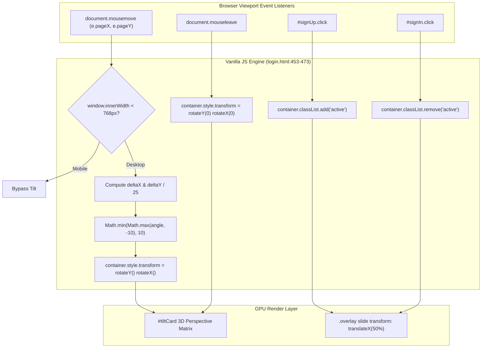
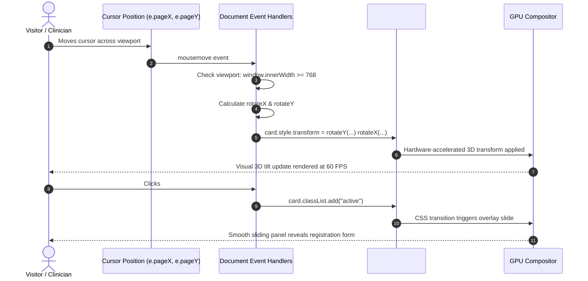
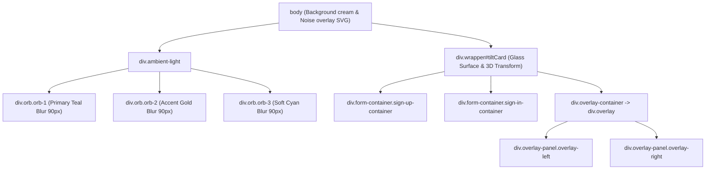
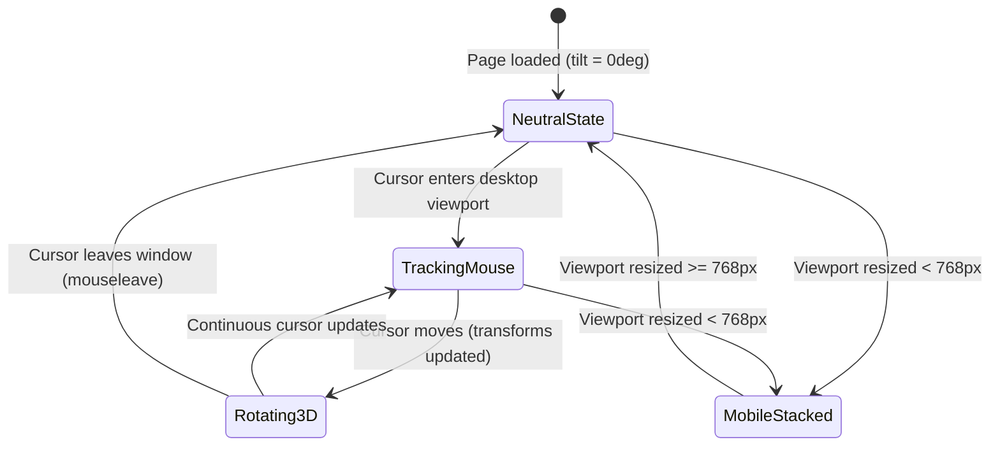
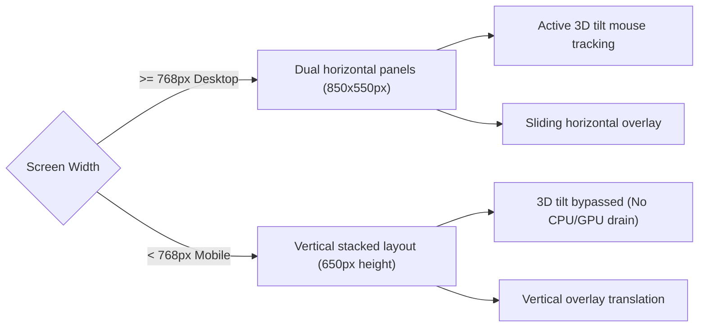

# Feature F6: Interactive 3D Tilt Card & CSS Glassmorphism

---

## 1. Overview & User-Facing Behavior

Feature **F6** provides an interface with modern visual aesthetics that sets the portal apart from traditional generic login screens:
1. **Glassmorphism Aesthetic**: Translucent cards with `backdrop-filter: blur(20px)`, subtle borders (`rgba(255, 255, 255, 0.8)`), and soft drop shadows.
2. **Ambient Particle Orbs**: Three radial gradient circular orbs with Gaussian blur filters (`filter: blur(90px)`) that float in the background via CSS keyframe animations.
3. **3D Interactive Parallax Mouse Tilt**: The authentication card dynamically tracks mouse position across the screen, rotating along the X and Y axes in response to the user's cursor.
4. **Sliding Dual-Panel Animation**: Clicking "Sign Up" or "Sign In" slides an overlay across the card with cubic-bezier timing, swapping visible forms smoothly without page reloads.
5. **Mobile Responsiveness**: Automatically disables 3D rotation and stacks panels vertically on viewport widths below 768px.

---

## 2. Code Trace & Function Level Reference

| Hop | File & Location | Function / Construct | Parameters | Return Value | Purpose |
| :--- | :--- | :--- | :--- | :--- | :--- |
| **Tilt Listener** | [`login.html:461-468`](file:///Users/avishjain/avishjain9-repos/54-login-auth-portal/login.html#L461-L468) | `document.addEventListener('mousemove', (e) => ...)` | MouseEvent `e` | Void | Computes viewport cursor offsets and updates CSS transforms on the card. |
| **Responsive Guard**| [`login.html:462`](file:///Users/avishjain/avishjain9-repos/54-login-auth-portal/login.html#L462) | `if (window.innerWidth < 768) return;` | Viewport width check | Void | Disables GPU-intensive tilt calculations on mobile and touch devices. |
| **Angle Clamping** | [`login.html:465-466`](file:///Users/avishjain/avishjain9-repos/54-login-auth-portal/login.html#L465-L466) | `Math.min(Math.max(angle, -10), 10)` | Computed angle | Clamped degree | Limits 3D perspective rotation to $\pm 10^\circ$ preventing distortion. |
| **Tilt Reset** | [`login.html:470-472`](file:///Users/avishjain/avishjain9-repos/54-login-auth-portal/login.html#L470-L472) | `document.addEventListener('mouseleave', () => ...)` | Event | Void | Smoothly returns the card to neutral rotation (`rotateY(0deg) rotateX(0deg)`). |
| **Panel Toggles** | [`login.html:458-459`](file:///Users/avishjain/avishjain9-repos/54-login-auth-portal/login.html#L458-L459) | `signUpButton.addEventListener('click', ...)` | Click event | Void | Toggles the `.active` CSS class to trigger overlay sliding animations. |

---

## 3. Diagrams

### Full Interaction Sequence Diagram

### Component Hierarchy & Styling Tree

### Lifecycle State Machine

### Fallback & Responsive Breakpoint Diagram

---

## 4. Edge Cases, Security & Engineering Quality

1. **GPU Acceleration & Jitter Prevention**:
   - The tilt card uses `transform-style: preserve-3d` and `perspective: 1000px` on the body. Applying transforms directly on the card ensures that the browser uses the GPU compositing thread rather than triggering expensive layout reflows.
2. **Mobile Touch Guard**:
   - Touch devices do not emit standard continuous `mousemove` coordinates and tilt transforms can interfere with finger scrolling. The breakpoint guard `if (window.innerWidth < 768) return;` prevents broken gestures on mobile.
3. **Floating Point Overflow / Rapid Mouse Movements**:
   - Clamping with `Math.min(Math.max(angle, -10), 10)` guarantees the card never flips past $10^\circ$, maintaining readability and preventing input distortion.

---

## 5. Say It Out Loud

> For the user interface, I wanted something that would immediately impress users and feel modern, rather than looking like another generic bootstrap form. I designed an interactive glassmorphic authentication card with pure CSS and vanilla JavaScript.
>
> In the background, three ambient gradient orbs float with a ninety-pixel blur, giving the screen depth. The card itself uses backdrop filters to create a frosted glass aesthetic with subtle light borders.
>
> To make the card feel alive, I wrote a custom 3D mouse parallax tilt engine in vanilla JavaScript. As the user moves their cursor across the screen, the listener calculates the mouse offset relative to the viewport center, divides it by twenty-five, and clamps the angle between negative ten and positive ten degrees. Then it applies a three-D rotateY and rotateX transform directly to the card container on the GPU compositing thread.
>
> When the user clicks sign up, an event listener toggles the active class, which triggers hardware-accelerated CSS transforms to smoothly slide the overlay and switch between the login and registration forms.
>
> On screens below seven hundred sixty-eight pixels, the script automatically shuts off the mouse tracking to prevent touch scrolling issues and stacks the layout vertically.
>
> I deliberately avoided importing React or external animation libraries like Three.js or GSAP here. Writing it in vanilla JavaScript keeps our client payload completely lightweight and ensures instantaneous page loading.
