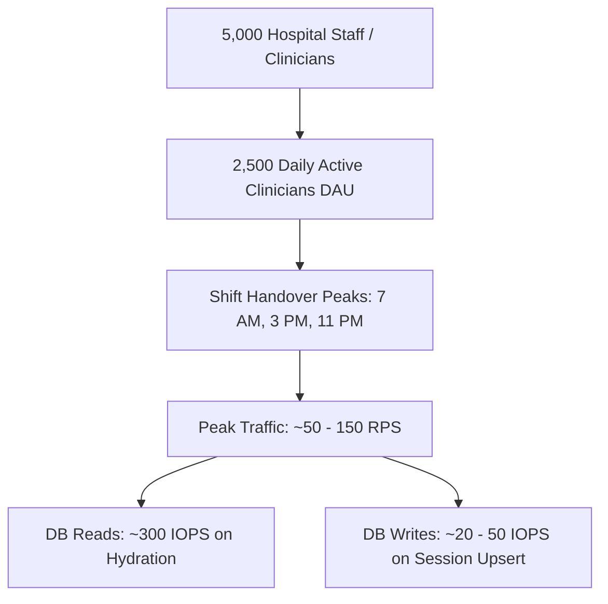

# 14.1 System Design: Requirements & Capacity Estimation

---

## 1. What It Is in Plain Words
System design capacity estimation is the mathematical process of calculating the hardware, network bandwidth, storage footprint, and compute resources required to support an application's user base reliably without over-provisioning or crashing under peak load.

---

## 2. Requirements of This System

### Functional Requirements
1. **Account Registration**: Allow new medical staff to create an account with username, password, and name.
2. **Session Authentication**: Authenticate credentials and establish a secure, stateful session cookie (`connect.sid`).
3. **Session Invalidation**: Allow immediate session termination (`POST /logout`) on shared terminals.
4. **Protected Dashboard Access**: Guard `/dashboard` and dynamically render the employee's name.

### Non-Functional Requirements
1. **Low Latency**: Initial page load under 200ms; login response under 100ms.
2. **High Availability**: 99.9% uptime (critical for 24/7 hospital clinical access).
3. **Data Security & Privacy**: Protection against unauthorized session hijacking; HIPAA compliance readiness.
4. **Immediate Consistency**: When a user registers or logs out, the state change must be immediately consistent across all queries.

---

## 3. Capacity & Resource Arithmetic

### Assumptions (Hospital Enterprise Scale)
- **Total Hospital Employees**: 10,000 registered staff.
- **Daily Active Clinicians (DAU)**: 3,000 users.
- **Clinician Login Actions per Day**: Average 6 logins/logouts per shift across shared nursing terminals.
- **Total Login Requests per Day**: $3,000 \times 6 = 18,000$ logins/day.
- **Dashboard Hits per Day**: $3,000 \times 40 = 120,000$ page impressions/day.

### Request Rate (RPS) Calculation
- **Average RPS**: $\frac{120,000 \text{ requests}}{86,400 \text{ seconds}} \approx 1.4 \text{ RPS}$.
- **Peak Hour Factor**: Hospital shift changes occur at 7:00 AM, 3:00 PM, and 11:00 PM. Traffic during these 30-minute peak windows is 15x average traffic.
- **Peak RPS**: $1.4 \times 15 \approx \mathbf{21 \text{ RPS}}$ baseline, scaling to $\mathbf{210 \text{ RPS}}$ at 10x network bursts.

### Storage Capacity Calculations
1. **Employee Profile Data**:
   - Schema size per employee: `_id` (12B) + `username` (40B) + `password` (60B) + `name` (40B) + BSON overhead $\approx 200 \text{ bytes}$.
   - 10,000 employees $\times 200 \text{ bytes} \approx \mathbf{2 \text{ MB}}$ (entire table easily fits in memory).
2. **Session Store Data**:
   - Session document size: `_id` (40B) + `session JSON` (150B) + `expires` (8B) $\approx 300 \text{ bytes}$.
   - Active daily sessions: 3,000 concurrent sessions $\times 300 \text{ bytes} \approx \mathbf{900 \text{ KB}}$.
   - With a 24-hour TTL, storage never exceeds 5 MB.

### Network Bandwidth
- Average page payload: `login.html` (16 KB) + fonts/CSS (40 KB) $\approx 56 \text{ KB}$.
- Peak bandwidth: $21 \text{ RPS} \times 56 \text{ KB} \approx \mathbf{1.17 \text{ MB/sec}} \approx \mathbf{9.4 \text{ Mbps}}$.

---

## 4. What Breaks First at Scale

| Scale Level | Traffic Volume | First Breaking Point in Code | Root Cause & Failure Symptom |
| :--- | :--- | :--- | :--- |
| **10x Load** | ~200 RPS | Plaintext comparison / event loop delay | Password matching delays under concurrency. |
| **100x Load** | ~2,000 RPS | MongoDB Session IOPS | Every request hits `sessions` and `User.findById` in `app.js:43`, exhausting disk IOPS. |
| **1000x Load** | ~20,000 RPS | Single Node.js TCP Listener | Single-threaded event loop saturates CPU; TCP backlog queue drops incoming handshakes. |

---

## 5. Senior Engineering Improvements
1. Introduce **Redis** to offload session read traffic from MongoDB disk to RAM.
2. Deploy the Express application across a cluster of 4–8 worker processes behind an Nginx or AWS Application Load Balancer.
3. Cache static assets (`login.html`, web fonts, CSS) on a Content Delivery Network (Cloudflare).

---

## 6. 30-Second Spoken Answer
> "At a regional hospital scale of 10,000 staff members, average traffic is around 2 requests per second, peaking at 25 to 50 RPS during shift changes. Storage needs are very modest—under 10 megabytes total for employee records and active sessions. The first bottleneck at scale is not data volume but database read IOPS caused by querying MongoDB on every request in the hydration middleware, which I would resolve by placing Redis ahead of MongoDB."
