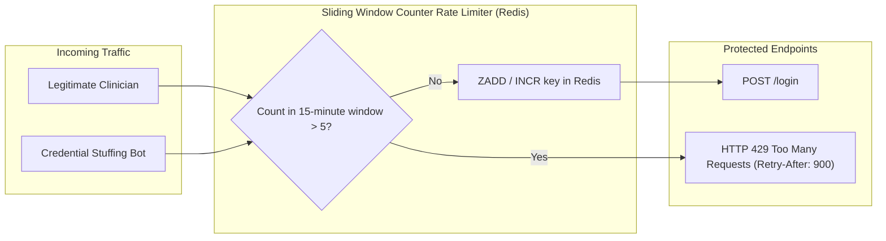

# 14.10 System Design: API Design & Distributed Rate Limiting



---

## 1. What It Is in Plain Words
API design defines the conventions, resource hierarchies, and status codes used for software communication. Rate limiting controls the rate of traffic sent or received by an endpoint to prevent abuse, brute-force password guessing, and Denial of Service (DoS).

---

## 2. Whether and How THIS Project Uses It
- **API Style**: Server-rendered form submissions using standard HTTP POST and GET redirects.
- **Rate Limiting**: Currently **Not Implemented** in the codebase. Any client can submit unlimited login or signup attempts in rapid succession.

---

## 3. Rate Limiting Algorithms Comparison Table

| Algorithm | How It Works | Memory Overhead | Accuracy | Traffic Smoothing | Fit for This Auth Portal |
| :--- | :--- | :--- | :--- | :--- | :--- |
| **Token Bucket** | Tokens added to bucket at fixed rate; request consumes token | Low (Stores count + timestamp) | High | Allows controlled bursts | **Excellent for general API traffic** |
| **Leaky Bucket** | Requests queue and leak out at constant rate | Low | High | Enforces smooth output rate | Good for data exports |
| **Fixed Window Counter** | Resets counter at boundary of time window (e.g. top of hour) | Lowest | Low (Boundary burst double-spend) | Poor | Vulnerable to boundary spikes |
| **Sliding Window Log** | Stores timestamp of every request in sorted set | High (Memory scales with request count) | 100% Exact | Excellent | Memory-intensive |
| **Sliding Window Counter (Chosen)**| Combines previous window weight with current counter | Low (Two counters per key) | ~99% Exact | Smooth | **Optimal for brute-force login defense** |

---

## 4. Rate Limiting Architecture for Hospital Authentication
1. **Per-IP Rate Limiting**: Limit anonymous IP addresses to 30 requests per minute on public pages to prevent scraping.
2. **Per-Account Brute Force Defense**: Limit failed login attempts for a specific `username` to **5 attempts per 15 minutes**.
3. **Storage Engine**: Rate counters must reside in **Redis** rather than Node process memory so rate limits are enforced uniformly across all clustered server instances.
4. **HTTP 429 Response Headers**:
   ```http
   HTTP/1.1 429 Too Many Requests
   Retry-After: 900
   X-RateLimit-Limit: 5
   X-RateLimit-Remaining: 0
   X-RateLimit-Reset: 1792915800
   ```

---

## 5. What Breaks First at Scale
- **10x Load**: Handled without rate limiting.
- **100x Load**: A single attacker running Hydra or Burp Suite can issue 500 requests/sec, driving database CPU to 100% and locking out legitimate hospital staff.
- **1000x Load**: Un-rate-limited traffic exhausts TCP connection sockets.

---

## 6. Senior Engineering Improvements
Implement `express-rate-limit` backed by `rate-limit-redis`. Mount stricter rate limits specifically on `POST /login` and `POST /signup`.

---

## 7. 30-Second Spoken Answer
> "Right now, the portal does not enforce rate limiting, leaving it open to credential stuffing. In production, I would install a Sliding Window Counter rate limiter using Redis. We would restrict login attempts to five per fifteen minutes per account. If exceeded, the server responds with HTTP 429 Too Many Requests, protecting clinician accounts from automated dictionary attacks."
