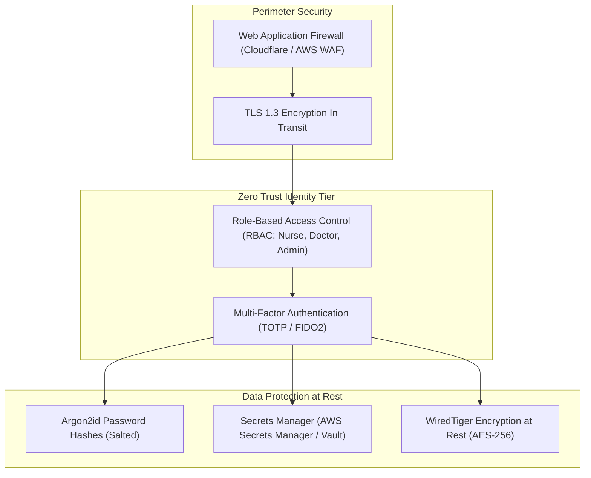

# 14.11 System Design: Enterprise Security Architecture & Zero Trust

---

## 1. What It Is in Plain Words
Security architecture is the systematic design of defensive barriers, cryptographic protections, access controls, and data segregation policies to protect sensitive systems and patient records from unauthorized access, insider threats, and external cyberattacks.

---

## 2. Whether and How THIS Project Uses It
- **Authentication**: Stateful sessions using signed HMAC cookies stored in MongoDB.
- **Route Authorization**: Strict route guard on `/dashboard` checking `req.session.userId`.
- **Gaps**: Missing TLS enforcement, hardcoded session secret, plaintext password storage, missing multi-factor authentication, and missing HIPAA audit logs.

---

## 3. Enterprise Authentication Architectures Comparison

| Architecture | Paradigm | Token/Credential Lifetime | Revocation Speed | Best Use Case | Fit for This Hospital Portal |
| :--- | :--- | :--- | :--- | :--- | :--- |
| **Stateful Sessions (Chosen)** | **Server DB validation** | **Short (e.g. 24h) + Sliding** | **Immediate (Delete DB row)** | **Shared internal workstations, strict compliance** | **Optimal** |
| **Stateless JWT** | Client-held signed token | Fixed (15m access, 7d refresh) | Delayed until expiry | Public consumer mobile apps | Poor for shared clinical terminals |
| **SAML 2.0 / Okta SSO** | XML assertion via IdP | Managed by hospital IdP | Centralized across hospital | Enterprise enterprise federation | Excellent for hospital-wide SSO |
| **FIDO2 / WebAuthn (Passkeys)**| Hardware cryptographic key | Session-based | Hardware-enforced | Zero-phishing authentication | Recommended for doctor login |

---

## 4. Healthcare Compliance & HIPAA Security Rule Alignment
1. **Access Control (§ 164.312(a)(1))**:
   - Enforce automatic session logout after 15 minutes of inactivity on shared medical terminals.
2. **Audit Controls (§ 164.312(b))**:
   - Every login attempt, failed credential verification, registration, and logout must write an immutable audit log containing timestamp, actor ID, client IP, and action status.
3. **Transmission Security (§ 164.312(e)(1))**:
   - Enforce HTTPS across all routes with HTTP Strict Transport Security (HSTS) headers: `max-age=31536000; includeSubDomains`.

---

## 5. What Breaks First at Scale
- **10x Load**: Handled fine.
- **100x Load**: Plaintext passwords present an unacceptable compliance liability during security audits.
- **1000x Load**: Distributed credential attacks require automated Web Application Firewall (WAF) rule sets at the edge.

---

## 6. Senior Engineering Improvements
1. Upgrade credential persistence to **Argon2id**.
2. Mount **`helmet`** to inject security headers (CSP, HSTS, X-Content-Type-Options).
3. Integrate hospital Active Directory or LDAP via SAML/OAuth2 for enterprise Single Sign-On (SSO).

---

## 7. 30-Second Spoken Answer
> "In a healthcare setting, security architecture must align with HIPAA and Zero Trust principles. While our prototype uses stateful MongoDB sessions for immediate access revocation, a production release requires encrypting data at rest with AES-256, hashing credentials with Argon2, enforcing TLS 1.3 with HSTS, and integrating hospital Active Directory through SAML or OAuth2."
