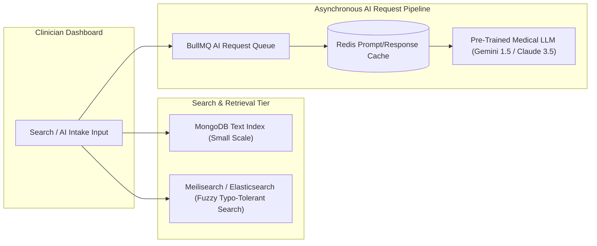

# 14.12 System Design: Search Systems & AI Request Pipelines

---

## 1. What It Is in Plain Words
Search architecture deals with retrieving relevant records across massive textual databases using inverted indexes, stemming, and fuzzy matching. AI architecture manages how user prompts are structured, queued, cached, filtered, and sent to LLM inference engines with strict cost and latency controls.

---

## 2. Whether and How THIS Project Uses It
In the current codebase:
- **Search**: **Not Used**. User queries are point lookups (`User.findOne({ username })`).
- **AI Integration**: **Not Used**. No machine learning models or generative AI APIs are called.
- **Reasoning**: An authentication portal requires exact string matching for credentials, where fuzzy search or non-deterministic AI generation would introduce security flaws [CONFIRM WITH DEVELOPER].

---

## 3. Search Engine Technologies Comparison

| Technology | Index Structure | Latency | Typo Tolerance | Operational Complexity | Fit for This Portal |
| :--- | :--- | :--- | :--- | :--- | :--- |
| **MongoDB Text Index** | **B-Tree Text Index** | **~10–20ms** | **Basic stemming** | **Zero (Built into existing MongoDB)** | **Sufficient for staff directory** |
| **Meilisearch** | Inverted Index in Rust | <5ms | Excellent typo tolerance | Low (Single binary) | Recommended for clinical patient lookup |
| **Elasticsearch** | Lucene Inverted Index | ~10ms | Advanced NLP | Very High (JVM cluster) | Overkill for basic staff directory |
| **Algolia** | Hosted SaaS Index | <10ms | World-class | Managed SaaS | Prohibitive cost and third-party data privacy risks |

---

## 4. AI Pipeline Architecture for Healthcare
If adding clinical triage or diagnostic assistance:
1. **Prompt Sanitization & De-Identification**: Filter out direct patient identifiers (names, Social Security numbers) to comply with HIPAA Safe Harbor de-identification rules.
2. **Semantic Caching with Redis**: If two clinicians submit identical symptom queries (e.g. standard fever dosages), serve the cached response from Redis in 2ms, avoiding expensive model inference costs and API token usage.
3. **Queue-Based Rate Leveling**: Route requests through a Redis queue (BullMQ) to prevent exceeding cloud provider rate limits (TPM / RPM).

---

## 5. What Breaks First at Scale
- **10x Load**: Handled fine.
- **100x Load**: Un-cached AI calls would hit external provider rate limits, returning HTTP 429 errors to doctors.
- **1000x Load**: Synchronous AI requests freeze Express worker threads while awaiting LLM tokens.

---

## 6. Senior Engineering Improvements
Deploy **Meilisearch** for instant staff directory and patient record lookups; implement a queued AI request pipeline with Redis semantic caching and streaming responses via Server-Sent Events (SSE).

---

## 7. 30-Second Spoken Answer
> "Currently, the portal relies on exact MongoDB queries rather than fuzzy search or AI models. If we expand into clinical patient search, I would integrate Meilisearch for typo-tolerant, sub-five-millisecond lookups. For AI assistance, I would build an asynchronous pipeline using BullMQ to queue inference requests, cache repeated medical queries in Redis, and stream tokens to the UI using Server-Sent Events."
