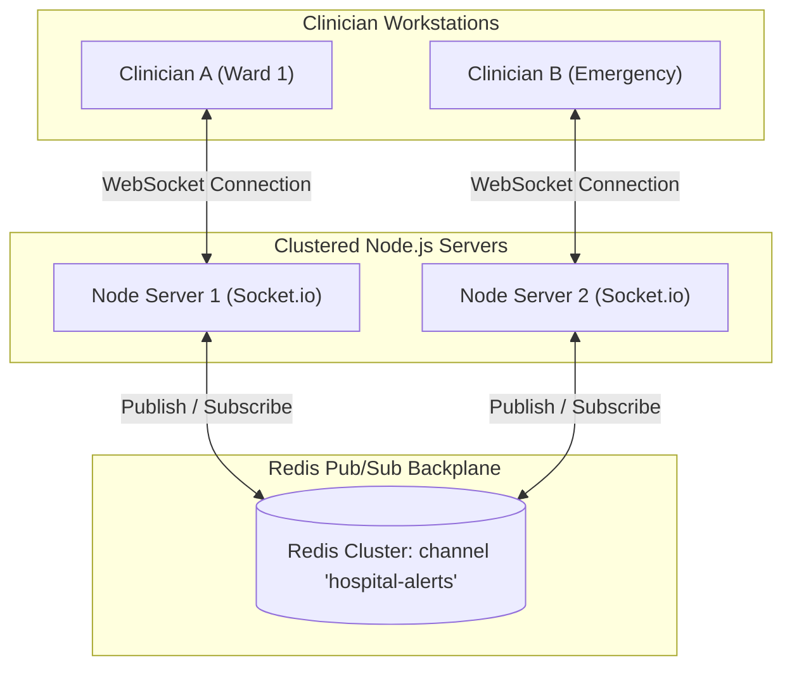

# 14.13 System Design: Real-Time Systems & Transports

---

## 1. What It Is in Plain Words
Real-time architecture enables instant, low-latency data push from the server to client browsers without requiring the client to repeatedly refresh or poll the server.

---

## 2. Whether and How THIS Project Uses It
In the current code, real-time protocols are **Not Used**. 
Communication is strictly request-response over standard HTTP GET and POST. For an authentication gateway, real-time transports are unnecessary. However, if the portal expands to deliver emergency alerts (e.g. *"Code Blue"* alerts to doctor dashboards), a real-time transport is required [CONFIRM WITH DEVELOPER].

---

## 3. Real-Time Communication Protocols Comparison

| Protocol | Handshake | Directionality | Transport | Connection Overhead | Reconnection / Heartbeat | Fit for Hospital Dashboards |
| :--- | :--- | :--- | :--- | :--- | :--- | :--- |
| **Server-Sent Events (SSE)** | HTTP GET | **Server-to-Client Only** | **HTTP/1.1 or HTTP/2**| **Low (Native browser EventSource)**| **Built-in browser auto-reconnect** | **Optimal for unidirectional emergency alerts** |
| **WebSocket (Socket.io)** | HTTP 101 Upgrade | Full-Duplex Bi-directional | TCP Socket | Medium (Maintains persistent connection) | Requires heartbeat logic | Optimal for real-time doctor-nurse chat |
| **Short Polling** | Standard HTTP | Client-driven | HTTP | High (Repeated TCP handshakes) | N/A | Inefficient; wastes server CPU |
| **Long Polling** | Hanging HTTP | Client-driven response | HTTP | High (Holds open connection, re-establishes) | Handled by application | Legacy fallback only |

---

## 4. Multi-Server Scaling with a Redis Backplane
If a WebSocket or SSE server is scaled horizontally across multiple Node.js instances:
- Doctor A is connected to Node Server 1.
- Doctor B is connected to Node Server 2.
- If Server 1 broadcasts an emergency alert, Server 2 would not know unless a shared message bus connects them.
- **Solution**: Use the **Redis Pub/Sub Adapter** (`@socket.io/redis-adapter`). When an alert is emitted, Server 1 publishes the event to Redis, which broadcasts it to all other Node instances, delivering the message to all connected hospital terminals simultaneously.

---

## 5. What Breaks First at Scale
- **10x Load**: Standard HTTP handles traffic easily.
- **100x Load**: Polling for updates exhausts database connections.
- **1000x Load**: 50,000 idle WebSocket connections consume file descriptors (`ulimit -n`) and RAM on server nodes.

---

## 6. Senior Engineering Improvements
Implement **Server-Sent Events (SSE)** on `/dashboard/alerts` for lightweight, one-way clinical emergency broadcasts; use WebSockets with a Redis Pub/Sub backplane if bi-directional clinical chat is required.

---

## 7. 30-Second Spoken Answer
> "While our authentication portal uses standard HTTP request-response, expanding into clinical alerts requires real-time push. I would choose Server-Sent Events over WebSockets for hospital broadcasts because SSE runs over standard HTTP, uses native browser auto-reconnection, and avoids bi-directional socket overhead. To scale across clustered servers, I would connect them using a Redis Pub/Sub backplane."
