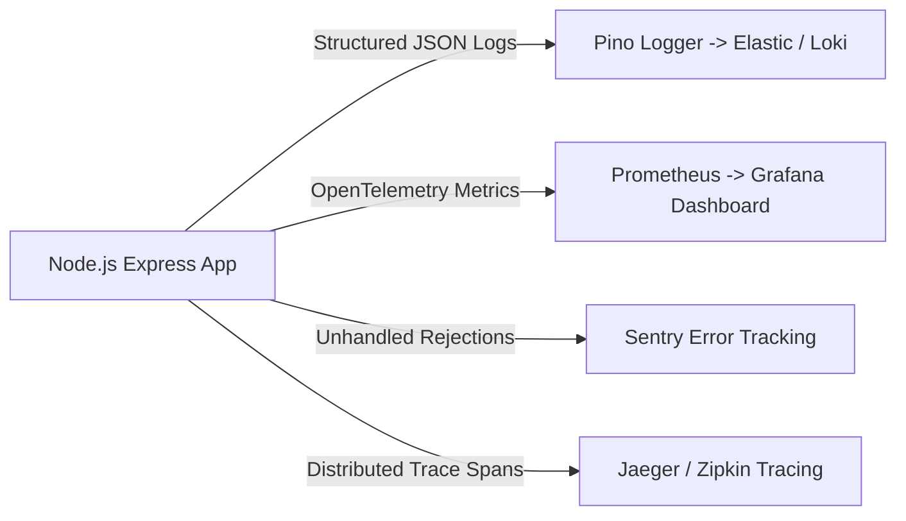

# 14.14 System Design: Observability & Telemetry

---

## 1. What It Is in Plain Words
Observability is the ability to understand the internal state of a software system based solely on the data it exports externally—comprising the Three Pillars: **Logs** (what happened), **Metrics** (how much / how fast), and **Traces** (where time was spent across hops).

---

## 2. Whether and How THIS Project Uses It
Currently, observability is **Minimally Implemented**:
- Simple `console.log` and `console.error` calls are used for connection messages and caught exceptions ([`app.js:14,83,105`](file:///Users/avishjain/avishjain9-repos/54-login-auth-portal/app.js#L14)).
- **Gaps**: No structured JSON formatting, no metric counters, no error tracking SDK (Sentry), and no distributed correlation IDs.

---

## 3. Telemetry Pillars & Tools Comparison Table

| Pillar | Purpose | Selected Tool | Alternative Tool | Comparison & Fit |
| :--- | :--- | :--- | :--- | :--- |
| **Structured Logging** | Event auditing with timestamps and context | **Pino (JSON)** | Winston | Pino is 5x faster than Winston with minimal event loop latency |
| **Metrics Collection** | Real-time RPS, event loop lag, memory, error rates | **Prometheus + prom-client** | Datadog | Prometheus is self-hostable on-premise without cloud data egress costs |
| **Metrics Visualization**| Visual operational dashboards and alerts | **Grafana** | AWS CloudWatch | Grafana provides customizable dashboards for hospital IT teams |
| **Error Tracking** | Capturing stack traces and breadcrumbs | **Sentry** | Bugsnag | Sentry groups duplicate errors and alerts on-call engineers instantly |
| **Distributed Tracing** | Tracking request duration across middleware and DB | **OpenTelemetry + Jaeger** | AWS X-Ray | Vendor-neutral industry standard for distributed span telemetry |

---

## 4. Key Performance Indicators (KPIs) & Golden Signals
1. **Latency**: p50, p95, and p99 response times on `/login` and `/dashboard`.
2. **Traffic**: Requests per second (RPS) broken down by route.
3. **Errors**: HTTP 5xx rate and failed login ratios.
4. **Saturation**: Node.js event loop lag (must remain under 20ms) and MongoDB active connection pool utilization.

---

## 5. What Breaks First at Scale
- **10x Load**: Terminal console logs scroll rapidly, making manual debugging impossible.
- **100x Load**: Synchronous `console.log` blocks the event loop under heavy concurrent throughput.
- **1000x Load**: Lack of correlation IDs prevents tracing which specific database query caused a timeout spike.

---

## 6. Senior Engineering Improvements
1. Replace `console.log` with **Pino** structured logging.
2. Inject a **Correlation ID** (`X-Correlation-ID`) on every incoming request using a UUID middleware.
3. Expose `/metrics` using `prom-client` and configure Grafana alerting for p99 latency exceeding 500ms.

---

## 7. 30-Second Spoken Answer
> "Right now, the prototype uses basic console logging. In production, I would establish the three pillars of observability: asynchronous structured JSON logging with Pino, Prometheus metrics tracking the four Golden Signals—latency, traffic, errors, and saturation—and Sentry for stack trace alerts. Every request would receive a unique correlation ID to trace issues across middleware and MongoDB queries."
