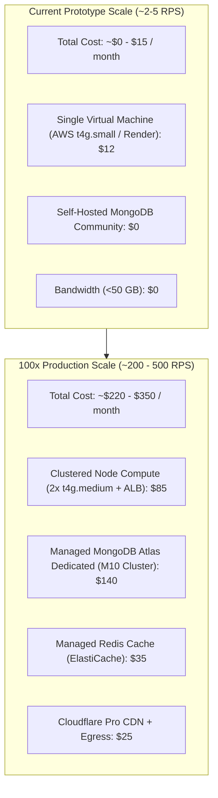

# 14.16 System Design: Cloud Cost Modeling & Trade-offs

---

## 1. What It Is in Plain Words
Cloud financial engineering (FinOps) models the operational costs (compute instances, database storage, egress bandwidth, caching tiers, and third-party APIs) required to run an application at different traffic scales, ensuring infrastructure costs scale linearly with business growth rather than exponentially.

---

## 2. Monthly Cost Breakdown: Current vs 100x Scale

### Current Scale (Local / Single Small Cloud Instance)
- **Application Hosting**: 1x AWS `t4g.small` (2 vCPU, 2 GB RAM, ARM64 Graviton) $\approx \mathbf{\$12.26 / \text{month}}$.
- **Database**: Local standalone MongoDB community edition running on the same host $\approx \mathbf{\$0.00}$.
- **Bandwidth**: Under 50 GB/month included in standard cloud free tier $\approx \mathbf{\$0.00}$.
- **Total Monthly Cost at Baseline**: $\approx \mathbf{\$12.26 / \text{month}}$.

### 100x Production Scale (~250 RPS Peak, 50,000 Hospital Clinicians)
- **Application Tier**: 2x AWS `t4g.medium` instances (2 vCPU, 4 GB RAM) across 2 Availability Zones $\approx \mathbf{\$49.00 / \text{month}}$.
- **Load Balancer**: AWS Application Load Balancer (ALB) $\approx \mathbf{\$22.50 / \text{month}}$.
- **Managed Database Tier**: MongoDB Atlas M10 Dedicated Replica Set (3 nodes, 10 GB storage, automated daily backups) $\approx \mathbf{\$140.00 / \text{month}}$.
- **Caching Tier**: AWS ElastiCache for Redis (`cache.t4g.micro`) $\approx \mathbf{\$15.00 / \text{month}}$.
- **CDN & Security**: Cloudflare Pro plan (DDoS defense, Web Application Firewall, edge caching) $\approx \mathbf{\$20.00 / \text{month}}$.
- **Outbound Data Transfer (Egress)**: 300 GB @ $0.09/GB $\approx \mathbf{\$27.00 / \text{month}}$.
- **Total Monthly Cost at 100x Scale**: $\approx \mathbf{\$273.50 / \text{month}}$.

---

## 3. Build vs Buy Analysis: Authentication & Identity

| Dimension | Build In-House (This Project) | Buy Managed Auth (Auth0 / Okta / Clerk) |
| :--- | :--- | :--- |
| **Monthly Cost (10,000 users)** | **~$0 extra (Runs on existing database infrastructure)** | **$250 – $800+ / month** (Billed per Monthly Active User) |
| **Data Privacy & HIPAA** | **100% On-Premise Control** (PHI stays inside hospital firewalls) | Third-party cloud vendor risks; requires enterprise BAA contracts |
| **Customization Flexibility** | Infinite (Custom EJS templates, bespoke 3D parallax tilt) | Constrained to vendor-hosted login widgets |
| **Maintenance Overhead** | Team is responsible for password hashing, rate limiting, patches | Vendor manages security updates and MFA |

---

## 4. Vendor Lock-In & Exit Strategy
1. **Database Layer**: We use standard open-source MongoDB APIs via Mongoose. The database can be hosted on AWS DocumentDB, Google Cloud, MongoDB Atlas, or self-hosted bare metal servers without changing a single line of application code.
2. **Compute Layer**: Containerizing the Node app via Docker ensures it runs identically on AWS ECS, Google Cloud Run, Kubernetes, or on-premise hospital VMware virtual machines.

---

## 5. 30-Second Spoken Answer
> "At our current scale, the application runs for under fifteen dollars a month on a single small virtual machine. Even scaling up one hundred times to support fifty thousand clinicians across a hospital network, total infrastructure costs remain under three hundred dollars a month using a managed MongoDB replica set and clustered ARM instances. Building our own auth portal rather than buying Auth0 saves thousands of dollars annually while keeping clinician data entirely within hospital firewalls."
