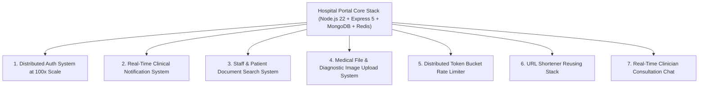
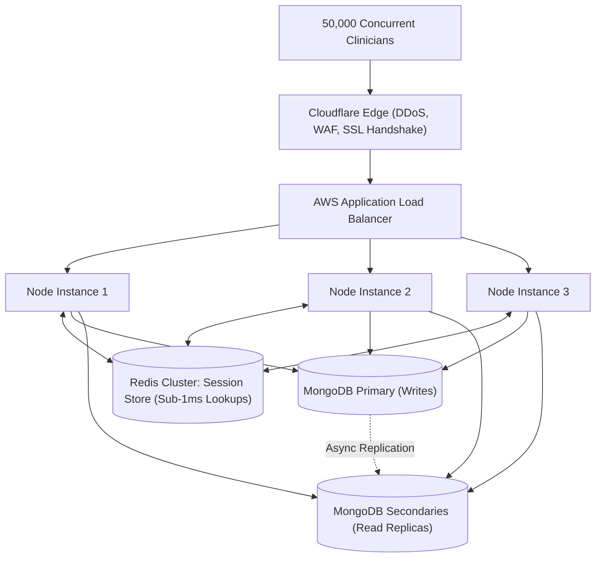
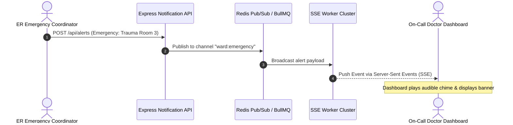
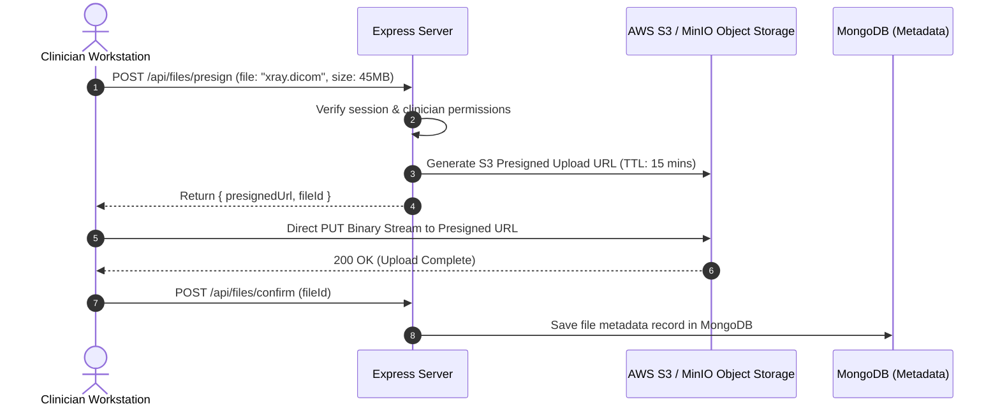
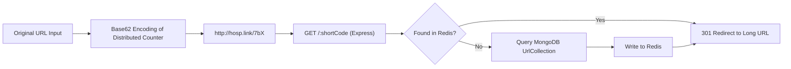
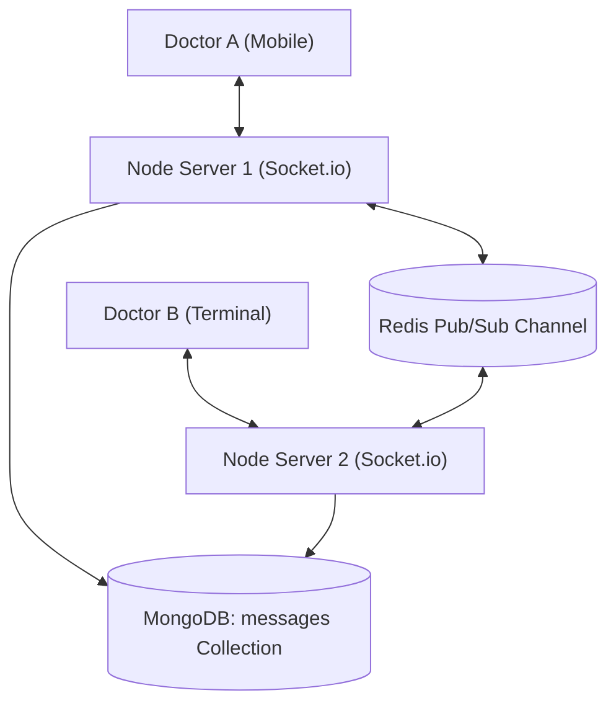

# 14.17 System Design: Classic Problems Applied to This Stack

---

## 1. Problem 1: Design This Authentication System at 100x Scale

### Requirements & Capacity
- **Scale**: 50,000 concurrent hospital workers; 1,000 peak RPS during morning shift handovers.
- **Latency**: Login response under 50ms; session validation under 2ms.

### Architectural Solution
1. **Move Sessions to Redis**: Replace MongoDB session store with Redis (`connect-redis`). Read latencies drop from ~5ms to ~0.5ms.
2. **Cluster Stateless Node Workers**: Deploy containerized Node instances across multi-AZ auto-scaling groups behind an Application Load Balancer.
3. **Password Offloading**: Hash credentials using Argon2id asynchronously via libuv thread pools.

---

## 2. Problem 2: Design a Real-Time Clinical Notification System

### Requirements & Design
- Push high-priority medical alerts ("Code Blue", ICU alarm triggers) to clinician dashboards in under 500ms.
- **Implementation**: Use **Server-Sent Events (SSE)**. The clinician dashboard opens an `EventSource('/dashboard/alerts')` connection. The backend uses a Redis Pub/Sub backplane to broadcast alert payloads to all connected hospital dashboard instances.

---

## 3. Problem 3: Design a Medical File & Diagnostic Image Upload System

### Requirements & Design
- Allow clinicians to attach large diagnostic images (DICOM scans, X-rays, lab PDFs up to 100MB) without overloading the Node.js application server.
- **Implementation**: Never stream large file buffers through Node's memory. Instead, Express generates an **AWS S3 / MinIO Presigned URL**. The browser uploads the file directly to object storage via HTTP PUT. Upon completion, a lightweight confirmation request writes metadata to MongoDB.

---

## 4. Problem 4: Design a URL Shortener Reusing This Stack

### Design Details
- **Data Model**: `{ shortCode: String (Indexed), originalUrl: String, createdAt: Date }`.
- **Key Generation**: Increment an atomic Redis counter (`INCR global_url_id`) and convert the integer to **Base62** (`[0-9a-zA-Z]`). 6 characters yield $62^6 \approx 56.8 \text{ billion}$ unique URLs.
- **Redirection**: Express route `GET /:code` checks Redis first; on miss, queries MongoDB and returns an HTTP `301 Moved Permanently` with the `Location` header.

---

## 5. Problem 5: Design a Real-Time Clinician Consultation Chat

### Design Details
- **Transport**: Full-duplex WebSockets using Socket.io.
- **Horizontal Scaling**: Socket.io instances use `@socket.io/redis-adapter` for inter-server message exchange.
- **Message Persistence**: Messages are written asynchronously to a capped MongoDB collection or partitioned message collection for chat history retrieval.
