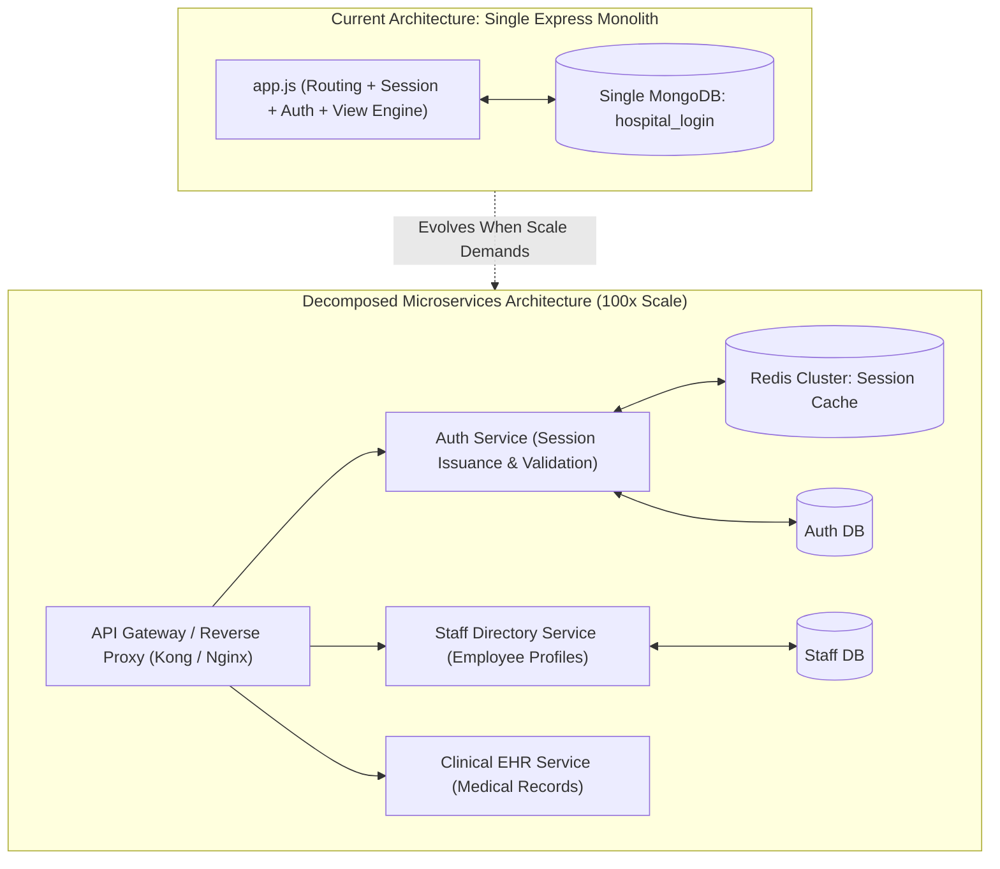

# 14.2 System Design: Architecture Styles

---

## 1. What It Is in Plain Words
An architectural style defines the overarching blueprint for organizing application logic, data ownership, and inter-process communication:
- **Monolith**: All application logic (routing, business rules, view rendering, and database queries) runs inside a single deployable process.
- **Modular Monolith**: Code is cleanly partitioned into domain modules with strict boundaries inside a single deployable artifact.
- **Microservices**: Independent, loosely-coupled services that communicate over network protocols (HTTP/gRPC) and maintain their own databases.
- **Serverless**: Event-driven ephemeral compute functions (AWS Lambda) executed on-demand.

---

## 2. Whether and How THIS Project Uses It
The portal is implemented as a **Classic Layered Monolith** in [`app.js`](file:///Users/avishjain/avishjain9-repos/54-login-auth-portal/app.js). A single Express 5 server handles static asset delivery, body parsing, session persistence, user registration, authentication logic, and dynamic EJS template rendering.

---

## 3. Comparison of Architecture Styles

| Architecture Style | Deployment Complexity | Fault Isolation | Team Autonomy | Operational Overhead | Latency Overhead | Fit for This Auth Portal |
| :--- | :--- | :--- | :--- | :--- | :--- | :--- |
| **Monolith (Chosen)** | **Minimal (Single node app.js)** | **Low (Process crash takes down all routes)** | **High for small teams** | **Zero infrastructure ops** | **Zero inter-service network hops** | **Optimal for current scope** |
| **Modular Monolith** | Low (Single deployment) | Medium (Logical isolation) | High (Clear module contracts) | Very Low | Zero network overhead | Recommended intermediate evolution |
| **Microservices** | Very High (K8s, service meshes) | High (One service failure does not crash others) | High for large teams | Massive (Distributed tracing, networking) | High (Network latency on internal RPCs) | Excessive over-engineering |
| **Serverless (Lambda)** | Medium (Cloud vendor setup) | High | Medium | Managed | Variable (Cold start penalties on auth routes) | Sub-optimal for persistent MongoDB pools |

---

## 4. Why Monolith was Chosen & Trade-offs Accepted
- **Why Chosen**: For an authentication gateway with six endpoints and one database model, microservices would introduce distributed transactions, network latency, and deployment complexity with zero business benefit [CONFIRM WITH DEVELOPER].
- **Trade-offs Accepted**: If a bug crashes the Node process, both the public login portal and the internal member dashboard become unavailable simultaneously.

---

## 5. What Breaks First at Scale
- **10x Load**: Operates smoothly within a single Node process.
- **100x Load**: A single monolithic process saturates one CPU core during concurrent user sign-ins.
- **1000x Load**: Interleaved I/O from dashboard queries competes for database connections with login requests, requiring physical service decomposition.

---

## 6. How a Senior Engineer Would Improve It
Evolve from a simple monolith into a **Modular Monolith** first:
1. Extract routing into dedicated router modules: `/routes/auth.routes.js` and `/routes/dashboard.routes.js`.
2. Extract business logic into a Service Layer: `/services/auth.service.js` and `/services/user.service.js`.
3. If expanding to a full hospital management platform, decompose the Auth Gateway into a dedicated authentication microservice that issues cryptographically verifiable identity claims to downstream clinical services.

---

## 7. 30-Second Spoken Answer
> "I built this project as a layered monolith because for an authentication portal with six routes, a monolith eliminates distributed system overhead, network serialization latency, and deployment friction. As the hospital system grows to include patient records, billing, and scheduling, I would evolve it first into a modular monolith with strict domain boundaries, and eventually extract the auth service into a dedicated identity microservice."
