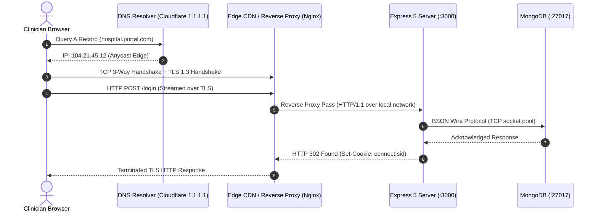

# 14.3 System Design: Networking & Protocols

---

## 1. What It Is in Plain Words
Networking in system design covers how binary data packets navigate from client browsers across public and private networks to server processes, including domain name resolution (DNS), transport protocols (TCP/UDP), encryption (TLS), application protocols (HTTP/1.1, HTTP/2, HTTP/3), and reverse proxy routing.

---

## 2. Whether and How THIS Project Uses It
- **Application Protocol**: HTTP/1.1 over standard TCP sockets via Node.js's built-in `http` module.
- **Data Serialization**: Form-encoded URL string parsing (`application/x-www-form-urlencoded`) handled by `body-parser` and HTML markup for views.
- **Database Protocol**: MongoDB Wire Protocol (a binary TCP socket protocol transmitting BSON documents over port 27017).

---

## 3. Communication Protocols Comparison Table

| Protocol | Transport | Multiplexing | Handshake Overhead | Directionality | Fit for This Project |
| :--- | :--- | :--- | :--- | :--- | :--- |
| **HTTP/1.1 (Chosen)** | **TCP** | **No (Head-of-Line Blocking)**| **1 RTT TCP + 1-2 RTT TLS** | **Client Request-Response** | **Simple, universally supported, zero config required** |
| **HTTP/2** | TCP | Yes (Single connection, multiple streams) | Same as HTTP/1.1 | Bidirectional streams | Recommended behind an Nginx reverse proxy |
| **HTTP/3 (QUIC)** | UDP | Yes (Eliminates TCP HOL blocking) | 0-RTT connection re-establishment | Bidirectional streams | Excellent for mobile clinician devices on flaky hospital Wi-Fi |
| **WebSocket** | TCP | Full-Duplex Bi-directional | Upgrades from HTTP | Persistent Bi-directional | Unnecessary for static auth forms |
| **gRPC** | HTTP/2 | High (Protobuf binary serialization) | Low | Request-Response & Streaming | Excellent for internal microservice communication |

---

## 4. Reverse Proxies & Network Perimeter
In production, a Node.js server should never be exposed directly to the public internet on port 80/443. It should sit behind a **Reverse Proxy** (such as Nginx or AWS ALB):
1. **TLS Termination**: Nginx offloads CPU-intensive TLS handshakes and certificate renewal (Let's Encrypt), freeing Node to run application logic.
2. **Slowloris & DDoS Defense**: Nginx buffers slow incoming HTTP streams, preventing malicious clients from tying up Node event loop sockets.
3. **Static File Offloading**: Nginx serves static assets (`login.html`, images, CSS) directly from disk at near-kernel speed using `sendfile`.

---

## 5. What Breaks First at Scale
- **10x Load**: HTTP/1.1 connection limits (browsers limit parallel TCP connections to 6 per domain).
- **100x Load**: SSL handshake overhead saturates single-process CPU without a reverse proxy.
- **1000x Load**: TCP connection socket exhaustion on port 3000 (`TIME_WAIT` socket states).

---

## 6. Senior Engineering Improvements
Deploy Nginx in front of Node with HTTP/2 enabled, configure TLS 1.3 with session resumption, and enable Gzip/Brotli compression on static text assets.

---

## 7. 30-Second Spoken Answer
> "Currently, the prototype uses HTTP/1.1 over Node's native HTTP module. For production deployment, I would front the application with an Nginx reverse proxy configured for TLS 1.3 and HTTP/2. This offloads SSL termination and static asset caching from Node, protects against Slowloris attacks, and reduces latency on hospital networks through HTTP/2 stream multiplexing."
