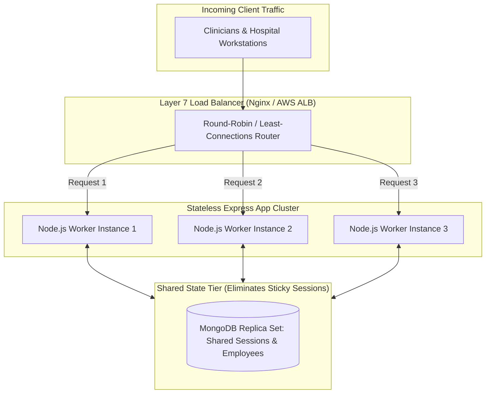

# 14.4 System Design: Load Balancing & Scalability

---

## 1. What It Is in Plain Words
Load balancing distributes incoming client requests across a pool of compute instances so that no single server becomes overwhelmed, maximizing throughput, reducing latency, and eliminating Single Points of Failure (SPOFs).

---

## 2. Whether and How THIS Project Uses It
In the local development prototype, load balancing is **Not Used**; the app runs as a single Node process (`app.listen(port)`). 
However, an architectural design choice was made: **the server is completely stateless regarding session memory**. Because sessions are stored externally in MongoDB (`connect-mongo`), multiple Express server instances can be spun up immediately behind a load balancer without requiring complex sticky sessions.

---

## 3. Load Balancing Strategy Comparison Table

| Load Balancing Algorithm | Mechanism | Pros | Cons | Fit for This Auth Portal |
| :--- | :--- | :--- | :--- | :--- |
| **Round-Robin** | Cycles sequentially through servers ($A \rightarrow B \rightarrow C$) | Simple, predictable | Ignores differences in server load | **High (All auth requests have similar compute cost)** |
| **Least Connections (Chosen)** | Routes to server with fewest active TCP connections | Adapts dynamically to traffic spikes | Requires state tracking at LB | **Recommended for production cluster** |
| **IP Hash (Sticky Sessions)**| Hashes client IP to bind to a specific server instance | Keeps state local to a server | Uneven distribution; fails on proxy IPs | **Unnecessary (Shared MongoDB session store eliminates sticky sessions)** |
| **Weighted Response Time** | Routes to fastest responding server | Optimizes latency | Complex configuration | Overkill for lightweight auth portal |

---

## 4. Single Points of Failure (SPOFs) & Remediation

| Component | Current SPOF Status | Failure Consequence | Production Elimination Strategy |
| :--- | :--- | :--- | :--- |
| **Node.js Process** | Single process on port 3000 | Process crash causes complete service outage | PM2 cluster mode or Kubernetes ReplicaSet with self-healing |
| **MongoDB Instance** | Single standalone daemon on `localhost:27017` | Database crash brings down auth and sessions | Deploy a 3-node MongoDB Replica Set (1 Primary + 2 Secondaries) |
| **Hosting Server** | Single physical/virtual machine | Machine hardware failure drops hospital access | Deploy multi-Availability Zone (AZ) auto-scaling compute groups |

---

## 5. What Breaks First at Scale
- **10x Load**: Handled without issue.
- **100x Load**: Single Node process saturates 100% CPU on SSL and template parsing; requests queue up in OS socket buffer.
- **1000x Load**: Load balancer saturates network interface bandwidth; database connection pool limits reached.

---

## 6. Senior Engineering Improvements
1. Use **PM2** or **Kubernetes** to run 1 Node process per available CPU core.
2. Place an **AWS Application Load Balancer (ALB)** or **Nginx** in front using the *Least Connections* algorithm.
3. Configure health checks (`GET /health`) so the load balancer automatically removes unhealthy instances.

---

## 7. 30-Second Spoken Answer
> "Because I stored sessions in MongoDB using `connect-mongo` rather than in-memory RAM, our application servers are stateless. That means we don't need sticky sessions. We can place an Nginx or AWS load balancer in front and distribute traffic using Least Connections across any number of Node.js worker processes. If any worker crashes, health checks remove it instantly while clinicians stay logged in seamlessly."
