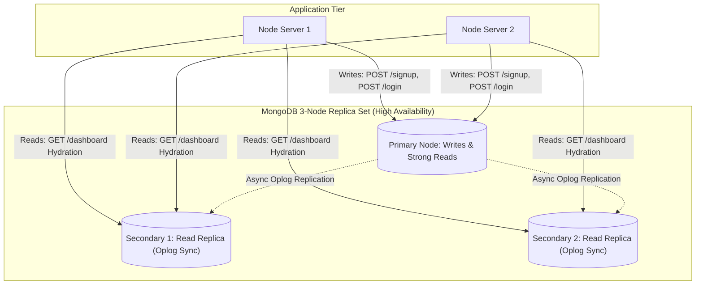

# 14.5 System Design: Databases & Storage Hierarchy

---

## 1. What It Is in Plain Words
Database and storage architecture governs how persistent state, transactional integrity, data durability, and query performance are guaranteed across disk, memory, and distributed storage engines.

---

## 2. Whether and How THIS Project Uses It
- **Database Engine**: MongoDB v7.0/8.0 running on localhost:27017 ([`app.js:12`](file:///Users/avishjain/avishjain9-repos/54-login-auth-portal/app.js#L12)).
- **ODM**: Mongoose v9.0.0 providing schema modeling, connection pooling, and object mapping.
- **Collections**:
  - `employees`: Stores user identity documents.
  - `sessions`: Managed by `connect-mongo` storing serialized session states.
- **Indexes**: Default B-Tree on `_id`; background TTL index on `sessions.expires`.

---

## 3. Database Paradigm & Storage Engine Comparison

| Database Paradigm | Core Mechanism | ACID Guarantee | CAP Classification | Optimal Fit Domain | Fit for This Project |
| :--- | :--- | :--- | :--- | :--- | :--- |
| **Document NoSQL (MongoDB)** | **BSON trees on WiredTiger engine** | **Single-document ACID; multi-document transactions** | **CP (Consistent / Partition Tolerant)** | **JSON object models, flexible catalogs, session stores** | **High (Selected for document mapping & session support)** |
| **Relational (PostgreSQL)** | Tables, rows, foreign keys | Full ACID (Multi-row isolation) | CA / CP | Relational medical billing, insurance records, prescriptions | High for complex medical records, overkill for auth |
| **In-Memory (Redis)** | RAM key-value structures | Single-command atomicity | CP / AP | Sub-millisecond session caching, rate limiting | Excellent as a cache ahead of MongoDB |
| **Wide-Column (Cassandra)** | LSM-Tree on commit log | Eventual consistency (BASE) | AP (Available / Partition Tolerant) | High-velocity time-series (patient ICU telemetry) | Unsuitable for strong auth consistency |

---

## 4. CAP Theorem & PACELC Analysis for This System
- **CAP Position**: **CP (Consistency + Partition Tolerance)**. In the event of a network partition, MongoDB stops accepting writes on isolated nodes rather than risking stale or split-brain credential writes.
- **PACELC Position**: **PC/EC** (If Partition: Consistency; Else: Consistency over Latency). For an authentication gateway, strong read-after-write consistency is mandatory—when a user registers, their immediate login attempt must find the newly written record.

---

## 5. What Breaks First at Scale
- **10x Load**: Standalone MongoDB instance handles read/write volume easily.
- **100x Load**: Disk I/O bottlenecks emerge because every authenticated request issues a read query to `sessions` and `employees`.
- **1000x Load**: Write throughput saturates the single primary node's storage engine.

---

## 6. Senior Engineering Improvements
1. **Deploy a 3-Node Replica Set**: 1 Primary for writes, 2 Secondaries for read replication, enabling automatic failover in <12 seconds if the primary crashes.
2. **Read-Preference Routing**: Route `res.locals.user` hydration queries to secondary replicas (`readPreference: 'secondaryPreferred'`), reserving the primary exclusively for login and registration writes.
3. **Partitioning & Sharding**: If the hospital network expands to 500,000 clinicians across multiple medical centers, shard the `employees` collection using hashed sharding on `username`.

---

## 7. 30-Second Spoken Answer
> "We use MongoDB on the WiredTiger storage engine, which provides document-level concurrency and BSON serialization. In CAP theorem terms, it operates as a CP system prioritizing consistency over availability during network partitions. To scale this to enterprise production, I would deploy a three-node replica set with automatic election failover and offload hydration read queries to secondaries."
