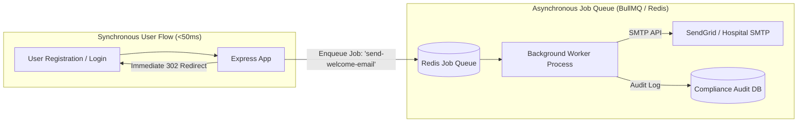

# 14.7 System Design: Messaging, Queues & Async Processing

---

## 1. What It Is in Plain Words
Asynchronous messaging and queue systems decouple fast user-facing HTTP request-response cycles from slow, error-prone, or heavy background tasks (such as sending verification emails, auditing login events, generating PDF reports, or calling external webhooks).

---

## 2. Whether and How THIS Project Uses It
In the current code, asynchronous message queues are **Not Used**. 
All operations—such as saving users, checking duplicates, and destroying sessions—execute synchronously within the HTTP request cycle. This was an acceptable decision for an MVP authentication portal with no external email or SMS integrations [CONFIRM WITH DEVELOPER].

---

## 3. Queue & Stream Technologies Comparison

| Technology | Paradigm | Message Ordering | Throughput | Persistence | Fit for This Auth Portal |
| :--- | :--- | :--- | :--- | :--- | :--- |
| **BullMQ (Redis-backed)** | **In-Memory Message Queue** | **FIFO per queue** | **~10,000–50,000 ops/sec**| **Redis AOF / RDB** | **Optimal for Node.js background tasks (emails, audits)** |
| **RabbitMQ** | AMQP Message Broker | Strict FIFO per queue | ~20,000–40,000 msg/sec | Disk & Memory | Heavy broker setup; overkill for basic background jobs |
| **Apache Kafka** | Distributed Event Log | Partition-ordered | ~1,000,000+ msg/sec | Distributed disk commit log | Massive architectural overhead |
| **AWS SQS** | Managed Cloud Queue | Standard (Best-effort) / FIFO | High | Managed by AWS | Vendor-locked; introduces network latency |

---

## 4. Delivery Semantics & Failure Handling
1. **At-Least-Once Delivery**: The queue guarantees the message is delivered, but network retries might cause duplicate executions. Background consumers must be **idempotent** (e.g. checking whether a welcome email has already been recorded in a `dispatched_emails` collection before sending).
2. **Dead-Letter Queue (DLQ)**: If a worker fails to process an email job after 5 exponential backoff retries (e.g. SMTP server down), the job is routed to a DLQ for developer inspection without clogging the primary queue.

---

## 5. What Breaks First at Scale
- **10x Load**: Synchronous operations hold up fine.
- **100x Load**: If an external email or SMS service is added synchronously to `POST /signup`, third-party network timeouts will freeze the user's browser for 10–30 seconds.
- **1000x Load**: Node process memory exhausts under concurrent unqueued background promises.

---

## 6. Senior Engineering Improvements
Add **BullMQ** with Redis:
1. When a clinician signs up, immediately respond with the 302 redirect.
2. Push a background job `{ type: 'AUDIT_LOGIN', userId: user._id, ip: req.ip, timestamp: Date.now() }` to BullMQ.
3. A separate worker process processes the queue asynchronously without adding a single millisecond to the user's HTTP response time.

---

## 7. 30-Second Spoken Answer
> "Right now, all operations in the portal execute synchronously within the HTTP request. As we add clinical welcome emails, multi-factor SMS codes, or HIPAA audit logging, executing those synchronously would hurt latency. I would introduce BullMQ backed by Redis to offload email dispatching and audit recording to background worker processes, keeping HTTP response times under 50 milliseconds."
