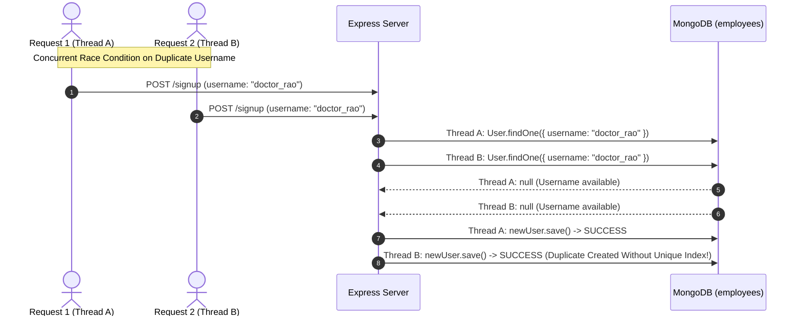

# 14.8 System Design: Concurrency & Distributed Consistency

---

## 1. What It Is in Plain Words
Concurrency and distributed consistency govern how an application handles multiple simultaneous requests attempting to read or mutate the same shared state at the exact same millisecond without creating race conditions, dirty reads, or corrupted records.

---

## 2. Whether and How THIS Project Uses It
In [`app.js:66-77`](file:///Users/avishjain/avishjain9-repos/54-login-auth-portal/app.js#L66-L77), the registration flow contains a classic **Check-Then-Act Race Condition**:
1. It queries `const existingUser = await User.findOne({ username })`.
2. If `existingUser` is null, it instantiates `new User(...)` and saves it.

### The Race Condition Flaw
If two identical requests arrive simultaneously on different threads or server instances, both queries find `null`, and both proceed to insert the document. Because `userSchema` lacks an explicit database-level `unique: true` index on `username`, two accounts with the exact same username can be inserted into the database.

---

## 3. Consistency Models Comparison Table

| Consistency Model | Definition | Latency Cost | Availability Under Partitions | Fit for This Portal |
| :--- | :--- | :--- | :--- | :--- |
| **Strong Consistency (Chosen)** | Every read receives the most recent write or an error | Higher (Must wait for replication) | Reduced availability during splits | **Mandatory (A newly registered user must be able to log in immediately)** |
| **Eventual Consistency** | Reads eventually converge on the latest value over time | Lowest | Highest (AP systems like DynamoDB/Cassandra) | Unacceptable for auth (risk of login failure after signup) |
| **Causal Consistency** | Operations causally related are seen in the same order | Moderate | Moderate | Useful for social feeds, unnecessary for single auth portal |

---

## 4. Remediation: Enforcing Atomic Database Constraints
To eliminate the race condition completely without slow distributed application-level locks:
1. **Database-Level Unique Index**:
   Declare `{ username: { type: String, required: true, unique: true } }` in the Mongoose schema.
2. **MongoDB Duplicate Key Error Handling**:
   MongoDB's internal WiredTiger B-tree index enforces atomicity at the storage engine level. If a duplicate insert is attempted, MongoDB returns error code `11000` (`E11000 duplicate key error collection`), which the application catches and handles safely.

---

## 5. What Breaks First at Scale
- **10x Load**: Rare collision probability.
- **100x Load**: Under distributed clustering, concurrent duplicate sign-ups create multiple identical accounts, corrupting user identity lookup.
- **1000x Load**: Without unique indexes, duplicate resolution queries lock tables.

---

## 6. Senior Engineering Improvements
Enforce database-level uniqueness in Mongoose, replace two-step check-then-act with an atomic `findOneAndUpdate` with `{ upsert: true }`, and use `redlock` distributed locking for cross-node coordination if complex multi-step provisioning is introduced.

---

## 7. 30-Second Spoken Answer
> "In the current prototype, there is a check-then-act race condition on registration where two simultaneous sign-ups could create duplicate usernames because uniqueness is checked in JavaScript rather than at the database level. In production, I would resolve this by adding a database-level unique index on the username field in MongoDB. This offloads concurrency control to MongoDB's atomic B-tree index, guaranteeing zero duplicates with code 11000 error handling."
