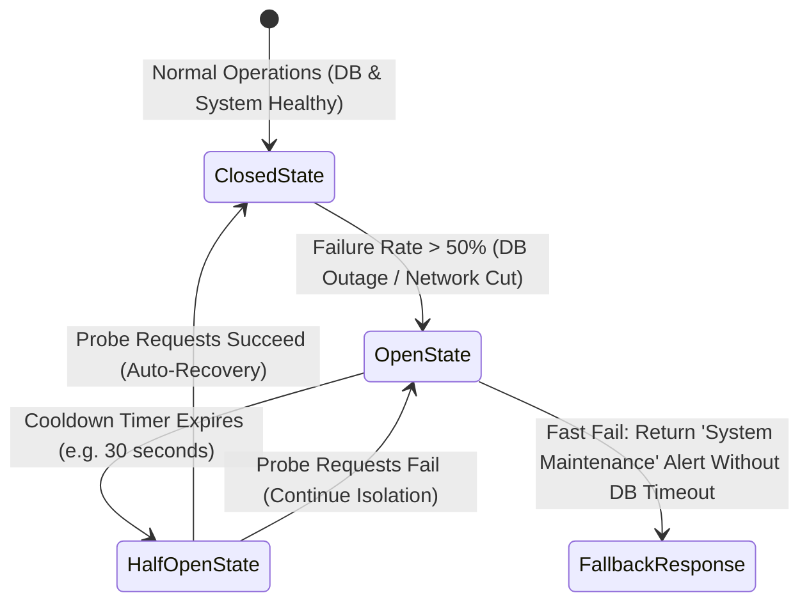

# 14.9 System Design: Reliability, Resilience & Fault Tolerance



---

## 1. What It Is in Plain Words
Reliability is the guarantee that a system performs its intended functions correctly over time, while resilience is the system's ability to withstand, isolate, and rapidly recover from component crashes, network partitions, or external dependency failures without cascading into a total system blackout.

---

## 2. Whether and How THIS Project Uses It
In the current code, reliability patterns are **Minimally Implemented**:
- Basic `try/catch` blocks catch database errors on `/signup` and `/login` ([`app.js:82,104`](file:///Users/avishjain/avishjain9-repos/54-login-auth-portal/app.js#L82)).
- **Gaps**: No circuit breakers, no automatic retries with exponential backoff, no health check endpoints (`/health`), and no graceful shutdown handlers on `SIGTERM`.

---

## 3. Resilience Patterns Comparison Table

| Resilience Pattern | Purpose | Mechanism | Impact of Not Implementing | Fit for This Auth Portal |
| :--- | :--- | :--- | :--- | :--- |
| **Graceful Shutdown** | Prevents dropping in-flight requests on redeploy | Listens for `SIGTERM`, stops accepting new requests, flushes DB writes | Requests aborted abruptly with 502 errors during deploys | **Mandatory** |
| **Circuit Breaker** | Prevents cascading failures when DB hangs | Trips open when failure threshold exceeded; fails fast | Sockets pool exhausts, crashing entire Node process | **High for database protection** |
| **Exponential Backoff + Jitter** | Prevents overwhelming recovering DB | Progressively increases retry interval with randomized jitter | Reconnecting clients create a thundering herd | **Recommended on initial DB connect** |
| **Bulkheading** | Isolates resources between modules | Limits connection pools per route | Unauthenticated bots exhaust connections for staff | **Recommended** |

---

## 4. Availability Targets (SLO & SLA Arithmetic)
For a 24/7 hospital clinical system:
- **Target Availability**: **99.9% ("Three Nines")**.
- **Permissible Downtime per Month**: $\approx 43.8 \text{ minutes}$.
- **Permissible Downtime per Year**: $\approx 8.76 \text{ hours}$.

---

## 5. Graceful Shutdown Implementation Pattern
```javascript
// Production graceful shutdown
const server = app.listen(port);

process.on('SIGTERM', () => {
  console.log('SIGTERM received. Starting graceful shutdown...');
  server.close(async () => {
    console.log('HTTP server closed. Closing MongoDB connection...');
    await mongoose.connection.close(false);
    console.log('MongoDB connection closed. Process exiting.');
    process.exit(0);
  });
});
```

---

## 6. What Breaks First at Scale
- **10x Load**: Handled fine.
- **100x Load**: Database connection spikes lead to cascading request timeouts.
- **1000x Load**: Without circuit breakers, slow database queries back up Node's event loop, causing health check failures and cascading restarts across the entire server cluster.

---

## 7. Senior Engineering Improvements
Implement a circuit breaker pattern using `opossum`, configure `SIGTERM` graceful shutdown listeners, and expose `/healthz` (liveness) and `/readyz` (readiness) endpoints for Kubernetes orchestrators.

---

## 8. 30-Second Spoken Answer
> "Currently, our error resilience relies on try-catch blocks. In production, I would enhance system reliability by implementing graceful shutdown handlers so in-flight clinical logins aren't dropped during deployments, adding readiness and liveness probes, and wrapping database interactions in a circuit breaker to fail fast if MongoDB experiences latency spikes."
