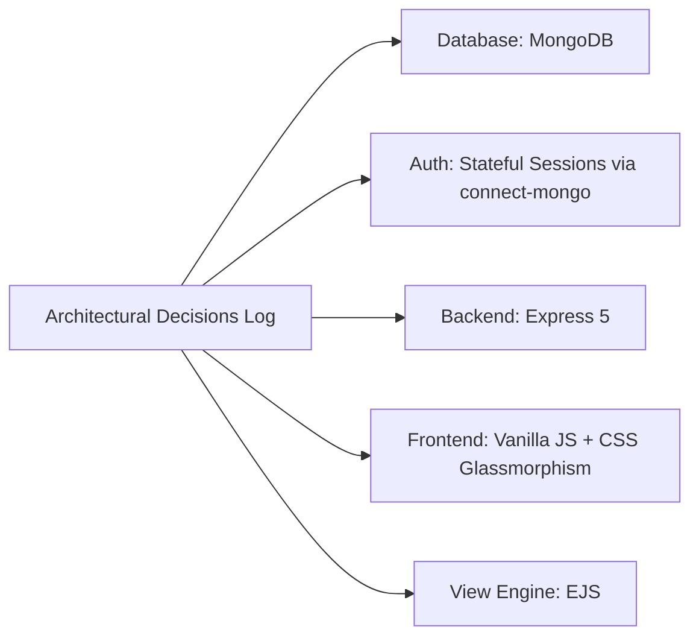

# Architectural Design Decisions Log

This ledger records every major architectural and implementation decision made in the Sachidanand Member Access Portal, capturing the alternatives considered, the deciding factors, the accepted trade-offs, and the conditions under which each decision should be revisited.

---

## 1. Master Decisions Ledger

| Decision Area | Chosen Option | Alternatives Considered | Deciding Factors | Trade-off Accepted | Revisit When |
| :--- | :--- | :--- | :--- | :--- | :--- |
| **Primary Database** | **MongoDB with Mongoose ODM** ([`app.js:5`](file:///Users/avishjain/avishjain9-repos/54-login-auth-portal/app.js#L5)) | PostgreSQL, MySQL, SQLite, Firebase, DynamoDB | Natural JSON document mapping; allows single database to store both employee data and session states via `connect-mongo`. | Lack of database-enforced relational foreign key constraints and ACID multi-table joins. | Hospital data expands to complex multi-table relational healthcare records (prescriptions, insurance billing, patient charts). |
| **Authentication Strategy** | **Stateful Server Sessions (`connect-mongo`)** ([`app.js:34`](file:///Users/avishjain/avishjain9-repos/54-login-auth-portal/app.js#L34)) | Stateless JWT, Redis Sessions, MemoryStore, OAuth2 | Instant session revocation is mandatory on shared hospital workstations; JWTs cannot be revoked immediately on logout without maintaining a distributed blacklist. | Requires a database read on authenticated requests; slightly higher write latency than in-memory Redis. | Active concurrent user sessions exceed 50,000, at which point Redis should be introduced as a dedicated session cache. |
| **Backend Framework** | **Express.js v5.1.0** ([`app.js:1`](file:///Users/avishjain/avishjain9-repos/54-login-auth-portal/app.js#L1)) | NestJS, Fastify, Koa, Django, Spring Boot | Lightweight, unopinionated, massive ecosystem support, and native Promise-based asynchronous error handling in Express 5. | No built-in architectural enforcement or dependency injection container. | Engineering team grows past 15 backend developers requiring strict TypeScript interfaces and auto-generated Swagger OpenAPI docs. |
| **Frontend Architecture** | **Vanilla JavaScript + Pure CSS Glassmorphism** ([`login.html:1`](file:///Users/avishjain/avishjain9-repos/54-login-auth-portal/login.html#L1)) | React SPA, Vue.js, Next.js, Three.js, TailwindCSS | Instantaneous First Contentful Paint (<150ms); eliminates 300KB bundle overhead and client-side hydration delays on low-spec hospital terminals. | No declarative two-way data binding for complex multi-step forms. | The dashboard evolves into a complex clinical Electronic Health Record (EHR) interface with interactive charts and dynamic widgets. |
| **Templating Engine** | **EJS (Embedded JavaScript)** ([`app.js:38`](file:///Users/avishjain/avishjain9-repos/54-login-auth-portal/app.js#L38)) | Pug, Handlebars, Mustache | Direct JavaScript syntax familiarity (`<%= username %>`); zero compilation learning curve for team members. | Less concise syntax than Pug's indentation-based markup. | Switching to a unified frontend component framework (e.g. Next.js / React SSR). |
| **Form Data Transport** | **URL-Encoded Forms (`body-parser`)** ([`app.js:27`](file:///Users/avishjain/avishjain9-repos/54-login-auth-portal/app.js#L27)) | JSON REST Payloads (`application/json`), GraphQL | Works natively with browser HTML `<form>` submissions without requiring client-side JavaScript fetch wrappers. | Limits response flexibility; errors require redirects or inline scripts rather than structured JSON error payloads. | Building mobile apps (iOS/Android) or external third-party partner integrations requiring RESTful JSON endpoints. |
| **Session Invalidation** | **HTTP POST `/logout`** ([`app.js:119`](file:///Users/avishjain/avishjain9-repos/54-login-auth-portal/app.js#L119)) | HTTP GET `/logout` | Complies with REST guidelines; protects against CSRF logout attacks and aggressive browser link pre-fetching. | Requires form element or JavaScript POST invocation rather than a simple hyperlink `<a>`. | Never (POST or DELETE is always mandatory for state-mutating session revocation). |
| **3D Card Parallax Engine** | **GPU CSS Transforms on `mousemove`** ([`login.html:461`](file:///Users/avishjain/avishjain9-repos/54-login-auth-portal/login.html#L461)) | Three.js WebGL canvas, GSAP library | Native GPU compositing achieves 60 FPS with zero external JavaScript dependencies or WebGL overhead. | Mouse tracking must be manually disabled on mobile viewports (<768px) to avoid touch gesture conflicts. | Complex 3D particle physics or custom 3D mesh rendering is required. |
| **Password Storage (Current)** | **Plaintext Prototype Storage** ([`app.js:20`](file:///Users/avishjain/avishjain9-repos/54-login-auth-portal/app.js#L20)) | Bcrypt, Argon2id, PBKDF2 | Permitted rapid prototype scaffolding and verification during initial repository setup [CONFIRM WITH DEVELOPER]. | Complete absence of cryptographic security; catastrophic liability in production. | **Immediately prior to staging or production deployment** (Upgrade to Argon2id / Bcrypt). |
